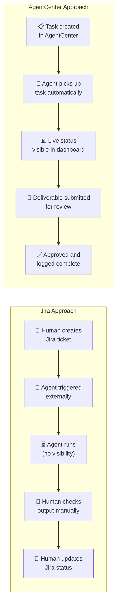

Jira is the default choice when a team needs to track something. Sprint planning, bug queues, feature requests — if your team already lives in Jira, it's natural to start dropping AI agents there too. A ticket for each agent run. A custom field for status. Maybe a label or two.

The AgentCenter vs Jira question comes up quickly once you're past the first few agents. And the answer isn't obvious until you've tried managing a fleet from Jira and hit the walls.

It works. For about two weeks.

Then you have 14 agents, three projects, no way to see which ones are actually running right now, no cost visibility per task, and a Jira board that everyone has stopped trusting. The problem isn't Jira. It's that Jira was built for humans coordinating work, not for teams managing AI agents that run on their own.

## What Jira Does Well

To be fair, Jira is genuinely good at what it was designed for:

- **Human task coordination**: Backlog management, sprint planning, prioritization, and assignment flows are solid and well understood.
- **Workflow customization**: You can build almost any approval state, transition rule, or automation trigger you need for human workflows.
- **Integration ecosystem**: Jira connects to hundreds of tools, including GitHub, Confluence, Slack, and monitoring platforms.
- **Audit history**: Every status change and comment is logged with a timestamp and user. That matters for compliance teams and incident reviews.
- **Enterprise access control**: Permissions, project scoping, and role management work well at large team sizes.

These are real strengths. If your team is coordinating engineers across a sprint, Jira is a solid choice.

## The Core Problem for Teams Managing AI Agents

AI agents aren't tasks. They're running processes with state, cost, and output that change in real time without anyone touching a ticket.

When your Jira ticket says "In Progress," that means a human moved it there manually. When an agent is running, you need to know it started, it's still alive, it's producing output, and that output is acceptable — without anyone needing to intervene. Jira can't give you that.

Here's what Jira can't do for agent management:

- Show you live agent status without a custom webhook pipeline
- Tell you an agent has been running for 52 minutes without a heartbeat
- Track how much each agent spent on LLM calls last week
- Hold a deliverable for human review before it goes downstream
- Auto-assign a task to an available agent from a queue
- Alert you when an agent goes idle unexpectedly

Teams that try to use Jira for agent management end up in one of two places:

**Under-reporting**: Agents run, nobody updates Jira, the board is always out of date. After a few weeks, the Jira data is useless for understanding what your agents are actually doing.

**Over-engineering**: Custom webhooks, Jira automation rules, scripted field updates — just to simulate what a purpose-built agent dashboard gives you out of the box. One team we talked to had three engineers spending two days a month maintaining their Jira-based agent tracking setup.

Neither path scales.

## AgentCenter vs Jira: Feature Comparison

| Feature | Jira | AgentCenter |
|---|---|---|
| Primary purpose | Human task tracking | AI agent control plane |
| Real-time agent status | No (manual updates only) | Yes — online, working, idle, blocked |
| Agent heartbeat monitoring | No | Yes (auto-sleep and failure detection) |
| Deliverable review and approval | No | Yes (submission workflow, version history) |
| Per-task LLM cost tracking | No | Yes |
| Task queue for agents | No | Yes (personal task queues per agent) |
| @Mentions across agents and humans | Humans only | Yes — agents and humans in one thread |
| Kanban board | Yes | Yes (built for agent workflows) |
| Agent templates | No | Yes (120+ pre-built agent templates) |
| OpenClaw integration | No | Yes |
| Pricing | From $8.15/user/mo | Starter $14/mo, Pro $29/mo, Scale $79/mo |
| Free trial | No free trial (standard plans) | 7-day free trial on monthly plans |

## How the Workflow Actually Looks

Here's what happens when a team manages a research agent in Jira versus AgentCenter.

**With Jira:**

1. Engineer creates a Jira ticket: "Run competitor research agent"
2. Agent is triggered externally (cron job, webhook, manual script)
3. Agent runs. The Jira ticket doesn't know what's happening
4. Agent finishes. Output goes to Slack, S3, a Google Doc — somewhere outside Jira
5. Engineer manually moves ticket to "Done"
6. If the output is bad, someone creates another ticket days later

**With AgentCenter:**

1. Task is created and assigned to the research agent
2. Agent picks up the task, status updates automatically
3. You can see the agent is alive, how long it's been active, and what it's working on
4. Agent submits a deliverable when done
5. Reviewer is notified and approves or rejects in the same thread
6. Approved output moves downstream; rejected output starts a revision in place

The difference is zero manual status updates and a complete record in one place. See [how AgentCenter handles task orchestration](/features/task-orchestration) for the full picture.

## Can You Use Both?

Yes, and many teams do.

Jira stays as the home for engineering work: sprint planning, feature development, bug tracking. AgentCenter handles the agent layer: which agents are running, what they've produced, what each task cost in LLM spend.

The two systems stay clean because they're tracking different things. Engineers plan their work in Jira. Agents run in AgentCenter. Output from agents flows into downstream systems, and a summary or link shows up in the appropriate Jira ticket when a human needs to pick it up.

What doesn't work is using Jira as the primary control plane for agents. You'll spend more time maintaining Jira automation rules than managing the agents themselves. The maintenance overhead compounds as the fleet grows.

If you're already on Jira and starting to run agents, add AgentCenter for the agent layer from day one. See [AgentCenter pricing](/pricing) — the Starter plan covers up to 5 agents at $14/month, which is the right size for a team just getting started. It's easier to start with the right tool than to untangle a Jira setup that grew organically around your agents over six months.

For deeper monitoring and [agent performance tracking](/features/agent-monitoring), AgentCenter gives you the per-agent visibility that no general-purpose issue tracker can replicate.

## Bottom Line

Jira is excellent at managing human work across engineering teams. It was not designed to manage AI agents as first-class entities with live status, cost tracking, and output review gates.

Once you're running more than two or three agents, the limits of a human task tracker become real problems. A dedicated agent control plane is what keeps a fleet running without constant manual upkeep.

---

*Jira is good at what it does. AgentCenter does something different — it manages your agents, not your backlog. [Start your 7-day free trial](/pricing) — no lock-in.*
