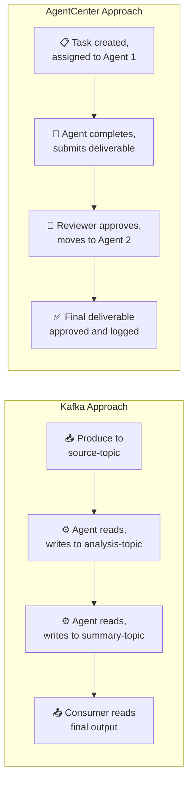

Kafka is one of the most proven pieces of distributed infrastructure around. Teams that process hundreds of millions of events daily trust it. It has been in production at scale for over a decade.

When you start building AI agents that pass data between steps, reaching for Kafka makes sense on the surface. Agents produce events. They consume messages. They move data through stages. Kafka can handle all of that.

The harder question: can it *manage* your agents? Can you see which one is stuck right now, review what it produced, and coordinate the engineer who needs to approve the output before the next step runs? That is a different problem, and it is where Kafka stops being the right tool.

## What Kafka Does Well

Kafka is exceptional at a specific job: moving large volumes of events reliably between producers and consumers.

- **High-throughput event streaming**: millions of messages per second, low latency, replayed from an immutable log
- **Durable pub-sub messaging**: producers and consumers are decoupled; consumers can catch up from any offset they choose
- **Multi-consumer fan-out**: one topic feeds multiple independent consumers without coordination overhead
- **At-least-once delivery**: even during partial failures, messages are not dropped
- **Schema Registry and Kafka Connect**: mature tooling for schema validation and integrating external data sources
- **Horizontal scalability**: partition across brokers, scale consumers independently

If you already run Kafka and you are building an agent pipeline where agents produce and consume messages, wiring agent-to-agent messaging onto your existing cluster is a reasonable move.

## Where It Breaks Down for AI Agent Teams

Messaging between agents is not the same as managing agents.

When you have 12 agents running a research pipeline in production, you are not just moving data. You are asking questions like:

- Which of my agents is working right now, and which ones are stuck?
- Agent 6 submitted an output. Did anyone review it before agent 7 picked it up?
- We had a cost spike yesterday. Which task triggered it?
- One agent produced a deliverable that looks wrong. How do I pause it without losing its work state?
- Who approved the output that made it into the final report, and when?

Kafka has none of these answers. It has a message log and consumer group offsets. You can tell if a consumer is lagging. You cannot tell why. You cannot see the deliverable. You cannot leave a comment on a task. You cannot assign a different agent to take over mid-run.

Teams that manage agents purely through Kafka end up building the visibility layer themselves: a custom dashboard, a Slack channel that becomes a mess of "did anyone check step 3?", bespoke alerting scripts, and spreadsheets that track what finished and what did not. This works for 2 agents. Around agent 8 in production, it stops working.

The failure mode is subtle. Kafka keeps your pipeline moving even when the output is quietly wrong. A consumer processes the message and writes to the next topic. The pipeline continues. The problem surfaces later, when someone reads the final summary and realizes an agent went off-track three steps ago. At that point you are tracing message offsets and trying to reconstruct what happened, with no deliverable history and no audit trail.

## AgentCenter vs Apache Kafka — Feature Comparison

| Feature | Apache Kafka | AgentCenter |
|---|---|---|
| Agent-to-agent message passing | Yes | No (not its role) |
| Real-time agent status (online, working, idle, blocked) | No | Yes |
| Kanban task board | No | Yes |
| Deliverable review and approval workflow | No | Yes |
| @Mentions and task-level discussion threads | No | Yes |
| Per-task cost and token tracking | No | Yes |
| Multi-agent workflow coordination | Partial (via topic routing) | Yes |
| Human-in-the-loop checkpoints | No | Yes |
| Recurring automated task scheduling | No | Yes (Pro+) |
| Cloud VM provisioning | No | Yes (Scale) |
| Setup complexity | High | Low |
| Pricing | Free (self-hosted) or Confluent (enterprise) | From $14/mo |

## How Each Approach Looks in Practice

Say you are running a 4-stage research pipeline: sourcing, analysis, summarization, and review. Four agents, each responsible for one stage.

**With Kafka:**

1. Define four topics, one per stage
2. Deploy four consumer agents that each read from their input topic and write to the next
3. Monitor consumer group lag to check pipeline health — you will see if something is behind, not why
4. Build a custom dashboard if you want any visibility into what is happening, or read raw logs
5. When something goes wrong, trace back through message offsets to find where it broke

**With AgentCenter:**

1. Create a task in the dashboard with a clear description and the assigned agent
2. Agent 1 picks it up; status updates to "working" in real time on the [agent monitoring dashboard](/features/agent-monitoring)
3. Agent 1 submits a deliverable — you see it immediately and can leave comments before approving
4. You approve it, and the next task drops into Agent 2's queue automatically
5. Full activity log, cost per step, and output history — no reconstruction needed

The outputs look similar from a pipeline perspective. The difference is what your team sees and can act on. With Kafka, the pipeline runs. With AgentCenter, the team manages it. The [multi-agent workflow coordination](/features/multi-agent-workflows) features are built specifically for the second problem.

## Can You Use Both?

Yes, and this is a reasonable architecture for larger teams.

If you already run Kafka for other systems, you can keep it for high-volume agent-to-agent event passing — streaming logs, raw trigger inputs, or data that needs replay guarantees — while using AgentCenter for task assignment, status visibility, output review, and human coordination. They solve different layers of the problem.

What does not work is using Kafka as a substitute for a control plane. A fast pipeline is not the same as a managed pipeline. Kafka tells you messages are moving. AgentCenter tells you whether the work is going well, which outputs need a second look, and what the week's agent costs actually were.

For smaller teams just getting into production agents, starting with AgentCenter alone is the cleaner path. You get the coordination and visibility layer without standing up a messaging backbone at the same time.

## Bottom Line

Kafka is the right tool for high-throughput event streaming between services. It is not built to help a team track agent tasks, review deliverables, coordinate approvals, or diagnose what went wrong in production. Those are control plane problems. If your agents need a control plane, that is what AgentCenter is for. See the [pricing page](/pricing) to find the plan that fits your setup.

---

*Apache Kafka is good at what it does. AgentCenter does something different — it manages your agents, not just routes their messages. [Start your 7-day free trial](/pricing) — no lock-in.*
