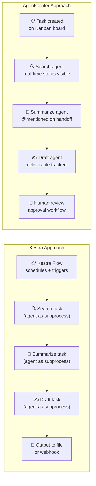

Kestra is a solid workflow orchestration platform. If you've ever maintained a sprawl of cron jobs, shell scripts, and ad-hoc Python files that trigger each other in ways no one fully understands, Kestra solves exactly that problem. YAML workflow definitions, a clean UI for tracking task state, retry logic, scheduling, event triggers — it handles the plumbing well.

So when teams building AI agent systems ask whether they should use Kestra or AgentCenter, it's worth separating the question. These tools aren't really competing. They solve adjacent problems. But the line between them matters, and crossing it in the wrong direction leads to a lot of workarounds.

## What Kestra Does Well

Kestra started as a workflow orchestration tool for data pipelines, and that pedigree shows.

- **Declarative workflow definitions** — workflows live as YAML, versioned in git, readable by anyone on the team
- **Broad task support** — HTTP calls, Python scripts, shell commands, database queries, cloud APIs — all first-class
- **Scheduling and event triggers** — cron-style schedules, webhook triggers, queue-based execution
- **Retry and error handling** — configurable retry policies per task, with branching on failure
- **UI for pipeline state** — you can see which tasks ran, which failed, and inspect the logs
- **Namespace isolation** — separate teams can own separate workflow namespaces without stepping on each other

If you're building ETL pipelines, orchestrating data transformations, or coordinating a sequence of services that needs scheduling and retry logic, Kestra is a reasonable choice. Many teams that use it for data work then try to bolt their AI agents onto it as well.

That's where the friction starts.

## The Core Limitation: Agents Aren't Pipeline Steps

When you run an AI agent as a task in Kestra, what you get back is an exit code and some logs. You can see whether the Kestra task succeeded or failed. What you can't see is what the agent was actually doing.

- Did it loop on a sub-task?
- Did it produce output that looks right but isn't?
- Is it blocked waiting on a tool call that's hanging?
- Did it complete 80% of the work and then stop?

Kestra doesn't know. Its job is to run the task and report back. The agent is a black box to the orchestrator.

For a data transformation step, that's fine — if it runs, it ran. But AI agents behave differently. They produce intermediate state. They get stuck in ways that don't surface as failures. They complete successfully and produce garbage. You can't review a pipeline step; you can review an agent output.

Teams managing more than a handful of agents in production end up building custom wrappers around Kestra tasks just to capture agent state, add visibility, and enable some form of human review. That's the gap AgentCenter's [agent monitoring](/features/agent-monitoring) and task management is built to fill.

## AgentCenter vs Kestra: Side by Side

| Feature | Kestra | AgentCenter |
|---|---|---|
| **Primary purpose** | Workflow and pipeline orchestration | AI agent control plane |
| **Workflow definition** | YAML (declarative, git-friendly) | Dashboard + API |
| **Agent visibility** | Task-level (pass/fail + logs) | Real-time: status, current task, cost |
| **Task management** | Workflow steps in a DAG | Kanban board with per-agent task assignment |
| **Deliverable review** | Not built-in | Approval workflows per deliverable |
| **Multi-agent coordination** | Sequential/parallel task execution | @Mentions, thread per task, agent handoffs |
| **Cost tracking** | Not built-in | Per-agent, per-task cost monitoring |
| **Pricing** | Free tier; Cloud from ~$99/mo | $14/mo Starter, $29/mo Pro, $79/mo Scale |
| **OpenClaw compatibility** | Requires custom integration | Native |
| **Designed for agents** | No — adapted for agents | Yes |

## How Each Handles a Multi-Agent Research Workflow

To make this concrete: you have three agents. One searches the web, one summarizes findings, one writes a draft report. Someone on your team needs to review the draft before it goes anywhere.

**Kestra's way:** You define the three tasks in a YAML flow. Kestra triggers them in sequence, passes outputs between steps via variables, and logs what each step returned. If the draft agent produces a bad output, you'll see the task completed with exit code 0 and whatever the agent returned in the logs.

**AgentCenter's way:** Each agent has a task on the board. You can see what each one is working on in real time. When the draft agent finishes, the deliverable goes into a review queue. A team member gets notified, reads the draft, and approves or sends it back with notes. The search agent's cost, the summarizer's token usage, the time each step took — all tracked.

The difference isn't about which steps ran. It's about whether a human can actually see what's happening and step in when needed.

## Can You Use Both?

Yes, and it's a reasonable setup for some teams.

Kestra handles the orchestration layer: what runs when, how data flows between services, how your agents fit into a larger pipeline with non-agent steps. AgentCenter handles the agent layer: what each agent is doing, what it produced, whether a human needs to review it, what it cost.

If you're integrating AI agents into an existing Kestra-based data platform, you probably don't want to throw away that infrastructure. You can keep Kestra for the pipeline backbone and add AgentCenter for the agent-specific visibility and task management that Kestra doesn't provide.

Where it gets complicated: if you add AgentCenter, some of what Kestra does for your agents becomes redundant. The scheduling, retry logic, and trigger mechanisms Kestra provides are useful. The task tracking and state management Kestra provides for agent work is less useful, because AgentCenter tracks that more granularly.

Most teams end up with one or the other as the primary system, with the second tool serving a narrow purpose. If your work is mostly data pipelines with agents as one step among many, Kestra leads. If your work is mostly agent management with some pipeline logic underneath, AgentCenter leads.

## Bottom Line

Kestra is the right tool if your problem is orchestrating workflows and your agents are one piece of a bigger system. AgentCenter is the right tool if managing, monitoring, and coordinating AI agents is the core of what you're doing. They're not the same problem, and the tools reflect that.

---

*Kestra is good at what it does. AgentCenter does something different — it manages your agents, not just triggers them. [Start your 7-day free trial](/pricing) — no lock-in.*
