Kubernetes is genuinely good at running containerized workloads. It schedules pods, restarts crashed containers, scales replicas under load, and manages secrets and config across a cluster. If your AI agent process dies at 2am, Kubernetes brings it back within seconds. For teams already running services on K8s, deploying agents there is a natural fit.

But here's what Kubernetes doesn't tell you: what that agent was working on when it crashed. Whether the output it produced before going down was usable. Which task it dropped that someone else is now waiting on. And what the run cost in LLM tokens.

That's the gap between infrastructure management and agent management. AgentCenter vs Kubernetes is not really a competition — they operate at different layers. But a lot of teams discover this the hard way after trying to use Kubernetes as their complete agent control plane.

## What Kubernetes Does Well

For infrastructure-level concerns, it's hard to beat:

- **Pod scheduling**: places containers across nodes based on resource availability
- **Self-healing**: detects failed pods and restarts them automatically
- **Resource limits**: caps CPU and memory per agent container to prevent runaway processes
- **Horizontal scaling**: adds replicas when load spikes, removes them when demand drops
- **Health checks**: liveness and readiness probes confirm pods are alive and accepting work
- **Secrets management**: stores API keys and config values without baking them into images
- **Ecosystem depth**: Helm charts, operators, service meshes, and years of tooling

If you have agents that need to run at scale across distributed infrastructure, Kubernetes handles the container layer well. That foundation matters.

## The Layer Kubernetes Doesn't Touch

Kubernetes works at the pod level. A pod is either running or it isn't. That's about as deep as the visibility goes into what your agent is actually doing.

It has no concept of:

- The task the agent was assigned, who assigned it, or what the success criteria were
- Whether the agent completed the task or stalled halfway through a long-running job
- What the output looked like and whether a human needs to review it before it ships
- How much that run cost across prompt tokens, completion tokens, and tool calls
- Which team member owns the work and what the handoff looks like

A pod marked `Running` could be doing excellent work or producing garbage output. Kubernetes reports the same status either way.

When you have three agents, you can track all of this in your head. At fifteen, you start losing things. At fifty, you need a control plane built for agents — not containers.

## AgentCenter vs Kubernetes: Feature Comparison

| Feature | Kubernetes | AgentCenter |
|---|---|---|
| Container orchestration | Yes | No (use K8s underneath) |
| Pod health and restarts | Yes | Not applicable |
| Task assignment and tracking | No | Yes — Kanban board per task |
| Real-time agent status | Pod state only | Working / idle / blocked / done |
| Output and deliverable review | No | Yes — built-in review workflow |
| @Mentions and task discussion | No | Yes — per-task comment threads |
| Per-agent cost tracking | No | Yes — LLM spend per agent and task |
| Multi-agent task handoffs | No | Yes — task dependencies and sequencing |
| Human approval gates | No | Yes — approval workflows before output ships |
| Recurring task automation | No | Yes (Pro plan and above) |
| Pricing | Free (cluster infra costs extra) | $14–$79/mo |
| Best for | Running containers reliably | Managing what agents do |

## How the Two Approaches Play Out

This is what a typical agent incident looks like with each setup.

```mermaid
graph TD
    subgraph "Kubernetes Only"
        A["🐳 Agent pod deployed"] --> B["📊 Liveness probe checks pod"]
        B -->|Pod crashes| C["🔄 K8s restarts automatically"]
        C --> D["📋 You check logs in the morning"]
        D --> E["❓ What task was it working on?"]
        E --> F["🔍 Reconstruct state from Slack or spreadsheet"]
    end
    subgraph "AgentCenter"
        G["🤖 Agent deployed with OpenClaw"] --> H["📋 Task assigned in Kanban"]
        H --> I["⚡ Status: Working — visible in real time"]
        I --> J["✅ Output goes to deliverable review"]
        J --> K["👤 Reviewer approves or requests changes"]
        K --> L["💰 Cost logged per task automatically"]
    end
```

**Kubernetes-only workflow when something goes wrong:**

1. Agent pod crashes at 11pm — Kubernetes restarts it in under a minute
2. You find out the next morning when a teammate asks why the nightly report didn't land
3. You pull logs and figure out it died mid-run
4. You go find the task somewhere — Jira ticket, Slack thread, shared doc
5. You reconstruct what the agent had completed and what's missing
6. You rerun manually and cross your fingers

**AgentCenter workflow for the same situation:**

1. Agent is working on a tracked task visible in the [Kanban board](/features/task-orchestration)
2. Pod crashes — you or a teammate sees the task move to a failed state in real time
3. You know exactly which task was affected and how far it got
4. You reassign the task, or retry it directly from the dashboard
5. Output, once produced, goes through [deliverable review](/features/agent-monitoring) before it ships
6. Cost and history stay attached to the task permanently

The infrastructure restart happens in both cases. The difference is whether anyone knows what was lost and what to do next.

## Can You Use Both?

Yes, and most teams running agents at scale do. They're not competing for the same role.

Kubernetes runs the container your OpenClaw agent lives in. AgentCenter manages what that agent does: the task queue, the output review, the cost tracking, the team coordination. One handles where the code runs. The other handles what the code produces.

A common setup: EKS or GKE manages the pod layer, AgentCenter tracks the work layer above it. Agents connect to the AgentCenter API on startup and report task status, output, and token usage as they run. You get full infrastructure control through Kubernetes and full operational visibility through AgentCenter.

If you're not on Kubernetes yet, that's also fine. AgentCenter doesn't require it. Agents can run on VMs, in Docker Compose, or via cloud functions. Kubernetes is one option, not a dependency.

## What Kubernetes Won't Cover No Matter What You Build on Top

Some teams try to add the missing layer themselves. A custom webhook that writes task state to a database. A cron job that checks outputs. A Grafana dashboard that reads custom metrics from the agent process.

That works until you have ten agents and three teams and the person who built the internal tooling leaves. Then you're debugging a monitoring system instead of the agents themselves.

The problem isn't Kubernetes. The problem is that task management, deliverable review, and agent coordination are a different job from container scheduling. They need their own dedicated surface — one built around how agent work actually flows, not around how containers run.

Check the [feature overview](/features) to see what that looks like in practice, or the [pricing page](/pricing) to find the plan that fits your current agent count.

## Bottom Line

Kubernetes is infrastructure. AgentCenter is operations. They solve different problems, and most teams at scale need both. If you're trying to use Kubernetes alone as your agent management layer, you'll end up building and maintaining a lot of tooling that a dedicated control plane already provides.

---

*Kubernetes is good at what it does. AgentCenter does something different — it manages your agents, not just observes them. [Start your 7-day free trial](/pricing) — no lock-in.*
