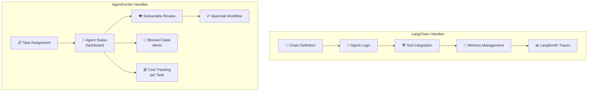

LangChain is one of the most widely used AI frameworks in existence. If you've built an AI agent in Python, there's a good chance LangChain (or LangGraph) was part of how you built it. The ecosystem is extensive. The documentation is thorough. The community is large.

So when teams ask about AgentCenter vs LangChain, the first thing I tell them is: these are not competitors. They solve different problems.

## What LangChain Does Well

- Building agent logic: chains, tools, memory, prompt templates
- LangGraph for stateful multi-agent workflows
- LangSmith for tracing and observability
- Huge ecosystem of integrations and community extensions
- Works with Claude, GPT-4, Gemini, Mistral, and many others
- Good for building complex reasoning architectures

LangChain's strong suit is building agent intelligence. The framework decisions that make agents capable.

## The Core Limitation for Operations Teams

LangChain is code. You write it, you deploy it, you maintain it. When it runs in production, you have LangSmith traces to tell you what happened. What you don't have is an operational interface for managing agents as ongoing entities.

LangChain doesn't have a concept of a task queue you can manage through a UI. It doesn't have a deliverable review flow. It doesn't show you that Agent 3 is blocked waiting for human input while Agents 1 and 2 are idle. It doesn't have @mentions or threads for your team to coordinate around agent work.

When an agent built with LangChain needs attention, you find out from a log, a trace, or a user complaint. Then you write more code to fix it.

## Comparison Table

| Feature                   | LangChain            | AgentCenter                |
| ------------------------- | -------------------- | -------------------------- |
| Agent logic building      | Yes (core)           | Via agent templates        |
| Multi-agent orchestration | LangGraph            | Task orchestration         |
| Observability/tracing     | LangSmith            | Task history + audit trail |
| Operational dashboard     | No                   | Real-time status           |
| Task assignment UI        | No                   | Kanban board               |
| Deliverable review        | No                   | Yes, built-in              |
| @mentions / team chat     | No                   | Yes                        |
| Cost per task tracking    | Partial (LangSmith)  | Yes                        |
| Self-hosting              | N/A (local code)     | Yes                        |
| Pricing                   | Free + LangSmith Pro | $14-$79/mo                 |
| Framework or platform     | Framework            | Platform                   |

## Workflow Comparison

**Running a research pipeline with pure LangChain:**

1. Define LangGraph agents in Python
2. Deploy and run
3. Check LangSmith for traces
4. If something goes wrong, read traces and write more code
5. No UI for assigning tasks or reviewing outputs
6. No way to see "all currently active agents" without custom code

**Running the same pipeline with AgentCenter:**

1. Assign task via dashboard or API
2. OpenClaw-compatible agent picks it up (can use LangChain internals)
3. Real-time status visible: which agents are working, idle, or blocked
4. Agent submits deliverable for review
5. Team reviews, approves, or sends back
6. Full cost and duration history per task

## Can You Use Both?

Absolutely. Many teams do. Build your agent logic with LangChain or LangGraph. Connect the agent to AgentCenter via the OpenClaw API. Now you have LangChain's framework capabilities plus AgentCenter's operational layer.

LangSmith handles tracing and debugging. AgentCenter handles task management, review workflows, and fleet monitoring. The two tools complement each other well.

If you're already using LangSmith for debugging, you don't have to give that up. AgentCenter fills the operational management gap that LangSmith doesn't cover.

## Bottom Line

LangChain is a framework for building capable agents. AgentCenter is a platform for managing those agents once they're built. If you've built agents with LangChain and now struggle to operate them reliably, that's the gap AgentCenter addresses. The choice isn't "one or the other" — it's about which layer each tool is responsible for.

_LangChain is good at what it does. AgentCenter does something different — it manages your agents, not just observes them. [Start your 7-day free trial](/pricing) — no lock-in._
