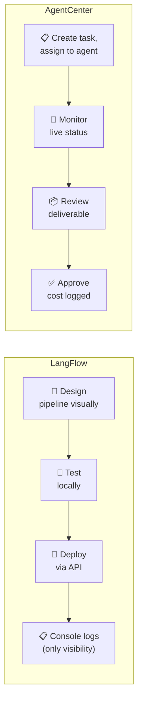

LangFlow is genuinely good at what it does. You drag nodes onto a canvas, wire them together, and you have a working agent pipeline in under an hour. It's one of the fastest ways to prototype a multi-step LLM workflow without writing much code.

But there's a question worth asking before you ship: what happens after the pipeline runs?

That's where the conversation changes.

## What LangFlow Does Well

LangFlow is an open-source visual tool (backed by DataStax) for building LangChain-based pipelines. It's earned its popularity for a few real reasons:

- **Fast prototyping**: Drag-and-drop components, connect nodes, test locally. You can have a working agent flow in an afternoon.
- **Wide component library**: 100+ pre-built nodes covering LLMs, vector stores, memory, tools, and more. Most common use cases are covered without custom code.
- **Flexible deployment**: Self-host for free, or use the DataStax cloud-managed version. You own the pipeline.
- **Multi-agent support**: You can chain agents, use conditional routing, and build reasonably complex flows visually.
- **Active community**: Lots of shared templates and active development. If something breaks, someone has probably hit the same issue.
- **Provider flexibility**: Works with Claude, GPT-4, Gemini, and others. Swap models without rebuilding the flow.

If you're prototyping, experimenting, or building internal tools with a small team, LangFlow is hard to argue against.

## The Core Limitation for Production Teams

LangFlow is a builder. It's designed for creating and testing pipelines. What it's not designed for is running agents as part of a team workflow in production.

When your agents graduate from "cool prototype" to "thing people depend on," you need answers to questions LangFlow can't give you:

- Which of my 12 agents is currently running? Which one is stuck?
- Who's responsible for reviewing what the agent produced?
- How much did that overnight run cost?
- Agent 7 failed at 3am. What was the last thing it did?

LangFlow shows you what the pipeline looks like at design time. It doesn't show you what's happening at runtime, or give your team any way to coordinate around agent work.

That's not a flaw in LangFlow. It's just not what it was built for.

## How the Two Compare

| Feature | LangFlow | AgentCenter |
|---|---|---|
| Primary purpose | Visual pipeline builder | Agent management + control plane |
| Pipeline design | Drag-and-drop canvas | Task templates + workflow configuration |
| Real-time agent status | None | Online / working / idle / blocked |
| Task management | None | Kanban board with priorities and due dates |
| Team collaboration | None | @mentions, chat threads, activity feed |
| Deliverable review | None | Built-in approval workflows |
| Per-task cost tracking | None | Yes, logged automatically |
| Multi-agent coordination | Chained nodes in a flow | Dependencies, handoffs, escalation rules |
| Recurring tasks | No | Yes (Pro and above) |
| Deployment model | Self-hosted or DataStax cloud | AgentCenter cloud (hosted) |
| Pricing | Free (open source) / DataStax pricing | Starter $14/mo, Pro $29/mo, Scale $79/mo |
| Best for | Prototyping agent logic | Managing agents in production |

## Workflow Comparison: Building vs. Managing

Here's what the day-to-day looks like in each tool once you're past the prototype stage.

**With LangFlow:**

1. Open the visual editor, drag components onto the canvas
2. Connect your LLM, tools, memory, and output nodes
3. Test the flow locally with sample inputs
4. Deploy the flow as an API endpoint
5. From here: console output and raw logs are your only window into what's happening
6. When something breaks, you dig through log files manually

**With AgentCenter:**

1. Create a task on the [Kanban board](/features/task-orchestration), write a clear description, set priority and due date
2. Assign the task to an agent; the agent picks it up and begins working
3. The dashboard shows live status: working, idle, blocked, or complete
4. The agent submits a deliverable when done; a human gets notified to review
5. Reviewer approves or requests changes, all tracked in the same thread
6. Cost for that task is logged automatically — no manual tracking

The gap isn't about which tool is better. It's about what phase you're in.

## Can You Use Both?

Yes, and this is actually a sensible setup.

LangFlow (or LangChain directly) to build and test the pipeline logic. AgentCenter as the control plane that sits on top. Your agent executes the LangFlow-built logic under the hood; AgentCenter handles task assignment, status monitoring, deliverable review, and team coordination around it.

A lot of teams build this way. The agent framework handles the *how* (memory, tool calls, routing). The [agent monitoring](/features/agent-monitoring) layer handles the *what's happening now* and *did the work get approved*.

The two tools don't compete. They serve different roles in the same stack.

If you're on a solo project and LangFlow is working, you probably don't need AgentCenter yet. Once you have more than a few agents running in parallel and other people depending on their output, the absence of a management layer gets painful quickly.

## The Real Question

LangFlow answers: "How do I build this agent pipeline?"

AgentCenter answers: "How do I manage 15 agents, track their work, review their output, and know what they cost?"

If you're still building, LangFlow is fine. If you've shipped and you're now running, you need a [control plane](/features/agent-dashboard).

Running agents without task management is like running a dev team without a project tracker. You can do it when it's just you. At three people and six agents, things start falling through the gaps. At ten people and twenty agents, you're flying blind.

## Bottom Line

LangFlow is the right tool for designing and prototyping agent logic. AgentCenter is the right tool for managing those agents once they're live. They solve different problems at different stages. Most teams that scale past five agents end up needing both.

---

*LangFlow is good at what it does. AgentCenter does something different — it manages your agents, not just builds them. [Start your 7-day free trial](/pricing) — no lock-in.*
