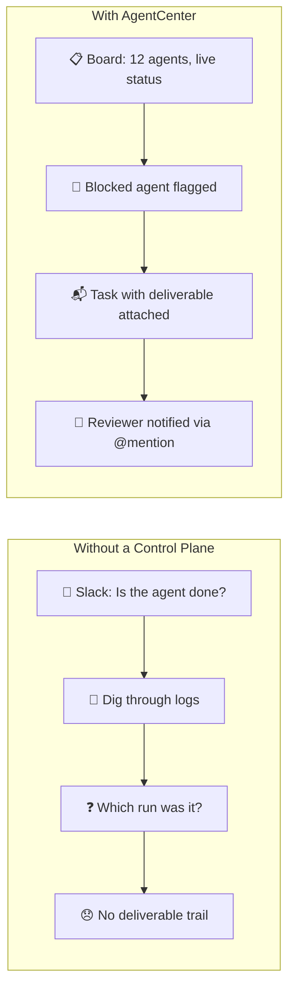

Langfuse is a genuinely good tool. If you're tracing LLM calls, versioning prompts, and scoring outputs, it does that job well. The open-source option is solid, the docs are clear, and it connects to most frameworks without much effort.

But after you've set up your traces, there's a question Langfuse doesn't answer: who's managing the agents?

Tracing what an agent did is different from managing what your agents are doing right now. Once you're running more than a handful of agents in production, that gap starts costing real time.

## What Langfuse Does Well

Be clear about what you're actually getting:

- **LLM call tracing**: Full trace trees showing every API call, prompt, and completion for a session — invaluable for debugging
- **Token and cost tracking**: Per-trace and per-model token counts with cost estimates, aggregated by user or session
- **Prompt management**: Version-controlled prompts you can deploy and roll back without code changes
- **Evaluation scoring**: Human scoring and LLM-as-judge scoring of outputs, linked back to traces so you can audit decisions
- **Dataset creation**: Save good and bad examples from production to build proper eval sets over time
- **Open-source self-hosting**: Full build with Docker, PostgreSQL, and ClickHouse — no vendor dependency if you want it

If your problem is "I need to understand why this agent produced a bad output last Tuesday," Langfuse is the right tool. The trace view is well designed and the prompt versioning workflow is genuinely useful.

## The Core Limitation for Agent Teams

Langfuse is a *debugging and analysis* tool. It tells you what happened after the fact.

It doesn't tell you what's happening right now. There's no place to assign tasks to agents, review what they returned, coordinate work across your team, or see which agents are blocked.

You can't open Langfuse and answer: "Which of my 14 agents is currently stuck? Who's reviewing the output from the contract analysis run? Which tasks are queued? Did the research agent finish its batch?"

Those questions require a different layer.

Teams running agents in production hit this wall around agent 5 or 6. You have traces. You have cost data. You have eval scores. But you're still pinging teammates on Slack asking "did the agent finish?" and digging through logs to figure out which run produced which deliverable.

The coordination layer is what Langfuse wasn't built to provide.

## AgentCenter vs Langfuse — Side by Side

| Feature | Langfuse | AgentCenter |
|---|---|---|
| LLM call tracing | Yes (core feature) | No |
| Prompt versioning and rollback | Yes | No |
| Output evaluation and scoring | Yes (scoring, datasets) | Deliverable review and approval |
| Real-time agent status | No | Yes (online, working, idle, blocked) |
| Task board across agents | No | Kanban view across all agents |
| Task assignment to agents | No | Yes |
| @Mentions and threaded comments | No | Yes (per task, per deliverable) |
| Multi-agent task dependencies | No | Yes (chained handoffs) |
| Cost tracking granularity | Per-trace (LLM tokens) | Per-agent and per-task |
| Deliverable review workflow | No | Yes (review, approve, reject) |
| Recurring task automation | No | Yes (Pro+) |
| Cloud pricing | Free tier, ~$59/mo Pro | $14/mo Starter, $29/mo Pro, $79/mo Scale |
| Self-hosting | Yes (open source) | No |
| Best for | ML engineers debugging LLM apps | Teams managing agents in production |

## How Each Workflow Actually Plays Out

### Debugging a bad output — the Langfuse workflow

1. Agent runs and produces wrong output
2. You open Langfuse, find the trace in the sessions list
3. You drill into the span tree: which prompt fired, what the model returned, where the context came from
4. You identify the issue — wrong context injection, prompt drift, model changed its behavior
5. You fix the prompt in Langfuse prompt management and deploy the new version
6. You mark the bad output as a negative example in your eval dataset
7. Next time the eval suite runs, that case is covered

That's a good workflow. Langfuse is well designed for it.

### Managing 12 agents across a team — the AgentCenter workflow

1. You open [AgentCenter's dashboard](/features/agent-dashboard) and see all 12 agents at a glance
2. Three are actively working, two are idle, one is flagged as blocked
3. You click the blocked agent and see it's waiting on a human approval step
4. You open the attached deliverable, leave a comment, and approve
5. The next agent in the pipeline picks up automatically based on the task dependency
6. After the run you can see the per-agent cost breakdown from [agent monitoring](/features/agent-monitoring)

Both workflows are real. They solve different problems.

## Can You Use Both?

Yes, and a lot of teams do.

Langfuse handles the "what happened inside that LLM call" question. AgentCenter handles the "where is this task, who owns it, and what did the agent return" question.

If you're debugging model behavior, prompt regressions, or evaluation drift, you want Langfuse's traces. If you're managing a fleet of agents doing real work for your team, you want AgentCenter's task board and coordination layer.

They don't compete for the same job. One is a microscope. The other is a control room.

Where overlap exists: both track costs. Langfuse does it at the LLM-call level through token counts. AgentCenter does it at the task and agent level across runs. If cost visibility is your only goal, one is enough. Most production teams end up wanting both layers as their fleet grows.

## Who Typically Reaches for Langfuse

Teams actively building and iterating on LLM pipelines. ML engineers who need to understand why a specific session went wrong. Research teams running systematic evals. Anyone doing serious prompt engineering work where traces are the primary debugging artifact.

## Who Typically Reaches for AgentCenter

Teams running agents as part of ongoing real workflows where results get reviewed and acted on. Engineering teams where agents produce deliverables that humans approve before they ship. Platform and DevOps teams that need clear operational visibility across a fleet. Anyone who's asked "what are my agents doing right now?" and couldn't answer quickly.

If your main frustration is "I have no idea which agents are working or stuck without checking logs," [AgentCenter's features](/features) address that directly.

## Bottom Line

Langfuse is an observability tool for LLM applications. It's good at what it does and the open-source option is a real advantage for teams that want full control over their data. AgentCenter is a control plane for teams managing agents in production. If your problem is "I need to understand what happened inside my LLM calls," Langfuse is the right call. If your problem is "I need to manage what my agents are doing, coordinate the work, and review what they produce," that's a different tool entirely.

---

*Langfuse is good at observability. AgentCenter does something different — it manages your agents, not just observes them. [Start your 7-day free trial](/pricing) — no lock-in.*
