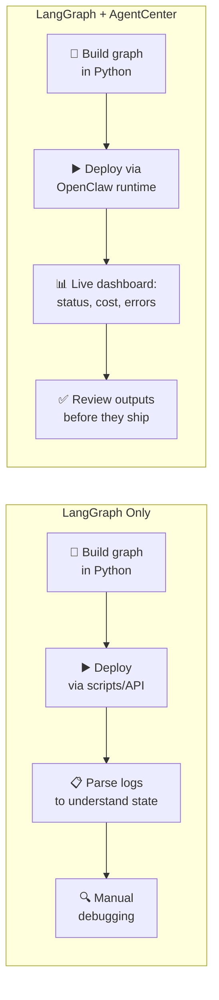

LangGraph is one of the most popular Python libraries for building AI agent workflows right now. If you need stateful, cyclic graphs (agents that loop, branch, call tools, wait for input, then continue), LangGraph gives you the building blocks. It's genuinely useful, and a lot of teams have adopted it for good reasons.

But there's a question that keeps coming up after LangGraph graphs are deployed: what do you actually do when something goes wrong?

Which node is stuck? What did the agent spend on tokens this run? Did the output meet the acceptance criteria before it reached the user? Who on the team can see any of this without reading Python logs?

That's the gap. LangGraph is a framework for building agents. AgentCenter is a control plane for managing them.

## What LangGraph Does Well

To be fair: LangGraph is a solid tool. Teams pick it for real reasons.

- **Stateful graphs**: Unlike simple chains, LangGraph agents can loop back, retry, and branch based on intermediate results. That's table stakes for real-world agent work.
- **Built-in persistence**: LangGraph has a checkpointing system that lets you pause and resume agent state across runs. Useful for long-running tasks.
- **Conditional routing**: You can wire up complex decision trees between nodes. An agent calls a tool, evaluates the result, then decides whether to retry or proceed.
- **Human-in-the-loop hooks**: LangGraph has an interrupt mechanism that pauses execution for a human review step, configurable in code.
- **First-class streaming**: Intermediate outputs from graph nodes stream as they happen, which makes for responsive UIs.
- **Strong Python ecosystem**: It integrates with LangChain, OpenAI, Anthropic, and most of the Python ML stack without friction.

If you're building complex agent graphs and want fine-grained control over the flow logic, LangGraph is worth considering.

## The Core Limitation for Production Teams

LangGraph gives you control over how agents run. It doesn't give your team visibility into what they're doing.

Once you have 8 or 12 graphs deployed (each handling different tasks, each consuming tokens, each potentially looping or failing silently), you need answers to questions that a framework can't answer:

- Which agent is currently stuck, and for how long?
- What did each run cost? Is one graph consuming 4x what it should?
- Did the output get reviewed before it went to the customer?
- Can a product manager or QA engineer check status without writing a Python script?
- How do you alert an on-call engineer when an agent fails at 2am?

These aren't framework questions. They're operational questions. LangGraph gives you the tools to build. It doesn't give you a dashboard to run.

Most teams start by tailing logs. Then they build a homegrown admin panel. Then they spend two months maintaining that instead of building the actual product. The pattern repeats until someone decides to stop reinventing the control plane.

## AgentCenter vs LangGraph — Side by Side

| Feature | LangGraph | AgentCenter |
|---|---|---|
| Primary role | Agent graph framework | Agent control plane |
| Primary users | Python developers | Developers and the whole team |
| Task management UI | None | Kanban board with real-time status |
| Agent monitoring | Log-based, manual | Live status per agent |
| Cost tracking | None built-in | Per-agent token cost tracking |
| Output review workflows | Interrupt hooks in code | Built-in approval queues with @mentions |
| Multi-agent visibility | Code-level graph logic | Visual task board across all agents |
| Alerting | DIY | Built-in failure notifications |
| Non-engineer access | None | Dashboard any team member can read |
| Open source | Yes (Apache 2.0) | No (SaaS, 7-day free trial) |
| Pricing | Free | Starter $14/mo, Pro $29/mo, Scale $79/mo |

## Workflow Comparison: Research Agent in Production

Say you're running a research agent built in LangGraph. It searches the web, summarizes sources, and produces a final report. You have 10 of these running in parallel for different clients.

**The LangGraph-only way:**

1. Kick off each graph run via your API or a cron job
2. Monitor by watching logs (or not watching at all between runs)
3. When a client reports a late delivery, dig through stdout to figure out what happened
4. Parse the LangGraph state object to find which node failed
5. Manually re-trigger the run
6. Hope the output is correct before it reaches the client

**The LangGraph plus AgentCenter way:**

1. Each run shows up as a task on the [agent dashboard](/features/agent-dashboard) the moment it starts
2. You see live status for each agent: working, idle, blocked, or failed
3. If a run takes 3x longer than the baseline, you catch it before the client does
4. Finished outputs land in a review queue where a team member approves them before delivery
5. If a run fails, you get an alert with the error and the cost up to that point

The LangGraph graph code stays the same. You're adding a layer of operational visibility through the OpenClaw runtime and the AgentCenter dashboard.

## Can You Use Both?

Yes. This is actually the common setup.

LangGraph handles the agent logic: state management, tool calling, conditional routing, memory. AgentCenter handles the operational layer around those agents once they're running: visibility, task coordination, cost tracking, and human review.

They solve different problems. LangGraph handles what happens inside each agent. AgentCenter handles what happens across agents, between agents and the team, and when things break.

Teams running both get:

- Reliable agent logic (LangGraph handles this)
- Real-time visibility into what each agent is doing in production
- A way for non-engineers to check status without pinging developers on Slack
- Approval workflows before agent outputs reach customers
- Cost tracking per agent and per task so you know where money is going

If your team has more than a handful of agents in production, adding AgentCenter on top of your LangGraph setup pays off quickly. The [agent monitoring features](/features/agent-monitoring) alone save debugging time when a run fails. And once you've given the whole team visibility instead of routing every status question through engineering, you get back real hours each week.

One practical note: AgentCenter requires an OpenClaw-compatible agent setup. LangGraph agents need to be deployed via an OpenClaw-compatible runtime to connect. That's a real integration step, and worth factoring in before you start.

## Bottom Line

LangGraph is a framework for building stateful agent graphs. It's not a control plane for running them at scale. Once agents are in production, you need visibility, cost tracking, and team coordination that no Python library was designed to provide. AgentCenter fills that gap — it doesn't replace your agent framework, it manages what the framework produces.

---

*LangGraph is good at what it does. AgentCenter does something different — it manages your agents, not just builds them. [Start your 7-day free trial](/pricing) — no lock-in.*
