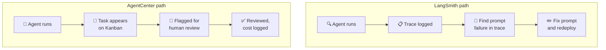

LangSmith is a genuinely useful tool. If you're building LLM apps and need to trace chains, debug prompt failures, or understand why your model responded the way it did, it solves a real problem. Many teams add it early in development. That's the right call.

But if your main problem is different — you have multiple AI agents running in production and need to know which one is failing, which one is blocked, how much each is costing, and who's supposed to review their output — LangSmith won't get you there.

These two tools sit at different layers of the stack. Understanding which layer you need helps you pick the right one, or decide you need both.

## What LangSmith Does Well

LangSmith is built for debugging LLM apps. Its strengths are real:

- **Full call tracing** — captures every LLM call, including nested chains, with input, output, and latency
- **Run visualization** — shows execution graphs so you can see exactly where a chain broke
- **Annotation and feedback** — lets you label runs, leave notes, and tag outputs for evaluation
- **Prompt testing** — run evaluation datasets against different prompt versions and compare results
- **LangChain integration** — works with LangChain, LangGraph, and adjacent tooling with minimal setup

If you're iterating on prompts and need to understand what's happening inside a chain, LangSmith handles that well.

## The Gap for Teams Running Agents in Production

LangSmith is an observability tool. It looks backward at what happened so you can debug and improve your prompts. That's valuable. But it doesn't give you a forward-facing view of your agent fleet.

Say you have 12 agents running right now, handling document summaries, lead enrichment, and support ticket drafts. LangSmith captures their traces. But it won't tell you:

- Which agent is blocked right now, waiting on a dependency
- Which task was submitted for review 90 minutes ago and still hasn't been approved
- Whether your document agent costs $0.30 per run or $3.00 this week
- Who on your team is responsible for each agent

You'd end up building that view yourself — in a spreadsheet, a Notion doc, a Slack channel — and keeping it updated manually. That works until it doesn't.

AgentCenter is the control plane that handles the operational layer. The [agent monitoring features](/features/agent-monitoring) track real-time status, cost per task, and error rates across every agent in your workspace. When something breaks or needs a human decision, the right person gets notified, and the task stays visible until it's resolved.

## AgentCenter vs LangSmith: Side-by-Side

| Feature | LangSmith | AgentCenter |
|---|---|---|
| LLM call tracing | Yes — full trace with inputs/outputs | No |
| Prompt debugging | Yes | No |
| Agent task status | No | Yes — live Kanban board |
| Per-agent cost tracking | No | Yes |
| Multi-agent coordination | No | Yes |
| Human review and approval workflows | No | Yes |
| @Mentions and task threads | No | Yes |
| Team ownership per agent | No | Yes |
| Recurring task automation | No | Yes (Pro+) |
| Cloud VM provisioning | No | Yes (Scale plan) |
| Pricing | Free / $39/user/mo | $14 / $29 / $79 per workspace/mo |
| Best for | Debugging LLM apps | Running agents in production |

For a detailed breakdown, see the [LangSmith comparison page](/compare/vs-langsmith).

## How Each Tool Handles a Failed Agent

Here's how the same problem — an agent produces bad output — plays out in each tool.

**With LangSmith:**

1. The agent runs and a trace is captured in LangSmith
2. You open the trace, find where the prompt was truncated or the response went wrong
3. You annotate the run, fix the prompt in your codebase, and redeploy
4. The fix lives in version control and gets picked up on the next run

**With AgentCenter:**

1. The agent runs and the task appears on the board with a status
2. The agent flags the task as needing review, or errors out visibly on the board
3. A team member opens the deliverable, leaves a comment, and either approves or sends it back
4. You update the agent config, re-run the task, and the output gets logged with the cost

LangSmith tells you why the agent failed. AgentCenter tells you that it failed, routes it to the right person, and tracks what happened next. They answer different questions.

## Can You Use Both?

Yes — and teams that care about both prompt quality and operational reliability often do.

LangSmith answers: "Why did this agent fail, and how do I fix the underlying prompt?"

AgentCenter answers: "Which agents are running, what state are they in, and who's managing them?"

They work at different layers. A team building complex LangChain pipelines and deploying those pipelines as production agents can use LangSmith to debug during development and AgentCenter to operate the fleet in production. There's almost no feature overlap.

If you're early stage — one or two agents, mostly experimenting — LangSmith alone might cover you. When you're running more agents, shipping deliverables to real users, and tracking costs and handoffs, AgentCenter covers the operational gap that LangSmith doesn't touch.

## Bottom Line

LangSmith is the right tool when your problem is "I don't know why my LLM is behaving this way." AgentCenter is the right tool when your problem is "I don't know what my agents are doing or whether they're on track." If you're dealing with both — debugging during development and operating at scale — you likely need both.

See the [pricing page](/pricing) if you want to understand how AgentCenter fits into your stack.

---

*LangSmith is good at what it does. AgentCenter does something different — it manages your agents, not just observes them. [Start your 7-day free trial](/pricing) — no lock-in.*
