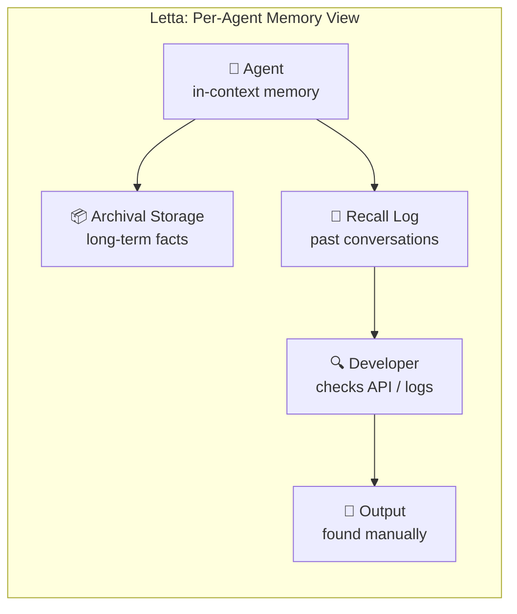
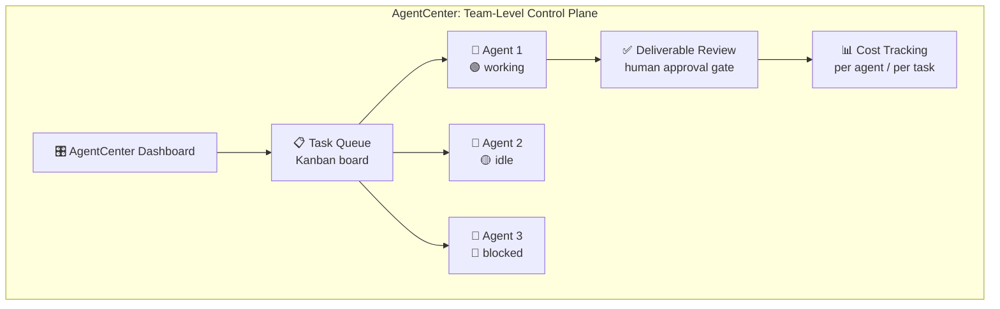

Letta (formerly MemGPT) solves a real problem: AI agents forget things. You have a conversation with an agent today, come back tomorrow, and it has no idea who you are or what you asked it to do last week. Letta's layered memory architecture fixes that. Agents built on Letta can recall past conversations, store long-term knowledge, and maintain context across sessions.

That's genuinely useful. For certain use cases, it's the only thing that works.

But if your team is running 10, 20, or 50 agents in production — shipping real deliverables, coordinating with human reviewers, tracking what each agent costs — Letta's memory features aren't the bottleneck you'll hit first.

## What Letta Does Well

Letta's core strength is memory management for individual agents:

- **In-context memory**: A curated buffer of recent and important information the agent keeps actively loaded
- **Archival memory**: External long-term storage the agent can search when it needs older context
- **Recall memory**: A log of past conversations the agent can query
- **Multi-session continuity**: Agents remember users, tasks, and context across separate sessions — not just within one conversation
- **Self-editing memory**: Agents can update their own memory blocks during a conversation as priorities shift
- **Open source**: Full control over your agent's state and storage, self-hostable with no vendor dependency

For use cases like personal AI assistants, code review agents that need to know a team's conventions over time, or research agents building a knowledge base across months — Letta is the right pick.

## The Core Limitation for Teams Managing AI Agents

Letta is a framework for building individual stateful agents. It's not built to help you manage a fleet of them.

When you're running 20 agents across 8 projects, the memory architecture inside each agent isn't your main operational concern. You're asking different questions:

- Which agents are working right now, and which are idle or blocked on a dependency?
- Who reviews the outputs before they go to a client or production system?
- Which agent just spent $200 in tokens on a task nobody approved?
- Three agents are handling parts of the same workflow — what's the handoff sequence, and where did it break?

Letta doesn't answer those questions. It has no task queues, no team-facing dashboard, no multi-agent coordination layer, no deliverable review workflow, and no cost tracking. That's not a criticism — those aren't things Letta is built to do.

The gap shows up fast when you move past one or two agents. You start writing scripts to poll Letta's API for agent state. You build Slack notifications to know when something is ready for review. You manage handoff logic between agents in application code. At some point, the coordination overhead costs more time than the agents are saving.

## AgentCenter vs Letta: Feature Comparison

| Feature | Letta | AgentCenter |
|---|---|---|
| Primary purpose | Persistent memory for individual agents | Control plane for managing agent teams and workflows |
| Agent memory | In-context, archival, and recall memory layers | Not a memory framework — pairs with your agent runtime |
| Task management | No task queue or tracking | Kanban board with assignment, status, and priorities |
| Real-time agent status | Not provided | Online, working, idle, blocked — live per-agent |
| Multi-agent coordination | No built-in orchestration | Task dependencies, sequenced handoffs, shared deliverables |
| Deliverable review | No review workflow | Inline deliverable approval with human-in-the-loop gates |
| Cost tracking | No cost visibility | Per-task and per-agent token and cost tracking |
| Team collaboration | No team features | @mentions, task threads, activity feed |
| Self-hosting | Yes (open source) | Cloud-hosted dashboard |
| Agent runtime | Letta agents (Python SDK) | Any OpenClaw-compatible agent (Anthropic, OpenAI, Gemini) |
| Pricing | Free (open source) / hosted tiers | $14/mo (Starter), $29/mo (Pro), $79/mo (Scale) |

## Workflow Comparison

### Managing Agents Without a Control Plane

Your team has built 12 agents using Letta. Each one has memory that persists across sessions. The user-facing ones remember preferences and history. The internal pipeline ones remember what tasks they've already processed.

But when a teammate asks "what's Agent 7 doing right now?" — you're querying the Letta API or pulling server logs. When a deliverable is ready for review, someone has to know to go check. When Agent A needs to hand work off to Agent B, you've coded that logic into the application. And when an agent fails silently in the middle of the night, the first sign is a missing report the next morning.

### Managing Agents With AgentCenter

With AgentCenter, your agents (running on OpenClaw) connect to a shared control plane. Open the [agent dashboard](/features/agent-dashboard) and see which agents are working, which are idle, and which are blocked. Tasks move through a Kanban board — assigned, in progress, waiting on review, done. When an agent completes something that needs a human decision, it surfaces in the queue with the deliverable attached and ready to approve or reject.

When Agent A finishes its analysis and Agent B needs to act on that result, you set that dependency in AgentCenter. Not in code. You see the full [multi-agent workflow](/features/multi-agent-workflows) in one place, and when the handoff breaks, you see exactly where.

## Can You Use Both?

Yes. The two tools operate at different layers.

Letta handles what individual agents remember. AgentCenter handles what your team sees and coordinates around. If you have agents that need multi-session continuity — remembering user history, building a knowledge base over time, or maintaining context across weeks of back-and-forth — Letta's memory architecture does that job well. AgentCenter sits on top, managing the task pipeline, surfacing deliverables for human review, and tracking what each agent actually costs across your team.

They're not competing for the same job. Letta works at the agent-memory layer. AgentCenter works at the team-operations layer.

Most teams hit the operations problem first. You deploy three agents, immediately lose track of what each one is doing, and spend more time debugging coordination than building features. That's when you need a control plane. The memory problem comes later — when specific agents need to maintain context across sessions and your users notice the difference.

## Bottom Line

Letta is the right tool when your agents need to remember things across sessions. AgentCenter is the right tool when your team needs to see, coordinate, and review what all your agents are doing in production. They solve different problems, and the order you need them in is almost always: control plane first, memory layer second.

If you're past the "one or two agent" stage and starting to lose track of what's running, [see what AgentCenter covers](/features).

---

*Letta is good at what it does — persistent memory is a real gap in most agent setups. AgentCenter does something different: it manages your agents, not just their memory. [Start your 7-day free trial](/pricing) — no lock-in.*
