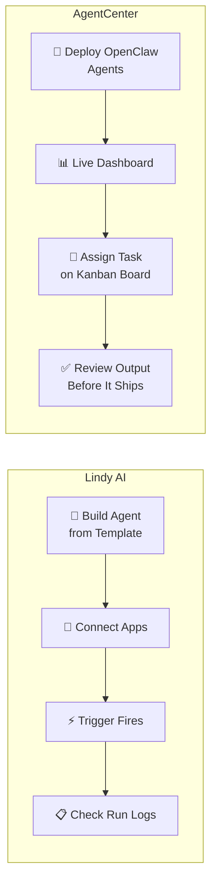

Lindy AI has built something genuinely useful. Non-technical teams can go from idea to running agent in under an hour. Connect your Gmail, pick a template, set a trigger, and you have an agent handling email triage, meeting scheduling, or lead qualification. No code, no infrastructure decisions, no waiting on engineering.

That's a real problem it solves well.

But here's the question that comes up after a few months: you're running 10 or 15 agents, costs have doubled, one agent sent the wrong output last week, and now nobody can tell you which agent caused it or whether it's still happening. Lindy gives you run logs. It doesn't give you a control plane.

That's where the comparison actually matters.

## What Lindy AI does well

Lindy is built for fast agent creation and deployment, specifically for people who don't write code. If your goal is to automate a repeatable business task without touching a terminal, it's one of the faster paths to something working.

- **Visual no-code builder**: A drag-and-drop interface that sales, support, and ops teams can learn without engineering help
- **Template library**: Ready-made agents for email triage, lead qualification, scheduling, CRM updates, customer support, and more
- **150+ integrations**: Gmail, Slack, Notion, HubSpot, Salesforce, Calendly, and most common SaaS tools are already connected
- **Built-in LLM access**: Claude, GPT-4, and others are wired in — no API key setup or model management required
- **Quick iteration**: Changing what an agent does takes minutes, not a deployment cycle
- **Low barrier to entry**: A team of 3 non-engineers can have 10 agents running inside a week

If you're a small operations team trying to reduce repetitive manual work, Lindy gets you moving fast.

## The core limitation for teams managing AI agents

Lindy is an agent builder. It was designed to help you create and run individual agents. The monitoring story is basic run history. The fleet management story doesn't exist.

This works fine when you have 3-4 agents doing isolated tasks. When you're running 15 agents across multiple teams, you start needing answers that Lindy can't provide:

- Which agents are running right now, and which are stuck?
- Which agent produced that wrong output two days ago, and has the problem been fixed?
- Which specific task drove the spike in my bill this month?
- Is there a human reviewing agent outputs before they get sent to customers?

There's no shared task board. No @mentions for flagging issues. No deliverable review queue that a human approves before the agent's output goes live. If you need to coordinate work across multiple agents, you're doing it manually outside the tool.

AgentCenter is built for exactly this layer. It's not a builder. It's the operations dashboard that sits on top of your [OpenClaw-compatible agents](/features/agent-monitoring) and gives you production visibility.

## AgentCenter vs Lindy AI: what each one does

| Feature | Lindy AI | AgentCenter |
|---|---|---|
| Primary purpose | Build automation agents | Manage agents in production |
| Target user | Non-technical teams | Developers, DevOps, ML engineers |
| Agent creation | Visual no-code builder | Works with OpenClaw-compatible agents |
| Multi-agent coordination | Sequential steps only | Full orchestration with task board |
| Real-time agent status | Run logs | Live status: online, working, idle, blocked |
| Deliverable review | Not available | Built-in approval workflows |
| Task assignment | Trigger-based rules | Kanban board with @mentions and threads |
| Per-task cost tracking | Credit totals only | Per-task cost breakdown |
| Performance analytics | Basic run history | Full analytics and activity feed |
| Team collaboration | Limited | Shared task board, comment threads |
| Agent framework | Lindy's own runtime | Any OpenClaw-compatible agent |
| Pricing | Free / ~$49 / ~$99 per month | $14 / $29 / $79 per month |
| Free trial | Free tier available | 7-day trial on all plans |

## How teams use each tool differently

Here's the workflow difference in practice.

**Running a task in Lindy:**
1. You build a Lindy from a template or from scratch
2. Connect your apps (Gmail, HubSpot, Slack)
3. Set a trigger — "when a new lead emails, qualify them and log to CRM"
4. The agent runs automatically whenever the trigger fires
5. You check run logs if you suspect something went wrong

**Running a task in AgentCenter:**
1. Your engineering team deploys OpenClaw agents for different task types
2. All agents appear in the AgentCenter dashboard with live status
3. Tasks are created on a Kanban board and assigned to the right agent
4. You see which agent is working, which is blocked, which finished
5. Outputs go into a review queue before they're acted on
6. Cost per task is tracked automatically

The core difference is control flow. Lindy is trigger-driven — the agent decides when to act based on conditions you set. AgentCenter is task-driven — your team decides what gets done and when, and the agent executes under your oversight.

That matters a lot when something goes wrong. In Lindy, diagnosing a bad output means scrolling through run logs for individual agents. In AgentCenter, you look at the task that produced the bad output, see exactly what the agent did, and trace the cost back to that specific run.

## Can you use both?

Yes, and there's a natural split.

Lindy handles the business automation layer well. If your sales team uses Lindy to qualify leads and your engineering team uses AgentCenter to manage the downstream agents that process those leads, the two tools coexist without conflict.

What doesn't work: using Lindy as a substitute for production operations. If your engineers are asking "which agent is misbehaving" or "what's driving this cost spike across our fleet," Lindy wasn't built to answer those questions. You'd be reading individual run logs one by one, which stops scaling past about 5 agents.

For the full technical breakdown, see the [AgentCenter vs Lindy AI compare page](/compare/vs-lindy-ai).

## Bottom line

Lindy AI is the right tool for non-technical teams who need to build and run automation agents quickly. The no-code approach and integration depth are real strengths for that audience.

AgentCenter is the right tool for engineering teams managing AI agents in production. If you're tracking costs, reviewing outputs, coordinating work across multiple agents, and debugging failures at scale, you need a [dedicated management layer](/features/agent-dashboard) — not a builder with basic run history.

Different tools, different jobs. Most teams with serious agent deployments end up needing both.

---

*Lindy is good at what it does. AgentCenter does something different — it manages your agents, not just runs them. [Start your 7-day free trial](/pricing) — no lock-in.*
