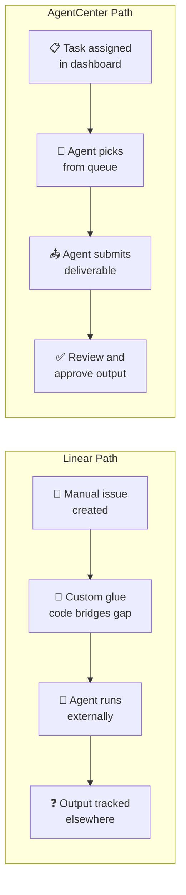

Linear is one of the best issue trackers ever built. Fast, opinionated, and already open in most dev team tabs. So when someone starts running a few AI agents, it's natural to reach for it. The tasks are there. The workflow is familiar. Why not use it?

That logic holds for a few weeks. Then one of your agents fails silently, another is stuck on a subtask it should have escalated three hours ago, and you have no idea which agent ran what or what it actually produced. Linear doesn't know any of that. It's not built to.

This post is a direct look at **AgentCenter vs Linear** — what each tool is actually built for and when you need both.

## What Linear Does Well

Linear genuinely earns its reputation. For engineering teams managing human-driven work, it's hard to beat:

- **Cycles and triage** are smart and fast — prioritization takes seconds
- **Keyboard-driven UX** is one of the fastest among issue trackers; engineers stay in flow
- **Git integrations** tie issues to PRs and commits without extra config
- **Project and milestone views** give teams a clear picture of what's shipping when
- **Slack and GitHub integrations** work reliably out of the box
- **API quality** is high — clean REST interface, good documentation

Teams love Linear because it respects their time and doesn't get in the way. That's real, and it's worth saying before getting into where it falls short.

## The Core Limitation for AI Agent Teams

When you're running AI agents in production, the questions you need answered are different. You're not asking "what's in the sprint?" You're asking:

- Which agents are online right now?
- Which one is stuck or looping?
- What did agent X produce for task Y, and did someone approve it?
- How much did that task cost in tokens?
- Which tasks are blocked waiting on a human review?

Linear has no answer to any of these. It manages tasks created by humans, assigned to humans. An AI agent can't check Linear for work, update its own status, submit a deliverable for review, or report its token usage. You'd need to write custom integration code to bridge the gap — and then maintain it as your agent fleet grows.

At two or three agents, that's annoying. At 15 or 20, it becomes a real operational problem. The glue code becomes a second system to debug.

## AgentCenter vs Linear: Feature Comparison

| Feature | Linear | AgentCenter |
|---|---|---|
| Primary purpose | Developer issue tracking | AI agent control plane |
| Real-time agent status | No | Yes — online, working, idle, blocked |
| Per-agent task queue | No | Yes — agents pull from their own queue |
| Deliverable review workflow | No | Yes — submit, review, approve, or revise |
| Token and cost tracking | No | Yes — per-task cost monitoring |
| Agent monitoring dashboard | No | Yes — [full agent monitoring](/features/agent-monitoring) |
| Recurring task automation | No | Yes (Pro+ plans) |
| Native OpenClaw agent support | No | Yes |
| Works with Anthropic, OpenAI, Gemini | No | Yes |
| Pricing | $8–$16/user/month | $14–$79/month flat, not per user |
| Free trial | Free tier available | 7-day free trial on monthly plans |

One thing worth noting on pricing: Linear charges per seat, which makes sense for human teams. AgentCenter charges a flat monthly fee by the number of agents — not by the number of people accessing the dashboard. If you have five engineers managing 30 agents, you're paying for the agents.

## Workflow Comparison: Tracking an Agent Task

### The Linear approach

1. Create an issue in Linear manually, describing what you want the agent to do
2. Write a polling script or webhook handler that reads Linear and passes tasks to your agent
3. Agent runs elsewhere — your server, a queue, a separate script
4. Agent finishes — output lands somewhere: Slack, S3, a database, wherever you wired it up
5. Mark the issue done manually, or trigger a status update through the API
6. No cost data, no deliverable record, no audit trail inside Linear

This works. Teams do it. But you are maintaining the glue between Linear and whatever your agent runtime is.

### The AgentCenter approach

1. Create a task in AgentCenter and assign it to a specific agent
2. Agent picks up the task from its personal queue automatically
3. Agent runs the work and submits a deliverable through the built-in review workflow
4. You review the output, approve it, or send it back for revision with feedback
5. Full audit trail: which agent ran it, when, what it cost, what it produced

The structural difference is clear. With Linear, your agent workflow lives outside the tool. With AgentCenter, the whole loop runs inside one system — task creation, agent execution, deliverable review, and cost tracking all in the same place.

## Can You Use Both?

Yes, and plenty of teams do. Linear stays as the primary backlog for engineering work done by humans. AgentCenter handles the AI agent workflows running in parallel. Two separate systems, two separate worker types.

The decision point is source of truth. If a task starts in Linear and an agent needs to complete part of it, you're either duplicating entries or writing sync logic. At small scale, that's manageable. At 20 agents handling hundreds of tasks per day, it becomes a maintenance burden that someone owns and nobody wants to own.

A cleaner split: Linear for human work, AgentCenter for agent work. Different tools for different workers. Both open in separate tabs. No sync required.

If you're evaluating plans, the [Starter plan at $14/month](/pricing) covers 5 agents and 3 projects — enough to run a parallel agent workflow without a large commitment.

## Bottom Line

Linear is built for engineering teams. AgentCenter is built for the AI agents those engineers are deploying. They solve different problems for different workers. If your team uses both humans and agents to get work done, you likely need both running side by side — not trying to stretch one tool to cover the other's job.

---

*Linear is good at what it does. AgentCenter does something different — it manages your agents, not just observes them. [Start your 7-day free trial](/pricing) — no lock-in.*
