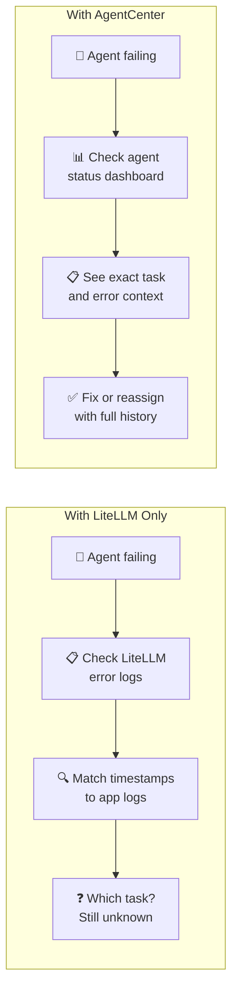

We added LiteLLM to our agent stack because our LLM costs were all over the place. Three agents sharing a budget with no visibility into who was spending what. LiteLLM fixed that in an afternoon. Per-key budgets, automatic provider fallbacks, call logs with costs per request. Good tool.

But three weeks later, one of those agents stopped making sense. It was completing tasks. LiteLLM showed healthy call counts and normal costs. The outputs were just wrong. Not erroring. Just wrong. We had no idea which task it was working on, who assigned it, or whether anyone had looked at what it produced.

That's when we realized LiteLLM and AgentCenter are solving different problems.

## What LiteLLM Does Well

LiteLLM is an open-source LLM proxy and gateway. It sits between your code and your LLM providers and gives you a single OpenAI-compatible API endpoint that routes to whatever backend you configure.

If you're running multiple LLM providers, LiteLLM handles:

- **Provider unification**: One API endpoint for Claude, GPT-4, Gemini, Llama, and 100+ other models — no per-provider SDK maintenance
- **Cost tracking**: Per-key, per-user, and per-team budget limits with automatic alerts when thresholds are hit
- **Fallbacks and load balancing**: If one provider goes down or gets too slow, LiteLLM routes to your backup automatically
- **Rate limiting**: Per-user and per-team rate limits, configurable without touching application code
- **Request caching**: Identical prompts can return cached responses, cutting redundant LLM calls
- **Logging**: Request logs, response times, token counts, and cost per call across all providers

For teams with multiple LLM providers and no unified spend visibility, LiteLLM is the right first step. It solves a real problem.

## Where LiteLLM Stops

LiteLLM knows what your agents are calling. It doesn't know what they're doing.

When your agent makes 200 API calls in an hour, LiteLLM tells you the model, token count, and cost per request. It doesn't tell you:

- What task the agent was working on when call 143 errored
- Whether the final output was any good
- Who assigned the task in the first place
- Whether the task is still open, completed, or stuck
- What the person waiting on the deliverable is supposed to do next

This gap is small when you have one or two agents. At 8 or 12, it gets expensive fast. We had a situation where three agents were all hitting the same external API through LiteLLM, all failing, all logging errors — but nothing tied those errors to specific tasks. The LiteLLM dashboard showed elevated error rates. To find out why, we spent two hours cross-referencing request timestamps with our own application logs.

Managing LLM calls is not the same as managing AI agents.

[AgentCenter's agent monitoring](/features/agent-monitoring) operates at the task and agent level: what is each agent doing right now, what did it produce, and is the output acceptable? Those questions don't have answers in an LLM gateway.

## AgentCenter vs LiteLLM — Feature Comparison

| Feature | LiteLLM | AgentCenter |
|---|---|---|
| LLM provider routing | Yes (100+ providers) | No |
| Request-level cost logging | Yes | No |
| Per-agent cost tracking | Partial (by API key) | Yes |
| Per-task cost tracking | No | Yes |
| Budget limits | Per key/user/team | Per agent/task |
| Agent status (live/idle/blocked) | No | Real-time |
| Task assignment and tracking | No | Kanban board |
| Deliverable review workflows | No | Built-in |
| Team @Mentions and task threads | No | Yes |
| Multi-agent coordination | No | Yes |
| Rate limiting | Yes | No |
| Fallback/load balancing | Yes | No |
| Self-hosted | Yes (open source) | Planned |
| Pricing | Free | $14–$79/mo |
| Best for | LLM API management | AI agent operations |

## The Workflow Difference

Here's what troubleshooting a failing agent looks like with each tool:

**With LiteLLM only:**

1. Alert shows elevated failure rate on your gateway
2. You pull request logs and filter by error codes
3. You see which model was called and what the response was
4. You manually trace timestamps back to your application logs
5. You figure out (eventually) which agent was running which task
6. No record of what the intended output was or who was waiting on it

**With AgentCenter:**

1. Real-time agent status shows which agent is blocked or failing
2. You open the task — description, assigned agent, current status, cost so far
3. Error context is attached to the specific task, not buried in gateway logs
4. You leave a comment, reassign, or close the task with full history
5. The person who assigned the task gets notified automatically

The [task orchestration view](/features/task-orchestration) gives you this at a glance across your whole agent fleet. LiteLLM gives you the API layer. You still need the operations layer on top.

## Can You Use Both?

Yes. Many teams do.

LiteLLM is infrastructure. It lives at the API call layer and handles routing, rate limiting, and provider abstraction. AgentCenter is operations. It lives at the agent and task layer and handles visibility, review, and coordination.

If you're running OpenClaw agents through a LiteLLM proxy for multi-provider support, the two tools don't overlap. LiteLLM handles "which model do I call and what did it cost per request?" AgentCenter handles "what is this agent working on, who's reviewing its output, and what's the status right now?"

Where teams get confused is treating LiteLLM's cost tracking as a substitute for agent-level cost visibility. Per-request cost data is useful. But it doesn't tell you which agent or task is your biggest spend driver. A single runaway agent making redundant calls looks identical in the gateway logs to three agents working normally — the only difference is what they're doing, and that's exactly what LiteLLM doesn't track.

AgentCenter's per-task cost tracking, on the other hand, shows you precisely which task is burning budget. If agent A spent $4.20 on one task last night, you know which task, what it produced, and whether anyone approved the output. See the [pricing page](/pricing) for what plan fits your fleet size.

## Bottom Line

LiteLLM is the right tool if you're running multiple LLM providers and want unified API access, fallback routing, and request-level budget controls. It does those things well.

It's not built to tell you what your agents are doing, whether their outputs are correct, or who's coordinating the work. That's a different problem, and one that a gateway can't solve.

---

*LiteLLM is good at what it does. AgentCenter does something different — it manages your agents, not just the API calls they make. [Start your 7-day free trial](/pricing) — no lock-in.*
