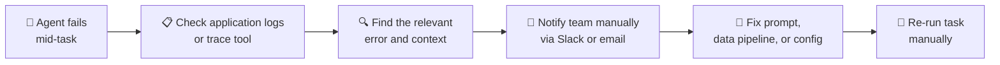
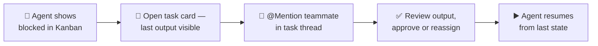

LlamaIndex is a well-built data framework. If you're building an agent that queries PDFs, connects to a knowledge base, or runs RAG pipelines, it's one of the first tools you reach for — and for good reason.

But once you've built that agent and deployed it, LlamaIndex steps back. You're on your own for monitoring it, managing task queues across multiple agents, reviewing outputs before they reach users, and figuring out which agent silently failed at 2am on Wednesday.

That's not a flaw. That's just not what LlamaIndex was built to do. There's a second layer needed once agents go live — and that's where AgentCenter fits.

## What LlamaIndex Does Well

LlamaIndex is a developer framework, and it excels at developer problems:

- **RAG pipelines**: Built-in connectors for vector stores, document loaders, and retrieval chains. The data-to-agent pipeline is genuinely well designed.
- **Document indexing**: You can take PDFs, databases, or APIs and turn them into a queryable knowledge layer your agent can reason over.
- **Agent tooling**: Supports ReAct agents, router agents, and OpenAI function-calling agents — all layered on top of its data connectors.
- **Integrations**: Works with most major LLM providers, vector stores, and storage backends out of the box.
- **Composability**: You can chain queries, transformations, and tool calls without writing a lot of glue code.

If your goal is "I need an agent that answers questions about my company's documents," LlamaIndex gets you there fast.

## The Core Limitation for Teams Running Agents in Production

Here's where it breaks down: LlamaIndex helps you build one agent. It doesn't help you run eight of them.

Say your team has built five LlamaIndex agents over the past quarter. One handles customer contract review. One runs competitive research on new leads. One processes incoming support tickets. One summarizes product feedback weekly. One generates internal reports.

Now answer these questions:

- Which of those agents is currently running, and which is stuck waiting on something?
- Which one consumed $340 in API costs last month — and on what tasks?
- Who approves the contract review output before it goes to the customer?
- When the competitive research agent returned bad results on Monday, who noticed and how long did it take?

LlamaIndex has no interface for any of this. You'd be building it yourself — writing logs to a database, setting up alerts, wiring together a Slack notification system, manually checking runs in whatever orchestration tool you're using.

That's three or four separate engineering projects on top of the agent you already built. A team of four ends up spending one person's time just keeping the lights on.

## AgentCenter vs LlamaIndex: Side by Side

| Feature | LlamaIndex | AgentCenter |
|---|---|---|
| Primary purpose | Build data-powered agents | Manage agents in production |
| RAG and data indexing | Core feature — this is what it does | Not applicable — manages the agent, not its internals |
| Agent monitoring dashboard | None | Real-time status: online, working, idle, blocked |
| Task management UI | None | Kanban board per project |
| Cost tracking | None | Per-agent, per-task cost visibility |
| Multi-agent coordination | Basic pipeline composition | Full coordination with @mentions and task handoffs |
| Output review and approval | None | Approval workflows built in |
| Error visibility | Logs only — you build alerting | Blocked state visible in dashboard immediately |
| Pricing | Open source (free), LlamaCloud from ~$97/mo | Starter $14/mo, Pro $29/mo, Scale $79/mo |
| Who it's for | Engineers building RAG and data agents | Teams managing multiple agents in production |
| OpenClaw required? | No | Yes — AgentCenter is the control plane for OpenClaw agents |

## Workflow Comparison: What Happens When an Agent Fails

This is the scenario that makes the difference concrete. An agent fails mid-task. What happens next?

**With LlamaIndex alone:**

You dig through logs, find the error, message someone, wait for a response, fix it, re-run. If you have separate observability tooling hooked up, maybe you catch it faster — but that's infrastructure you added on top, not something LlamaIndex provides.

**With AgentCenter:**

You see the blocked agent in the dashboard the moment it stalls. Open the task card, see what it produced, leave a note for whoever needs to handle it, approve or redirect. The whole loop happens in one place without context switching.

## What Teams Build Before They Realize They Need a Control Plane

There's a predictable pattern. A team builds their first LlamaIndex agent in a weekend. It works well enough to show stakeholders. They build two more. Then three more. At some point — usually around agent five or six — someone asks "which one broke last night?" and nobody has a clean answer.

The typical workarounds at that stage:

- A shared Notion page listing agents and their last known status (updated manually, usually out of date)
- A Slack channel where someone posts "FYI the contract agent is down again"
- A cron job that pings each agent and sends a failure alert (breaks when the agent stalls silently instead of throwing an error)
- A spreadsheet tracking API spend per agent (filled in manually from billing dashboards)

Every one of these is a tool you built to compensate for not having a control plane. AgentCenter replaces all of them with a single dashboard — [agent status, task queues, cost tracking](/features/agent-monitoring), and output review in one place.

The teams that get there fastest are usually the ones that had the most painful outage first.

## Can You Use Both?

Yes — and that's actually the most common pattern.

LlamaIndex handles what it's good at: your RAG pipeline, your document ingestion, your retrieval logic. The agent itself is built and tested in LlamaIndex. You then wrap it as an OpenClaw-compatible agent and connect it to AgentCenter.

What you get: LlamaIndex manages the data layer, AgentCenter manages the operational layer. You get the ecosystem flexibility of LlamaIndex and the production visibility of AgentCenter's [agent monitoring](/features/agent-monitoring) without building either from scratch.

Teams usually add AgentCenter once they have 3-5 agents running and start losing track of which ones are clean. At one or two agents, you can get by with logs. At five, you can't.

It's the same pattern as using a framework to build a web app and a separate tool to monitor it in production. You wouldn't expect Rails to also run your APM dashboards. Same idea here.

## Bottom Line

LlamaIndex is the right tool for building agents that reason over data. If you're building RAG pipelines, document agents, or knowledge-base workflows, it belongs in your stack. But building agents and running them in production are two different jobs. Once your team has more than a couple agents deployed and needs real visibility — task status, costs, approvals, error states — that's the problem AgentCenter solves.

[See what the production layer looks like](/features/agent-dashboard) or [check which plan fits your team](/pricing).

---

*LlamaIndex is good at what it does. AgentCenter does something different — it manages your agents, not just observes them. [Start your 7-day free trial](/pricing) — no lock-in.*
