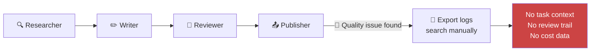
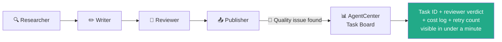

Lyzr is a genuinely capable platform for building AI agents. If your team needs to deploy a customer support agent, a document Q&A assistant, or an internal knowledge bot without spending weeks on infrastructure, Lyzr gets you there fast. That's a real value.

The question that comes up once agents are running is a different one: how do you know what each agent is actually doing right now? Who owns the one that's failing? Which task has been sitting blocked for three hours? Where did the cost spike come from?

That's not a build problem. That's an operations problem. And it's what AgentCenter is built for.

## What Lyzr Does Well

Lyzr is an AI agent studio. The entire platform is oriented toward the build-and-deploy phase — getting agents from idea to running as fast as possible.

- **Pre-built agent templates**: Dozens of ready-made configurations — support bots, HR assistants, research agents, lead qualifiers. Pick one, connect your data, and you're close to running.
- **RAG pipelines baked in**: Connect your knowledge bases without custom code. PDFs, Confluence spaces, scraped web pages — Lyzr handles the ingestion and retrieval layer.
- **Multi-channel deployment**: Push the same agent to your website chat, WhatsApp, or Slack without rebuilding anything.
- **Enterprise guardrails**: Built-in toxicity filters, PII redaction, and compliance framing for teams with regulated use cases.
- **No-code configuration**: Non-technical stakeholders can adjust behavior through a UI instead of touching prompts directly.

If your priority is getting an agent deployed quickly with minimal setup, Lyzr is well-designed for that goal.

## The Core Limitation for Teams Running Agents in Production

Once agents are live and handling real workloads, Lyzr's operational layer gets thin.

You can access conversation logs. You can check that the agent is up. But as soon as you're managing more than a couple of agents, or as soon as outputs from one agent flow into another, questions start piling up with no clean answers.

Which agent is currently working? Which one has been idle for six hours when it shouldn't be? A research agent kicked off a document processing run this morning — did it finish, or did it fail silently? You have quality issues in your CRM — was that the researcher, the writer, or the formatter that introduced the problem?

There's no task board. No deliverable review gate. No per-agent cost breakdown. No way to @mention the owner of the agent that's blocking the pipeline. No approval workflow before agent outputs reach downstream systems.

Lyzr is designed for the build phase. Teams that hit 5, 10, or 20 agents in production are operating in a different phase entirely. At that point, you need visibility into what's running, who's responsible for it, and what it's producing — not just that it deployed.

That gap is expensive when something goes wrong and you have no audit trail to reconstruct what happened.

## AgentCenter vs Lyzr: Side-by-Side

| Feature | Lyzr | AgentCenter |
|---|---|---|
| Build agents quickly | Yes — templates, RAG, multi-channel | No — connects to existing agents |
| Real-time agent status | Limited — aggregate conversation logs | Yes — online, working, idle, blocked per agent |
| Task management | No | Yes — Kanban board, task threads, dependencies |
| Deliverable review | No | Yes — submission, version history, approval gate |
| Cost tracking per agent | No | Yes — per-agent, per-task |
| @Mentions and team threads | No | Yes — per task, with full history |
| Multi-agent workflow coordination | Basic | Yes — orchestrated handoffs across projects |
| Human approval workflows | No | Yes — configurable per deliverable type |
| Recurring task automation | No | Yes (Pro+) |
| Pricing | Custom / enterprise pricing | Starter $14/mo, Pro $29/mo, Scale $79/mo |
| Best for | Building and deploying agents | Operating and coordinating agents in production |

## How the Operational Gap Shows Up in Practice

Here's a pattern that comes up repeatedly. A team builds 4 agents — researcher, writer, reviewer, publisher. After two weeks, the published outputs have quality issues. Nobody knows which agent introduced the problem or when it started.

**Without a control plane:**

1. Export conversation logs from Lyzr
2. Manually correlate timestamps across 4 separate agents
3. Try to reconstruct what happened in what order
4. Find the bad output — maybe. Find the root cause — harder.

**With AgentCenter:**

1. Open the task board — see which agent last touched the output
2. Pull the deliverable record — reviewer verdict and timestamp are visible
3. Check whether retry count spiked during that window
4. @Mention the agent owner with the flagged task ID and the exact run

The second path takes minutes. You come out with an audit trail you can show to stakeholders, not just a theory about what went wrong.

## Can You Use Both?

Yes. The two platforms aren't competing for the same job.

Lyzr is the build layer. You use it to configure agents, connect knowledge bases, and get agents running. AgentCenter is the operations layer. You use it to manage what those agents do once they're live — tracking tasks, reviewing outputs, monitoring costs, and coordinating across your team.

The combination makes sense for teams that want fast agent setup without sacrificing operational control. You'd wrap your Lyzr-deployed agent to report to AgentCenter via its [agent monitoring API](/features/agent-monitoring). That's a one-time integration step, not a rebuild.

If you have 1-3 agents running simple, self-contained workflows with no human review requirements, Lyzr alone might cover what you need. Once you have more agents, multiple people reviewing outputs, or downstream systems depending on what those agents produce, the missing operational layer starts showing up in firefighting time.

There's a [detailed comparison page](/compare/vs-lyzr) if you want to go deeper on the feature-level differences.

## Bottom Line

Lyzr is a strong build platform. If speed to first deployment matters and your agents are relatively self-contained, it does the job well. AgentCenter operates at a different layer — real-time status, task coordination, deliverable review, and cost tracking that don't exist in a build platform. Teams that need both don't have to choose. See what the full [control plane feature set](/features) looks like in practice.

---

*Lyzr is good at what it does. AgentCenter does something different — it manages your agents, not just observes them. [Start your 7-day free trial](/pricing) — no lock-in.*
