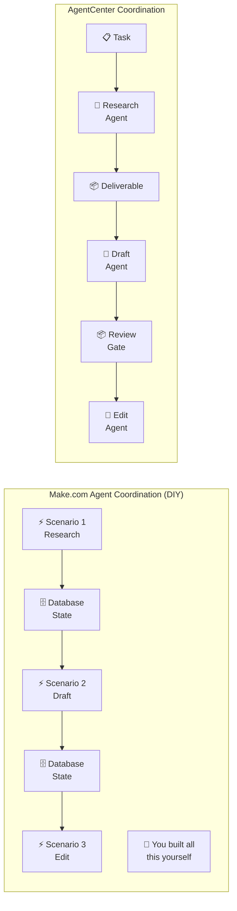

Make.com (formerly Integromat) is a genuinely powerful visual automation platform. The scenario builder is expressive. The conditional branching goes deeper than most no-code tools. The execution history is better than Zapier's. A lot of teams building integrations-heavy workflows reach for Make.com first.

When those workflows include AI agents, though, the model starts to strain.

## What Make.com Does Well

- Visual scenario builder with complex branching and conditionals
- Strong execution history and replay capabilities
- More flexible data transformation than most no-code tools
- 1,500+ app connectors
- Transparent pricing model based on operations
- Good for multi-branch, conditional workflows

Make.com is a solid choice when your automation has a lot of branching logic and you want visual clarity over what runs when.

## The Core Limitation for AI Agent Teams

Make.com's execution model runs scenarios. Scenarios have a start, steps, and an end. They succeed, fail, or hit an error. That's the whole model.

AI agents don't fit cleanly into this. An agent might run for 20 minutes. It might need to pause mid-run to ask a question. It might produce a draft that needs review before continuing. It might coordinate with two other agents that are running simultaneously.

Make.com has no concept of an agent as an entity that persists between executions. Each scenario run is isolated. There's no shared state across runs. There's no review queue. There's no way to see that Agent X is blocked while Agent Y is working.

A team I know built a content pipeline in Make.com: one scenario for research, one for drafting, one for editing, all chained together via webhooks. They had to build their own state machine using a database to coordinate them. They spent three weeks on the coordination layer that should have been handled by a control plane.

## Comparison Table

| Feature                     | Make.com                      | AgentCenter               |
| --------------------------- | ----------------------------- | ------------------------- |
| Visual workflow builder     | Yes (scenarios)               | Kanban board              |
| 1,500+ app integrations     | Yes                           | Via API / agents          |
| Agent status monitoring     | No                            | Real-time status          |
| Deliverable review workflow | No                            | Yes, built-in             |
| Multi-agent coordination    | Manual (DIY state)            | Native                    |
| Cost tracking per task      | No                            | Yes                       |
| Execution history           | Per-scenario                  | Full task + agent history |
| Self-hosting                | No                            | Yes                       |
| @mentions and team chat     | No                            | Yes                       |
| Pricing                     | $9-$29+/mo (operation limits) | $14-$79/mo (agent limits) |
| Free trial                  | Limited free tier             | 7-day free trial          |

## Workflow Comparison

**Multi-agent content pipeline in Make.com:**

1. Build Scenario 1 (research), triggered by webhook
2. Build Scenario 2 (draft), triggered by Scenario 1 output
3. Build coordination database to track state between scenarios
4. Build error handling for each scenario
5. Build monitoring to check if scenarios are actually running
6. Maintain all of this as agents evolve

**Same pipeline in AgentCenter:**

1. Create project with task brief
2. Assign research agent, draft agent, edit agent to sequential tasks
3. Each agent submits deliverable for review before next starts
4. Dashboard shows status of each agent in real time
5. Review and approve at each gate

## Can You Use Both?

Yes. Make.com handles the integration layer — your triggers, your data transformation, routing inputs from external systems into AgentCenter via API. AgentCenter handles the agent layer — what the agents do, how they coordinate, and whether the work is reviewable.

This split works well for teams that have existing Make.com workflows and want to add AI agents to them without rebuilding everything.

## Bottom Line

Make.com is a strong workflow automation tool that can call AI APIs. It's not designed to coordinate agents as persistent entities with state, deliverables, and review workflows. If your AI pipeline is simple and the outputs don't need review, Make.com may be enough. Once you're coordinating multiple agents and caring about output quality, you need a control plane.

_Make.com is good at what it does. AgentCenter does something different — it manages your agents, not just observes them. [Start your 7-day free trial](/pricing) — no lock-in._
