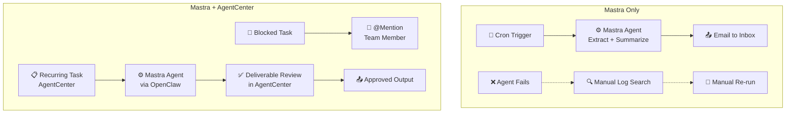

Mastra is one of the better TypeScript frameworks for building AI agents right now. It handles workflows, integrations, RAG pipelines, and agent memory with a clean developer experience. If your team writes TypeScript and you need to build an agent, Mastra is a reasonable place to start.

But there's a question nobody asks at build time: what happens when your agents are actually running? When you have 12 agents across three projects and something stops working at 11pm? When you need to tell your manager which agent spent $400 last week, or which team member is supposed to review the outputs before they go anywhere?

That's a different problem. Mastra doesn't solve it, and it's not trying to.

## What Mastra Does Well

Mastra is designed for building. It's good at it.

- **TypeScript-native API**: Clean types, good autocomplete, natural for frontend and full-stack teams moving into AI work
- **Workflow orchestration**: Step-based workflows with conditional branching, retries, and chained agent calls
- **RAG support**: Built-in document ingestion, chunking, and retrieval with multiple vector store options
- **Integrations**: Pre-built connectors to common tools including GitHub, Google Drive, Slack, and Resend
- **Agent memory**: Short-term context and long-term memory APIs out of the box, without writing your own storage layer
- **Local development experience**: Run agents and workflows locally with live feedback before deploying anywhere
- **Evals**: Basic evaluation hooks so you can test agent outputs as part of your development loop

If your problem is "I need to build an agent that extracts data, routes to different paths based on conditions, and calls a few external APIs," Mastra gets you there faster than assembling it from scratch.

## The Gap: Build vs. Run

Mastra is a framework. Frameworks solve the build problem.

The operations problem is separate. And it compounds quickly once you have more than two or three agents running.

Here's what we see regularly with teams that use a build-only framework in production: agents run fine for a few weeks, then something breaks. Nobody notices until a customer flags it. The team digs through container logs to find the failure. They fix it, re-run the failed batches manually, and ship a patch. The next month, their LLM bill spikes and they have no idea which agent caused it. They have outputs sitting in inboxes that nobody has reviewed, some of which have been wrong for days.

None of that is Mastra's fault. It's a missing layer problem. You built the agent. You didn't build the control plane around it.

That's exactly the gap AgentCenter is designed to fill. It's a dashboard for teams managing OpenClaw-compatible agents in production. It handles task tracking, agent status, output review, team coordination, and cost visibility. It doesn't compete with Mastra at the build layer. It picks up where Mastra ends.

You can run agents built with any framework through OpenClaw, including Mastra. AgentCenter sits on top of that runtime and gives your team visibility into what's actually happening.

## AgentCenter vs Mastra: Side-by-Side

| Feature | AgentCenter | Mastra |
|---|---|---|
| **Agent task management** | Kanban board with priorities and deadlines | No built-in task dashboard |
| **Real-time agent status** | Live view: online, working, idle, blocked | No production status monitoring |
| **Cost tracking** | Per-task and per-agent spend tracking | No built-in cost visibility |
| **Multi-agent coordination** | Task handoffs, @mentions, comment threads | Workflow steps between agents in code |
| **Deliverable review** | Approval workflows for agent outputs | No output review interface |
| **Team collaboration** | Multi-user access, per-task comments | No team dashboard |
| **Recurring task automation** | Scheduled workflows with cron-style control | Requires external scheduler |
| **Cloud VM provisioning** | Available on Scale plan | Bring your own infrastructure |
| **Pricing** | Starter $14/mo, Pro $29/mo, Scale $79/mo | Open source, self-hosted infra costs |
| **Primary purpose** | Manage agents in production | Build agents in TypeScript |

See the full [AgentCenter feature set](/features) and [pricing breakdown](/pricing) if you want the specifics.

## How the Workflow Compares

Say your team has a Mastra agent that processes incoming contracts daily: extracts key terms, flags exceptions, and routes summaries to a legal inbox. Here's what that looks like with and without AgentCenter.

**The Mastra-only flow:**

1. Cron fires. Agent runs. Email sends.
2. Agent fails on a malformed contract. Nothing alerts. Inbox owner notices something missing the next day.
3. You dig through logs to find which contract caused the failure.
4. You fix the issue, re-run manually, and hope you caught every failed batch.
5. End of month: LLM spend is high. You have no idea which job caused the spike.

**The Mastra + AgentCenter flow:**

1. AgentCenter schedules the recurring task via [task orchestration](/features/task-orchestration). Agent runs through OpenClaw.
2. Output lands as a deliverable in AgentCenter. Legal team reviews it before anything goes out.
3. If the agent blocks, the assigned team member gets an @mention immediately.
4. Cost per contract is tracked automatically through [agent monitoring](/features/agent-monitoring). No log parsing needed.
5. Monthly review shows exactly which agents are worth the cost and which ones need work.

The second flow takes more setup. It also means you're not the last to know when something breaks.

## Can You Use Both?

Yes, and this is the intended setup for production teams.

Mastra handles the build layer: agent logic, RAG pipelines, integrations, workflow branching. AgentCenter handles the operations layer: task visibility, output review, cost tracking, and team coordination. The two tools don't overlap. They cover different surfaces.

If you're a solo developer with one agent and no team, Mastra alone might be enough. You can watch it in your terminal. The moment you have multiple agents, outputs that other people need to review, or a real cost ceiling you're managing against, you'll want the AgentCenter layer on top.

OpenClaw-compatible agents built with Mastra connect to AgentCenter without changing your agent code. You register the agent, start running tasks through the dashboard, and your team gets visibility without waiting for you to build a custom monitoring setup.

## Bottom Line

Mastra is a solid framework for building AI agents in TypeScript. But building and running are different problems. Mastra ends at the edge of deployment. AgentCenter starts there: task visibility, deliverable review, cost tracking, and team coordination for agents already in production. If your team is using Mastra to build, AgentCenter is what you add when those agents start mattering enough to manage.

---

*Mastra builds the agent. AgentCenter manages the operation around it. [Start your 7-day free trial](/pricing) — no lock-in.*
