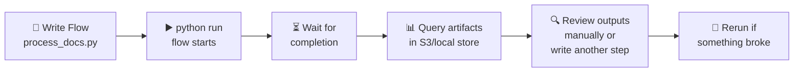
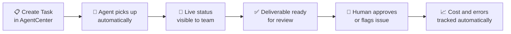

Metaflow is genuinely good software. Netflix built it to manage ML experiments at scale, open-sourced it, and a lot of ML teams rely on it daily. If you're building reproducible ML pipelines — feature engineering, model training, batch inference — Metaflow is a solid tool for the job.

But here's the question that comes up six months into a real agent deployment: "Can we use Metaflow to manage our AI agents?"

Teams try it. They write flows that wrap agent calls. They use `@step` decorators to chain agent outputs. And then they hit a wall — not because Metaflow is broken, but because ML pipeline orchestration and AI agent management are solving completely different problems.

## What Metaflow Does Well

Fair is fair — Metaflow does a lot of things right for ML teams:

- **Reproducible runs** — every execution is versioned, parameters are captured, and you can replay any past run without hunting through logs
- **Data artifact tracking** — outputs are stored and linked to the step that produced them, so you always know where data came from
- **Parallel step execution** — `@parallel` and `@foreach` let you fan out computation across resources without writing custom scheduling code
- **Cloud-native scaling** — runs on AWS Batch, Kubernetes, or locally with the same code
- **Experiment comparison** — you can compare multiple runs side by side to understand how changes affected outputs

For a data science team running experiments, this is exactly the workflow they need. Metaflow solves a real problem.

## The Core Limitation for Agent Teams

Metaflow thinks in steps and flows. You define a sequence — `start` → `process` → `end` — and Metaflow executes it, tracks it, and stores the result.

AI agents don't work that way.

An agent is an ongoing worker. It picks up tasks, makes decisions dynamically, might run for 30 seconds or 3 hours, and produces outputs that someone on your team needs to review before anything happens next. It can get stuck. It can fail halfway through. It can produce output that looks correct but isn't.

When teams try to run agents through Metaflow, here's what they run into:

**No real-time agent visibility.** Metaflow tells you whether a flow completed. It doesn't tell you that agent-4 has been stuck on the same document for 90 minutes and someone should check on it. There's no status layer for the agents themselves.

**No task management.** You can't assign a specific piece of work to a specific agent, set priority, add a comment, or mark something as blocked. Metaflow runs pipelines — it doesn't manage work.

**No team coordination.** When an agent produces a draft your team needs to review, Metaflow has nowhere for that review to happen. You end up back in Slack, with the actual coordination happening outside the tool.

**No LLM cost tracking per task.** Metaflow tracks compute resources for steps. It doesn't know about token costs. If you're running 20 agents making thousands of LLM calls per day, you need per-task cost visibility to understand what's actually expensive — not just which EC2 instance ran the step.

**No agent-level error patterns.** You can see that a flow failed. You can't see that one agent has a 35% error rate on a specific type of task while others are running fine. [Agent monitoring](/features/agent-monitoring) at that level of granularity requires something purpose-built for agents.

## AgentCenter vs Metaflow — Head to Head

| Feature | Metaflow | AgentCenter |
|---|---|---|
| Primary use case | ML pipeline orchestration | AI agent management |
| Real-time agent status | No | Yes — online, working, idle, blocked |
| Task assignment to agents | No | Yes |
| Visual task board | No | Yes — Kanban view |
| Team @mentions per task | No | Yes — threaded discussion per task |
| Deliverable review/approval | No | Yes |
| LLM token cost tracking | No | Yes — per task, per agent |
| Agent error rate monitoring | No | Yes |
| Multi-agent coordination | No | Yes — cross-agent dependencies |
| OpenClaw compatibility | No | Yes |
| Pricing | Free (plus infra costs) | $14/mo Starter, $29 Pro, $79 Scale |
| 7-day free trial | N/A | Yes, on all monthly plans |

## Two Different Workflows

Here's how the same task — process a batch of documents with an AI agent — looks in each tool.

**The Metaflow way:**

The flow runs. You wait. You check artifacts. If something went wrong, you rerun or add debugging steps. If a human needs to review the output, you build that coordination separately — a Slack notification, a spreadsheet, an email. Metaflow doesn't know about any of that.

**The AgentCenter way:**

The task is created, the agent picks it up, your team can see status in real time on the [agent dashboard](/features/agent-dashboard), and when the output is ready, there's a built-in review step. No glue code. No secondary tools for the coordination layer.

The difference isn't capability — Metaflow is doing exactly what it's built for. The issue is that agent management needs a different abstraction than ML pipeline orchestration.

## What Teams Actually Do

Most teams that land on this comparison aren't choosing between Metaflow and AgentCenter as direct competitors. They're asking whether Metaflow can stretch to cover agent management so they don't need to adopt something new.

The honest answer: it can stretch a little, but you'll spend significant engineering time building what should already exist — status APIs, task queues, review workflows, cost dashboards. That time usually comes back as maintenance debt six months later.

The pattern that works: keep Metaflow for what it's good at (reproducible batch ML jobs, experiment tracking, data artifact versioning) and use AgentCenter for the agent layer. They don't conflict. Metaflow handles your data pipelines. AgentCenter handles the [task orchestration](/features/task-orchestration) and visibility for the agents that operate on those pipelines.

## Can You Use Both?

Yes — and for certain teams, that's the right setup.

If you run both data science workflows and AI agents, Metaflow and AgentCenter cover different layers. Metaflow manages your batch ML jobs, experiment runs, and data transformations. AgentCenter manages the agents operating on top of that data.

Where it doesn't work: using Metaflow as a *replacement* for agent management. When teams try this, they end up writing custom flow steps for task tracking, building monitoring in notebooks, and debugging agent failures by tailing logs. The visibility you need doesn't exist because Metaflow was never designed to provide it.

If you're evaluating what to pay for, check the [pricing page](/pricing) — AgentCenter's Starter plan at $14/month covers teams running up to 5 agents, which is a reasonable starting point before you've figured out how many you actually need.

## Bottom Line

Metaflow is a well-designed tool for ML pipeline orchestration. If that's what your team does, it's worth using. But AI agent management is a different problem — closer to operations and task coordination than pipeline execution.

AgentCenter is built for that layer: the control plane between your team and your agents.

---

*Metaflow is good at what it does. AgentCenter does something different — it manages your agents, not just runs your code. [Start your 7-day free trial](/pricing) — no lock-in.*
