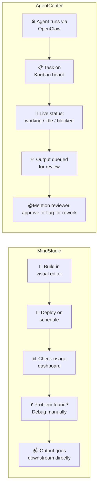

MindStudio is a genuinely useful tool if you want to ship an AI-powered app without writing code. You pick a template, wire up some logic, and you have something running in a browser within an afternoon. That's real value, and it's not what AgentCenter does.

The question most teams don't ask until too late is: what happens three months after you built the first agent? When that one app has turned into four agents, your team has doubled, and someone is asking why the research agent hasn't produced a report in two days.

That's where MindStudio and AgentCenter stop doing the same job.

## What MindStudio Does Well

MindStudio is built for the creation phase. If your goal is going from "we need an AI tool" to a working prototype without pulling in engineering, it's one of the faster options available.

- **Visual no-code editor**: Drag-and-drop workflow builder. No programming required.
- **Template library**: Pre-built starting points for customer support bots, content generators, research assistants, and more.
- **Multi-model support**: Works with OpenAI, Anthropic Claude, Google Gemini, and other providers.
- **App publishing**: Deploy your AI tool as a web app, embed it in a webpage, or share via direct link.
- **Prompt management**: Visual editor for building and iterating on prompts without touching code.
- **API integrations**: Connect to external data sources and webhooks to feed your agents live data.

If you want a chatbot running on your support page by end of week, MindStudio gets you there. Same with internal tools that don't need a developer to set up.

## Where It Falls Short for Teams Running Agents in Production

MindStudio is optimized for the build phase. Once your agents are live and need to run reliably, week after week, with real stakes, the tool starts to show its limits.

When you have 5 or 10 agents running across multiple projects, you need different answers than when you were building. Which agent is working right now? Which task is stuck or blocked? Which agent cost you $80 this month vs $8?

MindStudio doesn't answer those questions directly. There's no task board showing agent status across your whole fleet. There's no per-task cost breakdown tied to individual outputs. There's no way to @mention a teammate on a blocked task or route an agent's output to a reviewer before it goes downstream.

You end up back in Slack, asking someone to log in and check what happened. With one agent, that's fine. With ten, it breaks down.

Cost visibility is another real gap. MindStudio shows aggregate model usage, but it doesn't tie a specific cost to a specific task or agent run. If one of your agents starts making twice as many API calls because a prompt changed, you'll see the total bill go up but won't know which agent caused it without building your own tracking layer.

The other gap is output review. MindStudio sends outputs wherever you configured them to go. There's no built-in gate where a human can check an output, flag it for rework, or approve it before it touches a customer or downstream system. Teams doing anything compliance-adjacent tend to bolt on review steps manually, which creates its own mess.

## AgentCenter vs MindStudio: Side by Side

| Feature | MindStudio | AgentCenter |
|---|---|---|
| Primary purpose | Build no-code AI apps | Manage AI agents in production |
| Agent status monitoring | Basic usage metrics | Real-time per-agent status: online, idle, blocked, working |
| Task orchestration | Single-flow automation | Multi-agent Kanban boards with task dependencies |
| Deliverable review | Not built in | Structured approval workflow per task output |
| Cost tracking | Aggregate model usage | Per-task and per-agent cost breakdown |
| @Mentions and threads | None | Task-level chat threads with @mentions |
| Recurring tasks | Basic scheduling | Full recurring task automation (Pro+) |
| Multi-agent coordination | Sequential steps in one flow | Cross-agent task handoffs with live status |
| Agent runtime | MindStudio-hosted | OpenClaw-compatible (Anthropic, OpenAI, Gemini) |
| Pricing | Free / Pro ~$25/mo | $14/mo Starter, $29/mo Pro, $79/mo Scale |
| Best for | Non-technical builders, prototypes | Dev and ops teams running agents in production |

## How the Workflow Actually Differs

Here's the same scenario in both tools. Your team runs a research agent that monitors competitor pricing daily and produces a summary for review before it goes to sales.

**MindStudio path:**
1. You build the agent in the visual editor and set it to run daily.
2. It runs. You get usage stats in the dashboard.
3. If something breaks, you find out when someone tells you the report didn't arrive.
4. You dig through logs, figure out what failed, and fix it.
5. The output goes directly to wherever you pointed it, with no review step.

**AgentCenter path:**
1. The agent runs on your OpenClaw setup on the same daily schedule.
2. Each run creates a task on the team's Kanban board with real-time status.
3. Everyone can see whether the agent is working, idle, or stuck without logging into anything separately.
4. When the output is ready, it goes into a review queue instead of directly to sales.
5. A reviewer gets @mentioned, checks the output, approves it or sends it back with a note.
6. Every run is logged: how long it took, what it cost, what the output was.

The time-to-awareness gap is the real cost difference. In MindStudio, you learn about a problem when someone downstream notices it's missing. In AgentCenter, you see the agent status change to blocked and can act before the output is expected. That's the difference between proactive and reactive operations.

## Can You Use Both?

Yes, and some teams do.

MindStudio works well for AI tools that non-technical teammates need without engineering help. Customer-facing chatbots, internal content tools, quick prototypes for product experiments. When the use case is lightweight and the stakes are low, MindStudio's simplicity is the point.

AgentCenter is what teams reach for when their core agent workflows need visibility and accountability. When you want a named owner per agent, a cost number per task, and a review step before output leaves the system, you need a control plane.

Teams often start with MindStudio for the first agent. Then they add AgentCenter when the fleet grows and "I'll check the dashboard later" stops being good enough to manage risk.

## Bottom Line

MindStudio is the right tool for building AI apps quickly, especially without a developer. AgentCenter is the right tool for running AI agents in production, especially when the team needs real-time status, cost control, and output review built in.

If you're running more than a couple of agents and you can't answer "which one is failing right now" without logging into each app individually, you're missing a control plane. That gap gets expensive as you scale.

Check out [AgentCenter's agent monitoring features](/features/agent-monitoring) to see what production visibility looks like in practice. When you're ready, [pricing starts at $14/month](/pricing).

---

*MindStudio is good at what it does. AgentCenter does something different — it manages your agents, not just builds them. [Start your 7-day free trial](/pricing) — no lock-in.*
