The phrase "mission control" is doing a lot of work in the AI agent space right now. Both AgentCenter and Mission Control HQ use some version of it. Both want to be the place your team goes to understand what's happening across your agents. That's where the similarity ends.

This isn't a "one is obviously better" post. Mission Control HQ has real users for real reasons. What I want to do is help you figure out which one fits where your team actually is right now — and where you're headed.

## What Mission Control HQ Does Well

If you want a dashboard for your AI agents and you don't want to spend a week setting it up, Mission Control HQ makes a reasonable case for itself. The onboarding is fast. You connect your agents, and you get a clear status view without a lot of configuration.

Teams tend to pick it for:

- **Quick setup.** You can be watching agent status within an hour of signing up. There's no infrastructure change required on your agent side.
- **Clean visibility.** The status view tells you which agents are running, idle, or erroring. For teams just starting to move past guesswork, that's genuinely useful.
- **Low learning curve.** Non-engineers can open the dashboard and understand what they're looking at. That's not trivial.
- **Basic task assignment.** You can point agents at work and see the output. It's enough to get started.

If you're running two or three agents and the main question is "are they up?", Mission Control HQ can answer that.

## Where It Breaks Down

The problem shows up the moment an agent completes a task and that output needs to go somewhere.

An agent finishes a research brief. A human needs to review it before the writing agent picks it up. The reviewer isn't sure if the output is good enough to pass. Nobody has a clear way to flag it in the same place they saw the result. Someone sends a Slack message. Another person picks it up late. The writing agent runs on stale input.

Mission Control HQ shows you that the research task completed. It doesn't give you a way to manage what happens between completion and the next step.

That gap compounds. We ran a count with one team that had 12 agents across 4 projects. By month two, they were spending about 6 hours a week just coordinating handoffs — Slack, email, manual triggers. The agents were doing their jobs. The coordination wasn't.

[AgentCenter's task orchestration features](/features/task-orchestration) are built around exactly this problem. Tasks move through explicit stages. When an agent submits a deliverable, the next step doesn't start until a reviewer approves it. The full chain — what the agent produced, who reviewed it, what feedback was given, when it moved — lives in the task thread. No Slack. No memory required.

## Head to Head

| | Mission Control HQ | AgentCenter |
|---|---|---|
| Real-time agent status | Yes | Yes |
| Kanban task management | Basic | Full — WIP limits, priorities, due dates |
| @Mentions and task threads | No | Yes |
| Deliverable review and approval | No | Yes |
| Multi-agent workflow coordination | Basic | Full — parent-child tasks, dependencies |
| Per-task cost tracking | No | Yes |
| Recurring task automation | No | Yes (Pro+ and above) |
| Cloud VM provisioning | No | Yes (Scale plan) |
| OpenClaw agent integration | Third-party | Native |
| Agent performance monitoring | Basic | Full — cost, errors, latency per agent |
| Pricing | Contact for pricing | $14–$79/mo, 7-day free trial |

## The Workflow Difference

A research-to-report pipeline: a research agent gathers data, a writing agent drafts, a human reviews, a publish agent puts it live. Here's how that runs on each platform.

```mermaid
graph TD
    subgraph "Mission Control HQ"
        A1["🔍 Research agent<br/>completes"] --> B1["📊 Status: Done<br/>in dashboard"]
        B1 --> C1["📩 Slack message<br/>to reviewer"]
        C1 --> D1["👁️ Reviewer finds<br/>output manually"]
        D1 --> E1["✍️ Writing agent<br/>triggered manually"]
    end

    subgraph "AgentCenter"
        A2["🔍 Research agent<br/>submits deliverable"] --> B2["📋 Review gate<br/>opens automatically"]
        B2 --> C2["🔔 Reviewer @mentioned<br/>in task thread"]
        C2 --> D2["✅ Approved with<br/>inline feedback"]
        D2 --> E2["✍️ Writing agent<br/>auto-queued"]
        E2 --> F2["📊 Full cost +<br/>timeline tracked"]
    end
```

**Mission Control HQ:**
1. Research agent finishes — you see it in the dashboard.
2. You go to Slack to tell someone it's ready.
3. They find the output somewhere (a file, an email, a shared doc).
4. They manually trigger the next agent.
5. No record of whether the output was reviewed before it went downstream.

**AgentCenter:**
1. Research agent submits output — task moves to review automatically.
2. Reviewer gets @mentioned directly in the task thread.
3. They approve or leave comments in the same place.
4. Writing agent picks up once the output clears the review gate.
5. Cost, timing, reviewer name, and feedback are all in the task record.

At two agents, the difference is minor. At 15 agents across 5 projects, the AgentCenter path is the one that doesn't require a dedicated coordination person.

## Can You Use Both?

Probably not in a way that helps you. Both tools want to be your central view of agent activity. If your team is checking two dashboards, one of them becomes the real one and the other gets ignored — or worse, you get conflicting status signals and nobody knows which one is accurate.

The only case where running both makes sense: you're already deeply invested in Mission Control HQ for something specific it handles well, and you want to layer AgentCenter on top for deliverable review and task coordination. That's a real scenario, but it's not a common one.

If you're evaluating both from scratch, pick the one that fits where your team is going, not just where it is today. The [compare page for Mission Control HQ](/compare/vs-mission-control-hq) breaks down the feature difference in more detail.

## What the Pricing Tells You

AgentCenter's three plans — Starter at $14/mo for up to 5 agents, Pro at $29/mo for up to 15, Scale at $79/mo for up to 50 — are priced around the idea that teams grow their agent fleets and need more coordination features as they do. The [full pricing breakdown is here](/pricing) if you want to see what each plan includes.

Mission Control HQ doesn't publish pricing. That makes it hard to evaluate on cost alone. If budget is a constraint, that matters.

## Bottom Line

Mission Control HQ gives you visibility into what your agents are doing. AgentCenter gives you control over what they produce and what happens after they produce it. If you're at the "are the agents running?" stage, either tool can help. If you're at the "are the agents producing reviewable work that moves through a real process?" stage, they're different tools for different needs.

Most teams hit the second question sooner than they expect.

---

*Mission Control HQ is good for watching agents. AgentCenter is for managing what they actually deliver. [Start your 7-day free trial](/pricing) — no lock-in.*
