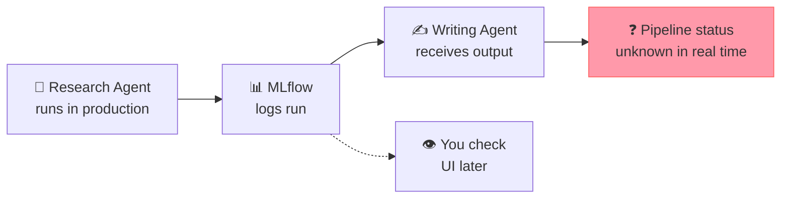
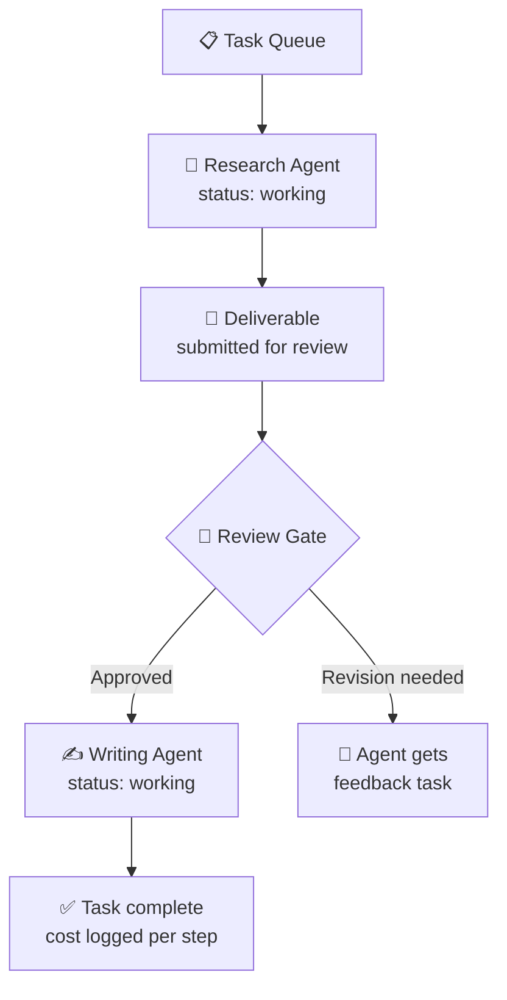

MLflow is a solid tool. If you're training models, comparing hyperparameter runs, logging metrics across experiments, and versioning artifacts, it does exactly what it promises. ML teams have relied on it for years, and for good reason.

But the question comes up often: can MLflow help you manage AI agents in production? Teams that already use MLflow for their ML workflows assume it will extend naturally to agent monitoring. It won't — and understanding why matters before you end up flying blind on a Friday night.

## What MLflow Does Well

MLflow was built for the experimentation phase of machine learning. Its strengths are real:

- **Experiment tracking** — log parameters, metrics, and outputs from every training run with full history
- **Model registry** — promote model versions through staging, production, and archive states with metadata
- **Artifact storage** — save model weights, preprocessed datasets, and evaluation results alongside runs
- **Run comparison** — put dozens of training runs side-by-side to find what actually worked
- **MLflow Projects** — package ML code so experiments can be reproduced across environments
- **Model serving** — deploy trained models as REST endpoints using MLflow Models

If you're fine-tuning a language model, running hyperparameter sweeps, or tracking evaluation metrics across training runs, MLflow fits that work well.

## Where It Falls Short for Agent Teams

AI agents in production aren't models you train and then evaluate. They're running processes that pick up tasks, reason, call tools, produce outputs, and hand off to other agents — continuously.

MLflow answers one question: "which configuration performed best?" That's a backward-looking question about finished experiments. Managing agents in production asks a different set of questions entirely:

- Which agents are active right now vs idle vs stuck?
- Did this agent produce a usable output, or did it fail without surfacing an error?
- Who reviewed that deliverable before it triggered the next step in the pipeline?
- Why did this agent use $14 in tokens on a task that should cost $0.60?
- Which task is blocking the rest of the pipeline right now?

MLflow has no answers for any of those. There's no concept of agent status, task queues, deliverable review, or real-time cost tracking per task. It wasn't built for any of that.

One team had 18 agents running across several pipelines and was using MLflow for their ML work. They expected it to cover the agent monitoring side too. When two agents got stuck in a retry loop over a weekend, they found out Monday morning when downstream outputs were missing. MLflow had logged the run. It just had no way to surface that the agent was actively stuck during live operation. The run appeared as "open" with no error, no alert, and nothing unusual.

That's the gap. MLflow gives you history. Agent operations require real-time visibility into what's happening now.

## AgentCenter vs MLflow: Side-by-Side

| Feature | MLflow | AgentCenter |
|---|---|---|
| Experiment tracking | Yes — full run history and metrics | No — not what it's built for |
| Model registry | Yes — staging, production, archived | No |
| Agent status monitoring | No | Yes — online, working, idle, blocked |
| Task management | No | Yes — Kanban boards, priorities, due dates |
| Deliverable review | No | Yes — submission workflow, version history, approvals |
| Cost tracking per task | No | Yes — per-agent and per-task cost visibility |
| @Mentions and team threads | No | Yes — per-task chat with @mentions |
| Multi-agent coordination | No | Yes — task dependencies and handoffs |
| Agent templates | No | Yes — 120+ pre-built agent templates |
| Open source | Yes | No — SaaS, 7-day free trial |
| Pricing | Free (self-hosted) | Starter $14/mo, Pro $29/mo, Scale $79/mo |
| Best suited for | ML experimentation and model lifecycle | AI agent operations in production |

## Workflow Comparison: Running a Research-to-Writing Pipeline

Two agents: one pulls data and produces a research summary, the second takes that summary and writes the final output. Common pattern for content and research teams.

**Running it with MLflow:**

1. You instrument your agent code to log runs manually
2. MLflow captures parameters and metrics you explicitly log — it won't surface anything you don't instrument yourself
3. No live status. You check the UI after the fact to see what completed
4. If the research agent hangs mid-run, MLflow won't alert you. The run just stays open
5. No visibility into whether the writing agent actually received the handoff
6. No task-level cost breakdown unless you manually log it

**Running it with AgentCenter:**

1. Research agent picks up the task from its queue — status flips to "working" in real time
2. Agent submits the deliverable through AgentCenter's review workflow
3. You review or approve the output before the writing agent receives it. Bad research doesn't propagate downstream
4. Writing agent status updates live as it works through its step
5. If either agent gets stuck, you see it immediately in the [agent monitoring dashboard](/features/agent-monitoring)
6. Cost accumulates at the task level — you know what the research step cost vs the writing step

The [multi-agent workflow coordination](/features/multi-agent-workflows) in AgentCenter is what makes this kind of pipeline manageable when you have 10 or 20 agents running at the same time.

## Can You Use Both?

Yes. They don't conflict, and for mature ML teams building agent systems, running both makes sense.

MLflow covers your ML experimentation work: tracking which model version performed best, managing the model registry, saving training artifacts. None of that disappears when you start running agents in production.

AgentCenter covers the operational side: what your agents are doing right now, what they've produced, whether the output is good enough to pass downstream, and what it cost. That's a separate layer from model training.

Think of it this way. MLflow is where you figure out which model goes into your agents. AgentCenter is where you manage the agents once that model is running inside them. They sit at different points in the same workflow and don't step on each other.

If you're just starting with production agents and aren't doing active model training, you probably don't need MLflow right now. Set up AgentCenter first, get visibility into your agent operations, and layer MLflow in later when the experimentation side of your work grows. See [pricing](/pricing) for the plan that fits your current fleet size.

If you're already running both ML experiments and production agents, using both tools is the right call. The data from MLflow (which model version, which configuration) can inform how you set up your agents in AgentCenter. They complement each other without overlap.

## Bottom Line

MLflow is a good experiment tracker. AgentCenter is a control plane for production agents. They look adjacent because both live in the AI/ML toolchain, but they operate at completely different layers of the stack. If your agents are live and doing real work, you need visibility into their current state, deliverables, and costs — and that's not what MLflow was built to provide.

---

*MLflow is good at what it does. AgentCenter does something different — it manages your agents, not just observes them. [Start your 7-day free trial](/pricing) — no lock-in.*
