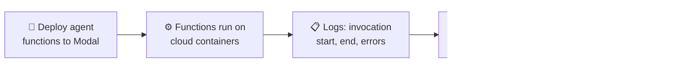
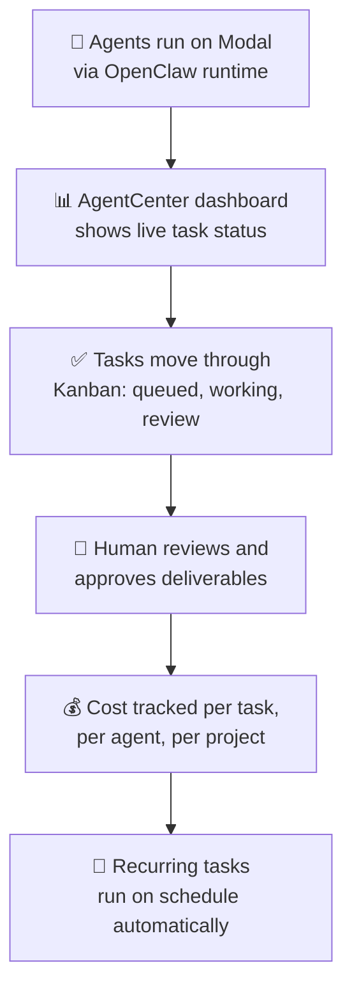

Modal is one of the strongest tools available for running Python functions in the cloud. If you need serverless GPU compute, fast cold starts, and clean deployment for ML workloads, it delivers. A lot of AI teams run their agent code on Modal and it genuinely works.

But here's the question teams hit eventually: after your agents are running, then what?

You get logs. You get function invocations. You see whether your code ran or crashed. What you don't get is a picture of what your agents are actually doing — which tasks they're on, whether the outputs are any good, what each agent is costing you per task, and who reviews deliverables before they go anywhere.

That's not Modal's job. Modal is compute infrastructure. Managing agents in production is a different problem.

## What Modal Does Well

Modal is genuinely strong at the infrastructure layer:

- **Fast, cold-start-optimized containers** — Python functions spin up in seconds, even with heavy GPU dependencies
- **Serverless scaling** — runs zero resources when idle, scales automatically without manual server management
- **Clean Python API** — decorate a function, it runs in the cloud. No YAML, no Kubernetes config.
- **GPU and CPU scheduling** — mix instance types without provisioning servers
- **Web endpoints and scheduled jobs** — expose agent functions as HTTP endpoints or cron jobs with a few lines of code
- **Container image caching** — images build once and cache, so repeated deployments are fast
- **Volume mounts** — persistent storage for agent checkpoints and intermediate files

Teams building agent pipelines often use Modal to handle the compute side. The agent code has to run somewhere, and Modal is a solid answer to that question.

## The Core Limitation for Teams Managing AI Agents

Modal tells you whether your code ran. It doesn't tell you what your agent did.

Those are different things. After you've deployed 8 or 10 agents on Modal, you'll find yourself asking questions that function logs can't answer:

- Which agent is working on which task right now?
- Why did agent #4 stall for 40 minutes yesterday afternoon?
- Who needs to review the output before it goes to a client?
- How much did the research agent cost across 300 tasks last week?
- When agent B depends on agent A finishing first, how do you coordinate the handoff?
- If an agent produces bad output at 2am, who finds out?

Modal gives you function-level observability: start time, end time, exit code, stdout. What you need for managing agents in production is task-level visibility, coordination between agents, cost tracking per task, and a review layer before outputs matter.

Those aren't infrastructure problems. They're management problems. Infrastructure tools don't solve them because they were never designed to.

## AgentCenter vs Modal: Side-by-Side

| Capability | Modal | AgentCenter |
|---|---|---|
| Serverless compute | Yes (GPU/CPU, fast cold starts) | No: AgentCenter is a dashboard, not compute |
| Agent task tracking | No | Yes — Kanban board with full task history |
| Real-time agent status | Function logs only | Online, working, idle, blocked — live updates |
| Cost tracking per task | No | Yes — per agent, per task, per project |
| Multi-agent coordination | Manual code logic | Built-in task orchestration |
| Deliverable review and approval | No | Yes — approval gates before output ships |
| Task threads and @mentions | No | Yes — per task |
| Recurring task automation | Via cron schedules | Built-in (Pro plan and above) |
| Human-in-the-loop gates | Custom code only | Built-in approval workflows |
| Agent analytics and activity feed | No | Yes — across all agents and projects |
| Starting price | Pay-per-second compute | $14/month (5 agents, 3 projects) |
| Best for | Running agent code at scale | Managing what agents do in production |

See [AgentCenter's full feature set](/features) and [pricing plans](/pricing) for details.

## Workflow Comparison

Here's how the two approaches look when you have five agents running a research-to-report pipeline.

### Running agents on Modal alone

You know your agents ran. You don't know what they accomplished, what it cost, or whether the outputs were usable.

### Running agents on Modal with AgentCenter alongside

The Modal side handles execution. The AgentCenter side handles everything around execution: what got done, by whom, at what cost, and whether it's good enough to ship.

### Step-by-step: their way vs AgentCenter way

**Modal alone:**

1. Write agent as a Python function, add Modal decorator
2. Deploy — function is available in the cloud
3. Trigger runs manually or via cron
4. Check logs if something looks off
5. No task history, no cost per run, no review step

**Modal + AgentCenter:**

1. Agents connect to AgentCenter through the OpenClaw runtime
2. Tasks are created in AgentCenter — assigned to agents, tracked on a Kanban board
3. Agent picks up its task, updates status in real time as it works
4. Deliverable is submitted for review — a human approves before it goes anywhere
5. Cost, timing, and output are logged per task, not just per function invocation
6. Recurring tasks trigger automatically on the schedule you set

The difference isn't about where the code runs. It's about what surrounds the code.

## Can You Use Both?

Yes, and teams commonly do. They serve different layers.

Modal runs your agent code. AgentCenter tracks what that code is doing in terms of tasks, outputs, and costs. Your agents connect to AgentCenter through the OpenClaw runtime, which handles task assignment, status updates, and deliverable submission. Where those agents execute — Modal, a VPS, AgentCenter's own cloud VMs on the Scale plan — is separate from the management layer.

If your agents already run on Modal and you add AgentCenter, you get task visibility and coordination layered on top of compute you already have. You don't need to migrate anything. You wire your agents to the OpenClaw runtime, and AgentCenter picks them up.

If you're on AgentCenter's Scale plan, you also get cloud VM provisioning built in. But if Modal already handles your GPU scheduling or you have existing pipelines there, keep using it. The two don't compete — Modal is a better compute layer than any general-purpose VM, and AgentCenter is a better management layer than any logging tool.

## Bottom Line

Modal is a compute platform that runs serverless Python workloads well. AgentCenter is a management dashboard for AI agents running in production. They solve different problems at different layers of the stack. Teams that run agents on Modal and manage them through AgentCenter don't have to choose.

If you're running agents today and your only visibility into them is function logs, that gap gets expensive fast. Cost overruns hide in it. Output failures hide in it. Agents that stall at 3am hide in it.

---

*Modal is good at what it does. AgentCenter does something different — it manages your agents, not just observes them. [Start your 7-day free trial](/pricing) — no lock-in.*
