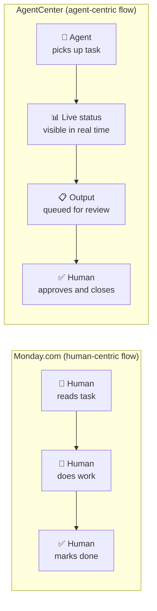

Monday.com is a genuinely good tool. If you have a team of people, projects to coordinate, and tasks to assign, it works well. The boards are visual, due dates are easy to track, and the automation between human-driven steps is solid.

But more teams are hitting the same question in 2026: what happens when the things doing the work are AI agents?

That's where Monday.com breaks down. Not because it's a bad product — it's a great product for human teams. The problem is that it was built for a world where a person reads a task, decides what to do, and checks a box when done. Agents don't work that way. They're running in the background, consuming tokens, hitting errors, producing output that needs review, and sometimes quietly failing without telling anyone.

Monday.com has no answer for any of that.

## What Monday.com Does Well

Before getting into the limitations, it's worth being specific about where Monday.com is genuinely strong:

- **Visual project boards** — kanban, gantt, timeline, and calendar views. Clear for humans to navigate.
- **Task assignment** — trivial to assign work, set deadlines, and send reminders to teammates.
- **Team collaboration** — comments, @mentions, file attachments, and status updates from people.
- **Automation recipes** — trigger-based workflows like "when status changes to Done, notify this person."
- **Integrations** — connects to Slack, Jira, GitHub, Google Workspace, Salesforce, and hundreds more.
- **Dashboards and reporting** — workload tracking, project velocity, deadline health across boards.

For teams shipping software, coordinating marketing campaigns, or running engineering sprints, Monday is a solid choice. That's not the use case we're comparing against.

## The Core Limitation for AI Agent Teams

When you introduce AI agents into the picture, three problems surface that Monday.com can't address.

**Agents don't self-update task status.**

A human finishes a task and marks it done. An agent completes a task and nothing changes in Monday.com. To get any visibility, you'd need to build a custom integration to push status updates from your agent runtime into Monday boards — and then maintain that integration every time your agent or pipeline changes.

**Monday.com has no visibility into what agents are actually doing.**

It shows you a card. It doesn't tell you whether the agent behind that card is actively processing, waiting on a tool call, throwing errors, or stuck in a loop. There's no live status. No token cost. No error log. No latency tracking. You're making decisions based on a card title that says "Working" because a human put it there.

**There's no structured way to review agent output.**

When an agent finishes, a human usually needs to check the output before it ships. In Monday, you'd copy-paste the output into a comment, someone reviews it in Slack or email, and then manually updates the board. That's not a workflow — it's duct tape.

AgentCenter was built specifically for teams where agents are doing the work. You see live status for every agent right now, what it's producing, whether it's healthy, and exactly what it costs per task.

## AgentCenter vs Monday.com: Side-by-Side

| Feature | AgentCenter | Monday.com |
|---|---|---|
| Real-time agent status | Yes — online, working, idle, blocked | No |
| Task assignment to agents | Built-in, native | Requires custom integration |
| Live cost tracking per task | Yes — token usage per agent, per task | No |
| Deliverable review workflow | Built-in approval queue | Manual copy-paste |
| Error detection and alerts | Native error monitoring | No |
| Agent performance metrics | Latency, success rate, cost trends | No |
| Multi-agent task orchestration | Coordinates tasks across agents | Not supported |
| Recurring agent task automation | Yes (Pro+) | Yes (for humans) |
| Pricing | From $14/mo — 5 agents, 3 projects | From $9/seat/mo — human seats |
| Designed for | AI agent workflows | Human project management |

## How the Workflow Actually Differs

**Managing an AI agent task in Monday.com:**

1. Create a task card and describe what the agent should do.
2. Build a custom integration so the agent can pull tasks from Monday's API.
3. Build another integration to push status updates back when the agent finishes.
4. Agent completes the task. Output is in your agent runtime — not in Monday.
5. Manually copy output into a comment or attachment on the card.
6. Someone reviews it via Slack, email, or a Monday comment. No structured approval.
7. A person updates the card status manually. Or via yet another automation.

**Managing an AI agent task in AgentCenter:**

1. Create the task in AgentCenter and assign it to an agent.
2. Agent picks it up automatically. Status updates to "Working" in real time.
3. You see live progress: token cost, elapsed time, current step, any errors.
4. Task completes. Output lands in the deliverable review queue.
5. A reviewer approves or sends it back with notes — all inside AgentCenter.
6. Task closes. All data stays in one place: output, cost, latency, errors, history.

The practical difference is that AgentCenter works without any custom integration. Monday.com requires building and maintaining a bridge between your agent runtime and your task board — and that bridge breaks when either side changes.

## Can You Use Both?

Yes, and some teams do. If you have a mixed team where some tasks are done by people and some are done by agents, using Monday.com for human-owned work and AgentCenter for agent-owned work is a reasonable split. You track human work in Monday and agent work in AgentCenter without expecting one tool to cover both.

What doesn't work: using Monday.com as the single source of truth for agent workflows. You'll spend time writing glue code, lose visibility when agents fail, and do manual status syncs that break the moment anything changes on either side.

If you want to understand what native agent task management looks like before deciding, the [AgentCenter features page](/features) shows the full control plane — [agent monitoring](/features/agent-monitoring), task orchestration, deliverable review, and cost tracking in one dashboard.

## Bottom Line

Monday.com is a solid product for coordinating people and projects. It was not built for AI agents, and that becomes clear the moment you try to use it that way. If your team is running agents in production, you need something that tracks live agent status, cost, errors, and output review natively — without a custom integration layer in between. That's what AgentCenter is built to do. See [pricing](/pricing) to find the plan that fits your current agent count.

---

*Monday.com is good at what it does. AgentCenter does something different — it manages your agents, not just their task cards. [Start your 7-day free trial](/pricing) — no lock-in.*
