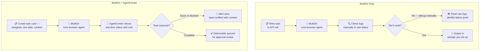

MultiOn is genuinely impressive technology. You give it a natural language instruction — "find and book the cheapest flight to NYC for next Tuesday" — and it navigates the web, fills forms, clicks buttons, and completes the task like a human would. That's a hard problem, and MultiOn solves a real piece of it.

But here's the question teams end up asking about six months after their first MultiOn deployment: how do you manage 15 of those browser agents running in parallel across different customer accounts? Which ones are stuck? Which ones just burned $40 in tokens chasing a broken page redirect? What's the approval flow when one of them attempts to submit a payment on a customer's behalf? Who owns that agent if the developer who built it leaves the team?

Those aren't MultiOn problems. MultiOn is a runtime — it runs browser agents. The questions above are control plane problems. And those two things are very different.

## What MultiOn Does Well

MultiOn is built around one thing: giving AI agents the ability to act on the web. If that's your need, it's one of the strongest options available:

- **Real browser control**: agents navigate actual websites, not just API surfaces
- **Natural language task instructions**: describe what you want in plain English, and the agent figures out the steps
- **Form filling and multi-step click sequences**: handles flows that would take days to hard-code as a scraper
- **Vision plus reasoning**: reads and interprets what's visually on screen, not just the DOM structure
- **API-first design**: drops into any agent stack as a capability layer
- **Handles dynamic pages**: works on JavaScript-heavy sites where traditional scraping fails

If your use case is "an AI agent needs to take an action on a website it wasn't specifically built for," MultiOn is a legitimate solution. Teams building research agents, procurement agents, or competitive intelligence agents often reach for it for good reason.

## The Core Limitation for Teams Managing AI Agents

MultiOn runs agents. It doesn't tell you what those agents are doing right now.

That gap is fine when you're running 2 or 3 browser agents in a prototype. It becomes a serious problem when you're running 20 agents across production workflows with real customers and real money involved.

At that scale, you need answers to questions like:

- Which agent is working, which is idle, and which has been stuck on the same page for 25 minutes?
- What task is each agent working on, and who assigned it?
- How much has each agent cost in tokens and compute this week?
- What output did the agent produce, and who is responsible for reviewing it before it goes to a customer?
- When one fails, what was the last step it completed — so you can resume from there instead of restarting from scratch?

MultiOn answers none of these. It hands you the capability to automate browser workflows. What you do with 20 agents running that capability is entirely your problem. Teams usually solve this with a mix of logging, status-check scripts, Slack messages asking "did agent 9 finish yet?", and a spreadsheet somewhere that nobody keeps current. That approach works until a major failure, an audit request, or the day your team grows past 3 people.

## AgentCenter vs MultiOn: Feature Comparison

| Feature | MultiOn | AgentCenter |
|---|---|---|
| Web browsing automation | Yes — core capability | No (runtime layer, not control plane) |
| Natural language task execution | Yes | Task cards with structured instructions |
| Real-time agent status | No | Yes — online, working, idle, blocked |
| Task assignment and ownership | No | Yes — Kanban with assignee and due date |
| Agent cost monitoring | No | Yes — per agent, per task, per period |
| Deliverable review and approval | No | Yes — built-in approval workflows |
| Multi-agent task coordination | Limited | Yes — dependencies and routing |
| Team communication per task | No | Yes — @Mentions, threaded comments |
| Error alerting | No | Yes — real-time error feed |
| Recurring task automation | No | Yes (Pro+) |
| Cloud VM provisioning | No | Yes (Scale plan) |
| Free trial | Usage-based API access | 7-day free trial |
| Pricing | API credits, usage-based | $14–$79/mo flat rate |

## Workflow Comparison: Running a Browser Agent in Production

Here's what managing a web automation agent actually looks like with each approach.

**MultiOn only:**

1. Write the task as an API call to MultiOn
2. Agent runs — you have no visibility unless you built your own logging around it
3. It finishes, fails, or stalls. You find out when you check, or when something downstream breaks
4. If it failed, you pull raw logs, trace where it stopped, fix the issue, and re-run from the beginning
5. If it succeeded, output sits in whatever storage you wired up — no review, no approval, no record of who looked at it

**MultiOn + AgentCenter:**

1. Create a task card — assignee, due date, and instructions visible to the whole team
2. Agent runs while AgentCenter tracks its status in real time
3. If it stalls, you get an alert with context on where it stopped
4. When it completes, the deliverable goes into an approval queue for a human to review
5. The right person approves it — no Slack threads asking "did you check that output?", no guessing

The second workflow doesn't replace MultiOn. It sits around it. MultiOn handles the browser execution layer; AgentCenter handles task management, visibility, cost tracking, and the approval chain your team actually needs.

## Can You Use Both?

Yes — and for teams doing serious web automation work, this is the right architecture.

MultiOn operates at the browser capability layer. AgentCenter operates at the team coordination layer. They don't overlap. MultiOn doesn't know your organization exists. AgentCenter is where your team plans, assigns, tracks, and reviews what your agents do.

In practice: you create a task in AgentCenter, assign it to the relevant agent, and the agent uses MultiOn's API to carry out the browser work. AgentCenter sees the task status update in real time. When the agent finishes, the deliverable is reviewed in AgentCenter. If something goes wrong, AgentCenter surfaces the failure with enough context for the team to triage without digging through raw logs.

If you're a solo developer running 3 browser automations for your own projects, MultiOn alone is fine. Once you're coordinating multiple browser agents across a team, or you need to answer "what did our agents cost last month" or "which agent ran the purchase workflow for account X yesterday," you need a control plane alongside the runtime.

See how [agent monitoring](/features/agent-monitoring) and [multi-agent workflows](/features/multi-agent-workflows) fit together in AgentCenter if you want to understand what that layer looks like in practice.

## Bottom Line

MultiOn is a browser automation API. A good one. AgentCenter is a management layer for teams running agents in production — including agents that use MultiOn to act on the web.

You don't pick one over the other. You use MultiOn to give your agents web capabilities, and AgentCenter to manage what those agents do, what they cost, who owns them, and whether they're actually working.

---

*MultiOn is good at what it does. AgentCenter does something different — it manages your agents, not just runs them. [Start your 7-day free trial](/pricing) — no lock-in.*
