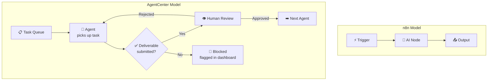

n8n is genuinely good at what it does. If you need to wire together APIs, trigger webhooks on schedule, and move data between services, n8n gets you there fast. It's low-code, self-hostable, and has a massive node library. A lot of teams reach for it when they start automating things.

The problem comes when those "things" are AI agents. Not static API calls. Not deterministic scripts. Actual agents that run for minutes or hours, make decisions, produce deliverables, and sometimes fail in ways you can't predict from a workflow diagram.

That's where n8n hits its ceiling.

## What n8n Does Well

- Visual workflow builder that non-engineers can use
- Hundreds of pre-built integrations (Slack, Notion, GitHub, etc.)
- Self-hosting on your own infrastructure
- Cron scheduling for repeating automations
- Good for linear, predictable workflows where each step has a known input and output

If your automation looks like "when X happens, call API Y, transform the data, send to Z," n8n is fine. Great, even.

## The Core Limitation for AI Agent Teams

n8n treats AI calls as nodes in a workflow. One input, one output, done. But real agents aren't nodes. They're persistent processes that run over time, check their own queue, ask for clarification, retry on failure, and hand off work to other agents.

With n8n, there's no concept of an agent being "blocked" because it needs human input. No way to see that agent #3 has been spinning for 45 minutes on a bad prompt. No review step where a human approves a deliverable before the next agent starts. No @mentions when something needs attention.

We had a team running research agents through n8n workflows. The workflow completed successfully every time. The agents were producing garbage. Nobody knew for three weeks because there was no deliverable review layer.

## Comparison Table

| Feature                         | n8n                              | AgentCenter                             |
| ------------------------------- | -------------------------------- | --------------------------------------- |
| Visual workflow builder         | Yes                              | Kanban board                            |
| Self-hosting                    | Yes (core product)               | Yes (available)                         |
| AI agent status monitoring      | No                               | Real-time (online/working/idle/blocked) |
| Deliverable review and approval | No                               | Yes, with version history               |
| Agent @mentions and chat        | No                               | Yes                                     |
| Multi-agent coordination        | Limited (chained nodes)          | Yes, with task orchestration            |
| Cost tracking per task          | No                               | Yes                                     |
| Error detection for agents      | Workflow-level only              | Per-agent with alerts                   |
| Recurring task automation       | Yes                              | Yes (Pro+)                              |
| Pricing                         | Free self-hosted, ~$20+/mo cloud | $14-79/mo                               |
| Max agents managed              | N/A (nodes)                      | 5-50 agents depending on plan           |
| Agent templates                 | No                               | 120+ pre-built templates                |

## Workflow Comparison

**Deploying a research agent pipeline in n8n:**

1. Build trigger node
2. Add AI call node with prompt
3. Connect to output/transform node
4. Test by running workflow manually
5. If agent fails, inspect workflow logs
6. Re-run entire workflow from scratch

**Deploying the same pipeline in AgentCenter:**

1. Create project, add task with brief
2. Assign to research agent from template library
3. Agent picks up task, starts working
4. Check real-time status in dashboard
5. Agent submits deliverable for review
6. Approve or send back with feedback
7. Next agent in pipeline picks up automatically

The difference isn't just UX. It's a fundamentally different model: n8n is event-driven automation. AgentCenter is agent coordination.

## Can You Use Both?

Yes, and some teams do. n8n handles the integrations layer — pulling data from third-party APIs, formatting inputs, routing outputs to downstream systems. AgentCenter handles the agent layer — what agents do, how they're coordinated, and whether the work is any good.

If you're running AI agents that need human oversight on their outputs, AgentCenter is the piece n8n doesn't have. If you need cheap automation glue between services, n8n is fine for that.

## Bottom Line

n8n is a workflow automation tool that can call AI APIs. AgentCenter is built specifically to manage agents as entities that work over time. If your team is running agents that produce deliverables, get blocked, or need coordination across multiple models, n8n won't give you what you need.

The comparison isn't "which is better." It's "which problem are you actually solving."

_n8n is good at what it does. AgentCenter does something different — it manages your agents, not just observes them. [Start your 7-day free trial](/pricing) — no lock-in._
