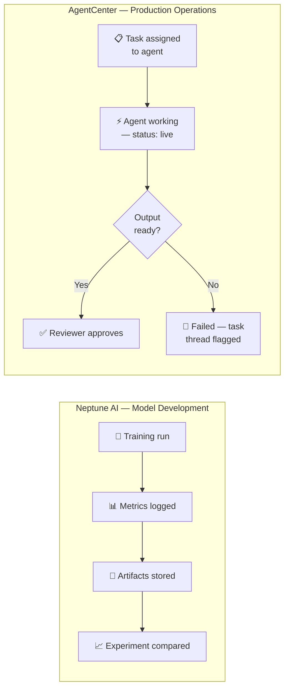

We'd been using Neptune AI for about six months when we added our first production agent. Neptune had all our training runs, hyperparameter logs, model artifacts, every experiment chart we'd ever generated. It was exactly what we'd needed for the research phase.

Then the agent shipped. It ran a research pipeline — pulled documents, summarized them, flagged anything over a confidence threshold, and routed results to a human reviewer. The first week went fine. The third week, it got stuck mid-run and nobody noticed for two days because Neptune had nothing to say about what an agent was doing in production.

That's when the difference became obvious.

## What Neptune AI Does Well

Neptune AI is a legitimate experiment tracking tool. Teams that are actively training models, running ablations, or managing model versions get real value from it:

- **Experiment logging**: Every run captures parameters, metrics, and outputs in one place
- **Model comparison**: Side-by-side diff of dozens of runs — learning curves, validation loss, accuracy over time
- **Artifact storage**: Checkpoints, plots, model files all attached to the run that produced them
- **Team collaboration**: Charts, notes, and notebooks shared and linked across a team
- **Framework integrations**: Works cleanly with PyTorch, TensorFlow, Keras, XGBoost, Scikit-learn, and others
- **Reproducibility**: Full run history means you can reconstruct exactly what produced a given result

If you're in a training loop — iterate, measure, compare, repeat — Neptune does this job well. It's purpose-built for that cycle and it doesn't try to be more than that.

## The Gap That Opens When Agents Run in Production

Agents aren't experiments. An experiment finishes. An agent runs continuously, picks up tasks, makes decisions, produces outputs, and hands them to people or other systems.

When a Neptune-tracked model gets deployed as an agent — or when that model powers a longer-running workflow — the experiment tracking layer stops being relevant. The questions change completely:

- Which agent is working on what task right now?
- Which one has been idle for three hours when it shouldn't be?
- Did this agent's output get reviewed before it was sent to the customer?
- What did that pipeline cost to run this morning, broken down by task?

Neptune can't answer any of these. It doesn't have agent concepts. It tracks runs, not tasks. It tracks metrics, not deliverables pending review.

Teams that try to cover this gap with Neptune end up writing custom scripts to log agent state, building their own Slack notifications when something fails, and tracking task status in a spreadsheet that's always two days behind reality. That setup works until you have more than three agents running — then it collapses fast.

The problem isn't that Neptune is bad. It's that it was never designed for this job.

## AgentCenter vs Neptune AI: What Each One Actually Does

| Feature | Neptune AI | AgentCenter |
|---|---|---|
| Experiment tracking | Yes — full run logging, parameters, metrics | No |
| Model artifact storage | Yes | No |
| Agent task management | No | Yes — Kanban board per agent and project |
| Real-time agent status | No | Yes — online, working, idle, blocked |
| Deliverable review and approval | No | Yes — approval gates before output ships |
| @Mentions and task threads | No | Yes — per-task comments and team coordination |
| Per-task cost tracking | No | Yes — token costs tracked per task and agent |
| Multi-agent coordination | No | Yes — task routing across multiple agents |
| Error visibility in production | No | Yes — failed tasks with timestamps and context |
| Built for | Model training and experiment cycles | Production AI agent teams |
| Starting price | Free tier, paid from ~$25/mo | From $14/mo (Starter) — 7-day free trial |

## What a Failing Agent Looks Like in Each Tool

Say one of your agents runs a nightly report pipeline — pulls data, generates a summary, routes it to a stakeholder. On Thursday night it breaks partway through. Here's what happens with each tool.

**With Neptune AI (or no agent management layer):**

1. Agent starts running — Neptune has nothing to log unless you've wired up custom instrumentation
2. Agent fails silently at step three
3. Stakeholder opens their inbox Friday morning expecting a report — nothing there
4. You spend the morning digging through raw logs to find where it stopped
5. No task history. No approval status. No thread. No cost breakdown for the failed run.

**With AgentCenter:**

1. Agent picks up the task from the [Kanban board](/features/task-orchestration)
2. Status updates in real time: Pending → Working → Failed with a timestamp
3. You see the failure before anyone else does
4. The thread on that task shows exactly which step broke
5. The [agent monitoring view](/features/agent-monitoring) shows cost for the partial run so you know what to attribute

Neptune handles the left side. AgentCenter handles the right. These aren't competing approaches — they cover different parts of the timeline.

## Can You Use Both?

Yes, and it makes sense if your work spans both phases.

If you're training models and deploying them as OpenClaw agents, you might run Neptune through the experiment cycle and hand off to AgentCenter once the agent is live in production. Neptune tracks what produced the model. AgentCenter tracks what the model is doing with real tasks, real inputs, and real reviewers waiting on the output.

There's no meaningful overlap. Neptune doesn't have agent concepts. AgentCenter doesn't have training run concepts. Using both is a clean split: one for development, one for operations.

If you're not training models at all — if you're connecting OpenClaw agents to existing providers like Claude, GPT-4, or Gemini and running production workflows — Neptune probably has no role in your stack. Your operational surface starts at the point where AgentCenter begins: task assignment, status tracking, review, coordination, and cost.

Check the [full feature breakdown](/features) to see which parts of the control plane your team actually needs.

## Bottom Line

Neptune AI earns its place during model development. If you're running experiments, it's a solid choice. But the moment agents are running tasks in production, Neptune has nothing to tell you. AgentCenter is where that visibility lives — who's working on what, what broke, what got reviewed, what it cost. Those are different questions than what Neptune was built to answer.

---

*Neptune AI is good at what it does. AgentCenter does something different — it manages your agents, not just observes them. [Start your 7-day free trial](/pricing) — no lock-in.*
