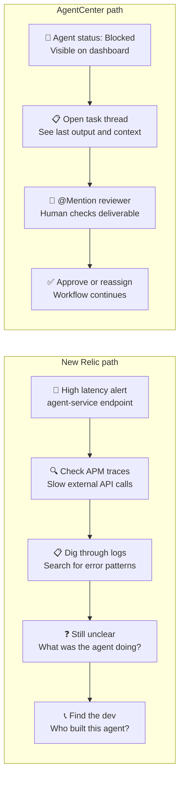

New Relic is one of the best observability platforms out there. If you're running distributed systems and want dashboards full of metrics, traces, and logs, it delivers. Plenty of engineering teams we know use it — and for good reason.

But here's the question that comes up when you start running AI agents in production: is a general-purpose observability tool the right place to manage them?

The short answer is no. Not because New Relic lacks quality, but because managing AI agents is a different problem than monitoring service health. This post breaks down where each tool actually fits.

## What New Relic Does Well

New Relic is genuinely strong at infrastructure and application observability. Before comparing, it's worth being clear about that.

- **Infrastructure monitoring**: CPU, memory, disk, network — all the classic signals, well-presented with automatic alerting
- **APM (Application Performance Monitoring)**: Trace slow endpoints, identify bottlenecks in code execution, surface p99 latency
- **Log aggregation**: Centralized logging with search, filtering, and alert rules
- **Distributed tracing**: Follow a request across services and see exactly where it slows down or breaks
- **Custom dashboards**: Build metrics views tailored to your team's specific systems
- **Alerting and on-call**: PagerDuty-style incident routing when thresholds are breached

These are real, production-grade capabilities. For traditional web apps and microservices, this is the kind of visibility you need.

## The Core Limitation for Teams Running AI Agents

The problem is not that New Relic lacks AI features. The problem is that managing AI agents requires a different kind of visibility entirely.

When your agent fails, you don't just need to know it errored. You need to know what task it was working on, what it produced, whether a human needs to review the output, and what should happen next in the workflow. New Relic was not built to answer any of those questions.

Here's what teams running agents actually deal with in production:

- An agent ran for 40 minutes and produced output. Was it correct? Nobody knows without reviewing it manually.
- Agent B was waiting on Agent A's result. Agent A finished but never handed off. Agent B is stalled with no visible reason why.
- Three agents are all consuming the same LLM API. Combined token spend is $800/day and climbing. Which agent is responsible?
- An agent got stuck in a retry loop at 2am. The APM dashboard shows "high latency" but gives no clue what the agent was doing.

New Relic will show you the latency spike. It will not tell you the agent is stuck, what it was trying to do, or who should handle it.

That gap is where [agent monitoring](/features/agent-monitoring) and task management need to work together — and that's a different tool category.

## How They Compare

| Feature | New Relic | AgentCenter |
|---|---|---|
| **Primary use case** | Infrastructure and app observability | AI agent management and coordination |
| **Task tracking** | No | Yes, Kanban board per agent |
| **Real-time agent status** | Metrics only, no semantic status | Online, working, idle, blocked |
| **Deliverable review** | No | Yes, built-in approval workflows |
| **Multi-agent coordination** | No | Yes, task dependencies and handoffs |
| **Per-agent cost tracking** | No | Yes, LLM spend per agent and per task |
| **@Mentions and task threads** | No | Yes, per-task chat threads |
| **Recurring task automation** | No | Yes, on Pro+ plans |
| **Pricing** | Usage-based, typically $25-$50/user/mo | $14-$79/mo flat per workspace |
| **Setup** | Instrument code + configure alert policies | Connect OpenClaw agents to workspace |
| **Best for** | Ops teams monitoring server and app health | Dev teams running AI agent workflows |

## Workflow Comparison

The difference shows up most clearly when something goes wrong.

**The New Relic flow:** An alert fires for high latency. You check APM traces, find slow external API calls, dig through logs, and eventually figure out the agent was waiting on a third-party service. But you still have no idea what the agent produced, whether the output is usable, or what the downstream agents should do. That answer lives in a separate Slack thread and a manual review.

**The AgentCenter flow:** The agent shows as blocked in the dashboard. You open the task, see the context and last output, @mention the right person to review it, and move the workflow forward. The whole thing is in one place.

### Step-by-step: Reviewing an agent output

**New Relic way:**
1. Agent completes a task — no notification, output lands somewhere (S3, database, email)
2. Someone manually checks whether the output looks correct
3. No audit trail of who reviewed it, what they said, or when
4. No way to approve or reject and trigger the next step automatically
5. Workflow continuation is manual

**AgentCenter way:**
1. Agent completes a task — status updates to "waiting for review"
2. Reviewer gets notified in the task thread
3. They review the deliverable inside AgentCenter
4. Approve or flag — the next agent picks up automatically
5. Full audit trail: who reviewed, what they said, when it was approved

The gap is not a missing feature in New Relic. It's a design difference. New Relic was built to monitor service health, not to manage agent work.

## Can You Use Both?

Yes — and this is actually a sensible setup for teams running agents at scale.

New Relic makes sense for monitoring the infrastructure your agents run on: server health, API latency, error rates in your custom orchestration code. Those signals are still useful.

AgentCenter manages the agent layer: what tasks are in progress, what agents are producing, who needs to review what, and what is blocked.

Think of it as two layers. New Relic watches the plumbing underneath. AgentCenter manages the work on top. They do not overlap.

That said: if you're just getting started with AI agents, a $14/month AgentCenter Starter plan gets you further than standing up a full observability stack first. You can add infrastructure monitoring later. Start with visibility into your agents and what they're actually doing. See the full [AgentCenter features overview](/features) and [compare plans at pricing](/pricing).

## Bottom Line

New Relic is a strong observability platform for traditional software systems. For AI agents specifically, it tells you when your agent service is slow but not what the agent was doing, whether the output was useful, or what to do next. AgentCenter covers that gap: task visibility, deliverable review, cost tracking, and multi-agent coordination. These are not competing products — they're different categories.

---

*New Relic is good at what it does. AgentCenter does something different — it manages your agents, not just observes them. [Start your 7-day free trial](/pricing) — no lock-in.*
