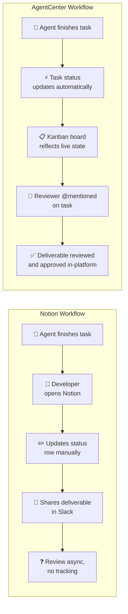

Most teams that start tracking AI agents seriously end up in Notion first. You create a database. Add columns for agent name, status, last run, cost, and owner. It works for a few weeks. Then you have eight agents, three teams sharing the same workspace, and nobody is sure which rows are current.

That is not a Notion problem. It is a paradigm mismatch.

## What Notion Does Well

Notion is a genuinely capable tool. Teams use it across their entire workflow, and for good reason.

- **Flexible databases.** You can model almost any structure. Views switch between table, board, calendar, and gallery. Filters and grouping are fast to set up.
- **Easy to share.** Non-engineers can read, comment, and update Notion pages without training. That matters for cross-functional teams.
- **Documentation alongside data.** Agent runbooks, design notes, and post-mortems live right next to your tracking tables.
- **Good for async work.** Meeting notes, weekly updates, and team wikis work well in Notion.
- **Accessible pricing.** The free tier covers most small teams. Upgrading costs $10 to $15 per user per month.

None of this is in dispute. Notion is a solid tool. The problem is what it cannot do when your agents are actually running.

## The Core Problem for Teams Managing AI Agents

Notion is passive. You update it. Your agents do not.

Every status column, cost figure, and task note in your Notion workspace was put there by a human. Someone ran a job, tabbed over to Notion, and typed "Running." Someone else checked it an hour later, saw no change, and assumed the agent was still going. Sometimes it had already failed.

That is the fundamental issue. A database that depends on manual updates breaks down the moment your team is not watching.

Consider what happens when you run 12 agents across three projects in production:

- An agent errors at 2am. Notion does not know. You find out when someone opens the page in the morning and sees the timestamp is stale.
- Two agents are waiting on each other. Nothing in Notion catches the deadlock. The task just sits there.
- An LLM cost spike happens on one agent. You find out at the end of the month when the invoice arrives.
- A deliverable needs review. You post it in Slack, someone replies in the wrong thread, and the context is lost.

None of these are edge cases. They are the normal friction of running agents without a live system.

Notion was built for documents. Agent management needs a connected control plane — one that talks to your agents directly, not through people.

## Notion vs AgentCenter: Feature Comparison

| Feature | Notion | AgentCenter |
|---|---|---|
| Real-time agent status | No — manual updates only | Yes (online, working, idle, blocked) |
| Task updates from agents | No | Yes — agents update tasks automatically |
| Cost tracking per agent | Manual / estimated | Automatic, per task |
| Deliverable review workflow | Workaround via linked pages or comments | Built-in approval and revision flow |
| @Mentions tied to tasks | Yes, but not agent-aware | Yes, scoped to specific agent and task |
| Multi-agent orchestration | No | Yes, with task dependencies |
| Error alerts | No | Yes — real-time error state on task board |
| Agent Kanban board | No | Yes, per project |
| Recurring task automation | No | Yes (Pro+) |
| Pricing | Free / $10 per user/mo | $14/mo (5 agents, 3 projects) |

AgentCenter is not a replacement for Notion. It is a different category. Notion stores what you write. AgentCenter reflects what your agents are doing.

## Workflow Comparison: Tracking vs Managing

Here is what it looks like in practice when an agent finishes a task.

**The Notion way:**

1. Agent finishes a task
2. Developer notices the output in logs
3. Developer opens Notion, updates the status column to "Done"
4. Deliverable gets shared via a linked page, Slack message, or comment
5. Review happens asynchronously with no structured approval step
6. Cost is checked separately in the LLM provider dashboard at the end of the month

**The AgentCenter way:**

1. Agent finishes a task
2. Task status updates automatically on the board
3. Deliverable is attached directly to the task in AgentCenter
4. Reviewer gets @mentioned on the specific task
5. Reviewer approves or requests revision, tracked in-platform
6. Cost is logged per task, visible immediately in the [agent monitoring view](/features/agent-monitoring)

The difference is where human attention goes. In the Notion model, people spend time updating the system. In AgentCenter, the system updates itself, and people focus on the actual work.

## Can You Use Both?

Yes, and this is the right answer for most teams.

Notion and AgentCenter solve different problems. Notion is where you document your agents: runbooks, design decisions, post-mortems, onboarding guides. AgentCenter is where you operate them: live status, task assignments, deliverable review, and cost tracking.

A practical split looks like this:

- **In Notion:** Agent runbooks ("what this agent does, what inputs it expects, who owns it"), architecture diagrams, post-mortems, team onboarding docs
- **In AgentCenter:** Active task queue, real-time status per agent, deliverable review, recurring automation, per-agent cost breakdown

You do not need to choose one. Teams that run this combination well use Notion for knowledge and AgentCenter for operations. The [task orchestration features](/features/task-orchestration) connect directly to agent workflows, so the two tools complement rather than compete.

## Where Notion Actually Helps

There is one area where Notion does something AgentCenter does not: long-form institutional knowledge.

If you are building runbooks that explain why an agent makes certain decisions, or documenting the history of a failed experiment, or writing onboarding material for a new team member inheriting an agent fleet — Notion is the right tool for that. It is readable, searchable, and shareable without requiring anyone to learn a new system.

Use it for that. Keep the live operations work in a system that talks to your agents.

## Bottom Line

If you are tracking two or three agents and a Notion table is working, keep doing it. When agents start running in parallel, failing overnight, and producing deliverables that need structured review, a manual database cannot keep up.

Notion stores what you tell it. AgentCenter shows you what is actually happening. Those are different tools for different jobs, and past a certain scale you will need both. Check the [pricing page](/pricing) if you want to see which plan fits your current agent count.

---

*Notion is a great docs tool. AgentCenter does something different — it manages your agents, not just records them. [Start your 7-day free trial](/pricing) — no lock-in.*
