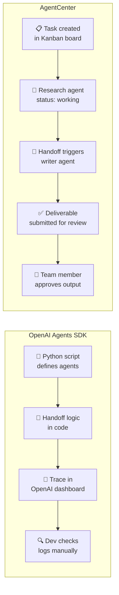

The OpenAI Agents SDK is genuinely good at what it does. If you're building a multi-agent system on top of GPT-4o and you want agents that can hand tasks to each other, call tools, and trace their runs, the SDK gets you there in a clean Python library. It's opinionated enough to be useful, flexible enough to grow with you.

But here's the question nobody asks during the build phase: once your agents are running in production, how do you know what's happening?

Not at the code level. At the operational level. Who's working on what task? Which agent is blocked right now? What did the research agent actually produce before handing off to the writer? How much did yesterday's full pipeline cost per completed task? Who on your team needs to approve that output before it ships to a client?

The OpenAI Agents SDK doesn't answer any of those questions. It was never designed to. That's where AgentCenter comes in.

## What the OpenAI Agents SDK Does Well

The SDK (released in early 2025, built on top of the earlier Swarm experiment) has a clear purpose: give developers a structured way to build multi-agent systems in Python without having to wire up all the orchestration logic themselves.

What it actually delivers:

- **Agent definitions** with clear names, instructions, and tool access in a consistent Python API
- **Handoffs** that let one agent route control to another based on task context or conditions
- **Built-in tracing** that logs agent runs to the OpenAI dashboard for inspection
- **Guardrails** for validating inputs and outputs before they're processed by an agent
- **Tool calling** with structured function definitions that agents can invoke reliably
- **Context objects** for passing shared state between agents throughout a run
- **Streaming** for real-time output during long-running agent interactions

For a team building a customer triage pipeline, a document processing workflow, or a research-to-draft system, the SDK removes significant boilerplate. The abstractions are tight. The handoff model is clean. You can go from "idea" to "working multi-agent pipeline" in a day.

## The Core Limitation for Teams Managing AI Agents

The SDK is a framework for building agents. It is not a control plane for operating them. That distinction matters more than it sounds once you're past the first production deploy.

When you run an OpenAI Agents SDK pipeline, you get a Python process. If something fails mid-handoff, you check logs. If you want to know which tasks completed and which are stuck, you parse traces in the OpenAI dashboard or write your own logging layer. If a non-technical teammate needs to see what the agent produced, they ask you to pull the output manually. If the weekly run cost $80 more than expected, you find out when the invoice arrives.

None of that is a knock on the SDK. It was built for developers who want to construct agent logic, not for teams who need to operate agents at scale. The problem is that production agent operations aren't just a developer concern. You have product managers who need to see task status. You have clients waiting for deliverables. You have engineers who need to know which agent failed and why, not after the fact but right now.

The SDK leaves that entire operational layer open. You either build it yourself or you bring in a tool designed for it.

## How They Compare

| Feature | OpenAI Agents SDK | AgentCenter |
|---|---|---|
| Primary purpose | Build multi-agent Python systems | Manage and monitor agents in production |
| Dashboard UI | No native UI; traces in OpenAI dashboard | Full web dashboard with Kanban board |
| Multi-agent coordination | Via handoffs defined in code | Visual task orchestration across agents |
| Task management | No task concept | Create, assign, and track tasks per agent |
| Real-time status | No (logs and traces only) | Live status: online, working, idle, blocked |
| Team collaboration | No built-in team layer | @Mentions, task threads, shared dashboards |
| Cost visibility | Aggregate in OpenAI billing | Per-task and per-agent cost breakdown |
| Deliverable review | Manual output inspection | Built-in review and approval workflow |
| Recurring tasks | Not built in | Automated recurring task scheduling (Pro+) |
| Pricing | Free SDK, OpenAI API costs apply | From $14/mo ([see plans](/pricing)) |

## Workflow Comparison: Their Way vs AgentCenter

Here's what the same research-to-writing handoff looks like in each system:

**With the SDK:**

1. Define agents in Python with instructions and tool access
2. Write handoff logic connecting agent A to agent B based on output conditions
3. Run the pipeline from your terminal or CI job
4. Check the OpenAI tracing dashboard to see what ran and when
5. If something failed mid-run, dig into logs to find the failure point
6. Export output manually if a teammate needs to see the result

**With AgentCenter:**

1. Open the dashboard, create a task for the research agent
2. Watch agent status update to "working" in real time from any browser
3. When the research phase completes, the task moves to the writing agent automatically
4. The writer produces a deliverable, which appears in the task thread for review
5. A team member gets notified via @mention, approves or comments without leaving the tool
6. Cost for the full workflow shows up in per-task analytics, not just aggregate billing

The SDK path is fine when you're a single developer who can watch the terminal. It stops scaling when your team grows or when agents run unattended overnight.

## Can You Use Both?

Yes. Many teams do, and it's a natural split.

The OpenAI Agents SDK handles what it's good at: defining agent logic, tool calls, handoff conditions, and guardrails in Python. AgentCenter handles the layer above: what tasks are running, what agents are doing them, what got produced, and who needs to act on the output.

If you're already using OpenAI's models to power your OpenClaw-compatible agents, you can use AgentCenter as the operational dashboard on top of whatever framework you used to build them. The management layer doesn't require you to rewrite agent logic. You add visibility without changing how your agents work.

The [agent monitoring](/features/agent-monitoring) and [multi-agent workflow coordination](/features/multi-agent-workflows) features are worth looking at if you're trying to understand what that operational layer covers in practice.

## Bottom Line

The OpenAI Agents SDK is a solid foundation for building multi-agent systems in Python. What it doesn't give you is a way to see what those agents are doing once they're running, share that visibility with your team, or manage deliverables without writing custom tooling. AgentCenter fills that gap: task tracking, real-time agent status, team coordination, and deliverable review, without requiring you to change how your agents are built.

---

*OpenAI Agents SDK is good at building agents. AgentCenter does something different — it manages the agents you've already built. [Start your 7-day free trial](/pricing) — no lock-in.*
