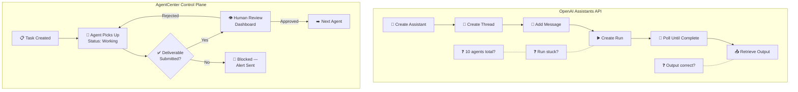

The OpenAI Assistants API is one of the first things developers reach for when building AI agents. It's well-documented, backed by OpenAI's infrastructure, and removes a lot of boilerplate. Persistent threads, file handling, tool calling, a managed runtime — for building agents, it's genuinely solid.

The question isn't whether it works. The question is what happens after it works. When you have 12 Assistants running across three products and one of them has been silently returning wrong answers for four days. That's when you realize the Assistants API is a runtime, not a control plane.

## What OpenAI Assistants API Does Well

- **Managed threads**: persistent conversation history without building your own storage layer
- **Tool calling**: code interpreter, file search, and custom functions, all built in
- **Token management**: automatic context truncation so you don't hit limits mid-run
- **Model flexibility**: swap between GPT-4o, GPT-4 Turbo, and others per Assistant
- **Simple API surface**: create, thread, run, retrieve — four concepts cover most use cases
- **OpenAI infrastructure**: global endpoints, high availability, no servers to manage

If you're building a single-agent product, a document processing tool, or a conversational assistant, the Assistants API gets you running fast.

## The Core Limitation for Teams Managing AI Agents

The Assistants API has no concept of a task queue. No agent status page. No way to see that Run #847 has been spinning for 20 minutes because your retry logic stalled on a rate limit. No place for a human to review what the agent produced before it gets passed downstream. No visibility across Assistants.

You manage all of that yourself. You build a database to track run states. You write polling logic. You build your own dashboards. You wire up your own alerts. You handle approvals in your application code.

That's fine for one assistant. For two. Maybe three. When you're at ten agents across three products, that custom management layer starts taking more time to maintain than the agents themselves.

We saw a team running seven GPT-4 Assistants — one for intake, two for research, three for drafting, one for review. They were tracking run IDs in a Google Sheet. They checked it every morning. If a run failed, they found out when a human noticed the output was missing — sometimes days later.

That's the gap. The Assistants API builds the agent. It doesn't manage the fleet.

## AgentCenter vs OpenAI Assistants API: Side by Side

| Feature | OpenAI Assistants API | AgentCenter |
|---|---|---|
| Agent runtime and execution | Yes | No (requires OpenClaw) |
| Real-time agent status | No (run status only) | Yes (online/working/idle/blocked) |
| Task queue and Kanban board | No | Yes |
| Deliverable review and approval | No | Yes |
| Multi-agent coordination | Manual, via your own code | Built-in task orchestration |
| Cost tracking per task | No | Yes |
| @Mentions and team chat threads | No | Yes |
| Recurring task automation | No | Yes (Pro+) |
| Human-in-the-loop workflows | Build it yourself | Yes, built in |
| Agent monitoring dashboard | No | Yes, [real-time](/features/agent-monitoring) |
| Pricing | Usage-based (tokens per API call) | $14/mo Starter, $29/mo Pro, $79/mo Scale |
| Who manages the control layer | You, from scratch | AgentCenter |

## Workflow Comparison: Two Agents Handing Off Work

**Using OpenAI Assistants API:**

1. Create two Assistants with different system instructions
2. Build a Thread-per-task system, store run IDs in your database
3. Start Agent A's run, poll until `status === "completed"`
4. Extract output from the thread messages
5. Feed that output as a new message into Agent B's thread
6. Start Agent B's run, poll again
7. Hope nothing failed silently between steps 3 and 6

If Agent A produces garbage output, it flows into Agent B without any check. Your only signal is a bad final result. You then dig backwards through thread message histories to find where it broke.

**Using AgentCenter:**

1. Create a task on the [Kanban board](/features/task-orchestration), assign it to Agent A
2. Watch Agent A's status update in real-time on the dashboard
3. Agent A submits its deliverable when done
4. A team member reviews it and approves or rejects it with a comment
5. Once approved, the task moves automatically to Agent B
6. If Agent A gets blocked, you get an alert — not silence

The difference is not the agents. It's whether you know what they're doing while they're doing it, and whether a human can catch a bad output before it propagates.

## Can You Use Both?

Yes, and a lot of teams do.

AgentCenter works with any OpenClaw-compatible AI provider. You can run OpenAI models on the backend. The Assistants API handles the execution layer: memory, tool calls, token management. AgentCenter sits above it as the control plane: task assignment, status visibility, deliverable review, cost tracking, team coordination.

The Assistants API is the engine. AgentCenter is the management system around the engine.

If you're already using Assistants and it's working, you don't have to replace anything. You'd wire your agent runs into the AgentCenter task lifecycle so the [dashboard](/features/agent-dashboard) reflects what's happening inside each run. Teams that do this typically stop maintaining their own run-tracking databases within a few weeks.

One honest note: if you're running one or two Assistants for a focused product, you may not need a separate control plane yet. A custom polling script and a Slack alert might cover your needs. The friction starts showing up around five or six agents, or when your team grows past the people who built the original scripts.

## Bottom Line

The OpenAI Assistants API is the right choice for building AI agent capabilities. AgentCenter is the right choice for managing the agents you've built. They answer different questions. The Assistants API answers "can my agent do X?" AgentCenter answers "is my agent doing X right now, and is the output any good?"

Most teams need both. See the [pricing page](/pricing) to find which plan fits where you are.

---

*OpenAI Assistants API is excellent at running agents. AgentCenter does something different — it manages them, tracks them, and lets your team review what they produce. [Start your 7-day free trial](/pricing) — no lock-in.*
