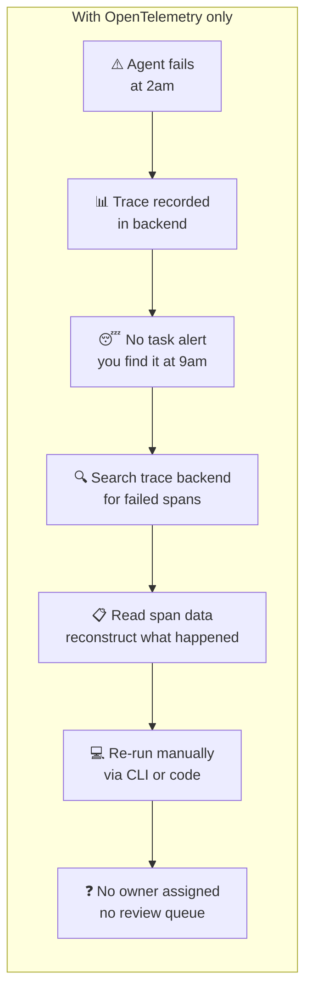
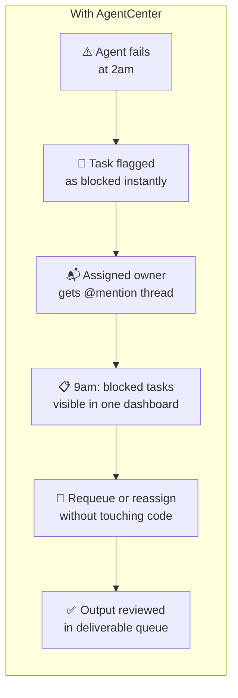

OpenTelemetry is one of those tools that looks like it should solve your agent visibility problem. You add it to your codebase, it traces every function call, and suddenly you have spans and attributes and a waterfall diagram showing exactly what your agents did. That's genuinely useful data.

But when a production agent returns bad output at 11pm on a Tuesday, you open your trace viewer and stare at it. You can see that the LLM call took 4.2 seconds. You can see the token count. You can see that the tool call returned a 200. And then you realize: this tells you what happened. It doesn't tell you what to do about it.

That's the gap. For teams running agents in production, it's a significant one.

## What OpenTelemetry Does Well

OpenTelemetry is a CNCF project and the dominant open standard for distributed tracing and observability. It does its job exceptionally well:

- **Standardized instrumentation**: Add OTel to any language and get consistent trace, span, and metric data across your whole system
- **Vendor-neutral**: Your traces go wherever you point them — Jaeger, Honeycomb, Datadog, Grafana, or any other OTel-compatible backend
- **Automatic context propagation**: Traces follow requests across service boundaries, which matters when your agents call external APIs or hand off to downstream services
- **Wide ecosystem support**: Most major AI SDKs — including Anthropic's, OpenAI's, and LangChain — have first-party or community-built OTel exporters
- **Token and cost data at the span level**: You can attach token counts and estimated costs as span attributes and see them per-trace or aggregate them in dashboards
- **Debugging complex execution paths**: When an agent makes 12 tool calls and you want to know which one slowed everything down, a trace waterfall answers that in seconds

If you're building a team of engineers who need to understand what their agents are doing under the hood, OTel gives you the data pipeline to do it. It's solid infrastructure.

## The Core Limitation for Agent Teams

OTel answers one question well: "What did my agent do, and how long did each step take?"

It doesn't answer the follow-up questions that teams running agents in production actually need to answer:

- Which agent is currently stuck, and who owns it?
- This task failed at 3am — how do I requeue it without touching code?
- We have 20 agent tasks in progress right now. Which ones need human review before results go out?
- Agent C produced output that looks wrong. Who approves or rejects it?
- How do I hand context from Agent A to Agent B after Agent A finishes?
- We're over budget on the research agent this week. What tasks is it spending on?

OpenTelemetry wasn't built to answer any of those. It's observability infrastructure — built to record what happened, not to manage what happens next.

The path most teams follow: they instrument their agents with OTel, ship traces to a backend like Honeycomb or Datadog, build a few dashboards, and feel like they've solved visibility. Then the first real production incident hits. An agent ran for 43 minutes and returned a result with a 94% confidence score. The output is wrong. The trace is complete and accurate. And it's completely useless for deciding what to do next, who needs to know, and how to prevent it from happening again tomorrow.

Traces capture execution. A control plane manages operations.

## AgentCenter vs OpenTelemetry: Side by Side

| Feature | OpenTelemetry | AgentCenter |
|---|---|---|
| Primary purpose | Distributed tracing and metrics | Agent task management and operations |
| Task assignment and tracking | No | Yes — Kanban board, API, @mentions per task |
| Real-time agent status | No | Yes — online, working, idle, blocked in one view |
| Deliverable review | No | Yes — review and approve agent outputs before they ship |
| Multi-agent coordination | No | Yes — task dependencies and handoffs between agents |
| Cost tracking | Via span attributes (manual setup) | Built-in per-task cost tracking |
| Human-in-the-loop | No | Yes — approval workflows and @mention threads |
| Recurring task automation | No | Yes (Pro+ plans) |
| Pricing | Free (open standard) | Starter $14/mo, Pro $29/mo, Scale $79/mo |
| Setup | Instrument your code manually in each service | Connect your OpenClaw agents; no code changes needed |
| Best for | Debugging latency, tracing execution paths | Managing agent work, teams, and output quality |

## Workflow Comparison: Triage After an Overnight Failure

Here's what the experience actually looks like when 2 of your 8 agents fail overnight and you need to triage and recover in the morning.

The difference isn't just workflow — it's the mental model. With OTel, you're an engineer reading logs after something broke. With AgentCenter, you're an operator managing a live system where work has owners, statuses, and a review queue.

The [agent monitoring](/features/agent-monitoring) layer in AgentCenter specifically covers the gap that tracing data leaves open. A trace tells you how long an LLM call took. AgentCenter tells you that the task has been in a blocked state for 6 hours and the assigned agent hasn't moved on it.

## Can You Use Both?

Yes — and this is actually the right setup for most teams running agents at scale.

OpenTelemetry and AgentCenter are not competing for the same slot in your stack. They operate at different layers.

OTel belongs in your observability infrastructure. If you're already shipping traces to Honeycomb, Grafana, or Datadog, keep doing that. Use OTel to diagnose latency regressions, track LLM API error rates by provider, build cost dashboards from span data, and debug unexpected behavior at the execution level.

AgentCenter belongs in your [operations layer](/features). Use it to assign and track tasks, coordinate work across agents, monitor real-time agent health, and build a review workflow around what your agents produce before results reach users or downstream systems.

The teams that get the most out of AgentCenter typically already have some observability in place. They're not flying blind — they have traces and dashboards. But they're hitting the ceiling of what traces can tell them. They know something is slow. AgentCenter helps them see which tasks are stuck, who owns them, and what the output quality looks like across the fleet.

If you're just starting with 2 or 3 agents and no visibility at all, getting basic OTel instrumentation set up first is reasonable. Once you're running 6 or more agents and hitting real coordination and review problems — tasks without owners, outputs that nobody reviewed, agents that ran for hours without anyone noticing — that's when a dedicated control plane pays back its cost in the first week.

For a detailed look at what the [task orchestration](/features/task-orchestration) side of AgentCenter handles, the feature page covers the specifics of how task dependencies and agent handoffs work.

## Bottom Line

OpenTelemetry gives you data. AgentCenter gives you control. Teams that try to run agent operations with traces alone end up with dashboards that show them what happened yesterday — but no good way to assign tasks, coordinate agents, or review outputs before they ship. That's not a gap OTel can fill. It's not what it was built for.

---

*OpenTelemetry is good infrastructure. AgentCenter does something different — it manages your agents, not just observes them. [Start your 7-day free trial](/pricing) — no lock-in.*
