You have agents running in production. Something breaks at 11pm. You need to know.

So you wire up PagerDuty. It pages your phone when an agent throws an error or goes silent. Your on-call engineer gets woken up, investigates, fixes it.

That setup works. But it only covers one part of running AI agents. PagerDuty handles the fire alarm — AgentCenter handles everything else. PagerDuty doesn't tell you why the fire started, which agents are working right now, what they produced today, or what it all cost.

That's the gap this post is about.

## What PagerDuty Does Well

PagerDuty is genuinely good at incident management. Teams running any production system — AI agents included — get real value from it:

- **Reliable alerting**: Define thresholds, get paged. SMS, phone calls, push notifications. It reaches you.
- **On-call scheduling**: Rotation management, escalation policies, and handoff documentation between engineers.
- **Incident timelines**: Track when alerts fired, who acknowledged, how long resolution took.
- **Runbook links**: Attach runbooks to alert types so the on-call engineer knows what to do.
- **Post-mortem structure**: Template-driven retrospectives after incidents close.
- **Wide integrations**: Connects to most monitoring stacks — Datadog, Grafana, CloudWatch, and dozens more.

If you need a paging layer for your agent fleet, PagerDuty works. The problem isn't what it does — it's what it can't do.

## The Core Limitation for Agent Teams

PagerDuty is reactive. Something has to go wrong before it's useful.

By the time an alert fires, you already have a production problem. You don't know which of your 12 agents caused it. You don't know whether the agent was producing bad output silently for the last 6 hours before hitting a hard failure. You don't know if this is a one-off or a pattern developing across your fleet.

Agent management requires more than incident response. Teams need to know:

- **What agents are doing right now** — running, idle, blocked, or producing output?
- **What they were assigned** — which task, by whom, with what context?
- **Whether output is any good** — task complete and output acceptable are not the same thing
- **What it's costing** — per-agent, per-task token spend, not just a monthly bill
- **How agents hand off to each other** — who waits on whom, and did that handoff succeed?

PagerDuty doesn't touch any of this. It knows something went wrong after the fact. That's a different job.

## AgentCenter vs PagerDuty: Side by Side

| Feature | PagerDuty | AgentCenter |
|---|---|---|
| Real-time agent status | No | Yes — live board: running, idle, blocked |
| Task assignment and queues | No | Yes — per-agent task queues with priorities |
| Deliverable review and approval | No | Yes — submission workflow with human review gates |
| Token cost tracking | No | Yes — per-task and per-agent cost visibility |
| Multi-agent coordination | No | Yes — task dependencies, parent-child tasks |
| @Mentions and task threads | No | Yes — team chat attached to each task |
| Incident alerting | Yes — core feature | Basic (heartbeat and status monitoring) |
| On-call scheduling | Yes | No — outside scope |
| Runbook integration | Yes | No — separate tooling |
| Agent templates | No | Yes — 120+ pre-built agent templates |
| Pricing | ~$21/user/month (Professional) | From $14/month flat (up to 5 agents) |
| Best for | Alerting when agents break | Managing what agents do before and after |

## Two Ways to Handle a Stuck Agent

The difference shows up when something is going wrong — but not wrong enough to fire an alert yet.

Say Agent A is taking four times longer than normal on a document extraction task. No error. No crash. It's just slow, and output quality is degrading as the context window fills.

**PagerDuty-only approach:**

1. Nobody knows — there's no task tracking, so slow and degrading looks identical to running normally
2. Eventually the task times out or throws a hard error
3. PagerDuty fires — on-call engineer wakes up
4. They try to figure out which agent, which task, what state it was in before the failure
5. That context is gone. They reconstruct from logs and start over.

**AgentCenter approach:**

1. Task duration is visible on the [agent monitoring dashboard](/features/agent-monitoring) — the spike shows up early
2. The task is in the queue with its full history: what it was working on, how long it's been running, what it's produced so far
3. Team spots it before it hits an error, pauses the task, and either fixes the input or reassigns
4. If it does fail, the full task context is there — no reconstruction required

The difference isn't just faster recovery. It's catching problems before they become incidents.

```mermaid
graph TD
    subgraph "PagerDuty-Only Approach"
        A1["🤖 Agent running"] --> B1["⚠️ Silent degradation<br/>no visibility"]
        B1 --> C1["💥 Hard error fires"]
        C1 --> D1["📱 PagerDuty pages<br/>on-call engineer"]
        D1 --> E1["🔍 Investigate with<br/>no task context"]
    end
    subgraph "AgentCenter Approach"
        A2["🤖 Agent running"] --> B2["📊 Task duration climbs<br/>visible on dashboard"]
        B2 --> C2["👀 Team spots early<br/>before hard failure"]
        C2 --> D2["⏸️ Pause, investigate,<br/>or reassign"]
        D2 --> E2["✅ Resolved with<br/>full task history"]
    end
```

## Can You Use Both?

Yes — and a lot of teams do.

PagerDuty handles the paging layer. AgentCenter handles the management layer. They solve different problems and barely overlap.

If your agents are critical enough that downtime means someone needs to be woken up, keep PagerDuty for on-call rotation and escalation policies. Wire your monitoring stack to fire into it when agents go silent past a threshold.

Use AgentCenter for everything that happens before and around incidents: task assignment, status tracking, deliverable review, cost tracking, and [multi-agent workflow](/features/multi-agent-workflows) coordination. The coordination side — which agent depends on which, what gets passed between them — is something PagerDuty has no concept of.

Where teams get into trouble is assuming that "no PagerDuty alert" means "agents are working." It doesn't. No alerts means no hard failures. It says nothing about output quality, task progress, or cost. An agent producing plausible-but-wrong outputs every day for two weeks won't fire a single PagerDuty alert.

## What to Actually Run

If your fleet is small and simple — two or three agents doing narrow, well-defined tasks — PagerDuty plus some basic uptime monitoring might cover you to start. Set a timeout. Get paged when it fires.

Once you're running more than four or five agents, or once agents are producing deliverables that other people or systems depend on, alerting alone stops being enough. You need to know who's working on what, whether the work is usable, what it costs per task, and whether handoffs are completing.

That's where a dedicated [control plane](/features) earns its cost — not in catching fires faster, but in giving you enough visibility that fewer fires start.

Check [pricing](/pricing) — the Starter plan is $14/month and covers up to 5 agents, which is enough to get started without committing to the full setup.

## Bottom Line

PagerDuty is a solid incident management tool and it works for agent alerting. AgentCenter manages what your agents are actually doing — tasks, deliverables, costs, and team coordination — before any incident fires. Most teams that get serious about running agents in production end up needing both, doing different jobs.

---

*PagerDuty is good at what it does. AgentCenter does something different — it manages your agents, not just alerts when they break. [Start your 7-day free trial](/pricing) — no lock-in.*
