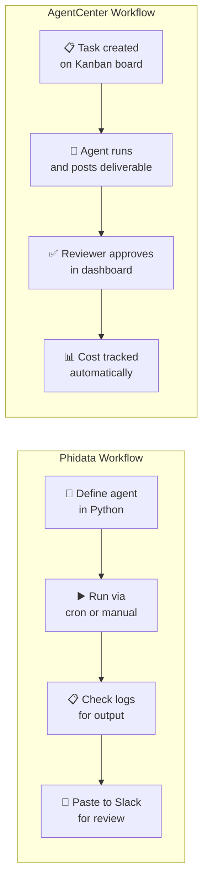

Phidata is genuinely good at what it does. You write a Python class, attach tools, wire in a knowledge base, and you have an agent that can reason, retrieve, and act. The Playground UI lets you test it in a browser without standing up a frontend. For a solo developer building their first few agents, it's one of the cleaner frameworks available.

The trouble comes later. Not when you're building agents, but when you're running eight of them and a team of five people is supposed to know which ones are working, which failed overnight, who's reviewing the outputs, and how much each one cost last week.

That's not a framework problem. That's a coordination problem. And Phidata doesn't solve it.

## What Phidata Does Well

- **Clean Python API**: define an agent in 30 lines with tools, memory, and reasoning built in
- **Flexible memory**: short-term session memory, long-term storage, and vector knowledge base retrieval as first-class features
- **Multi-agent teams**: Phidata supports delegation patterns where one agent routes to another
- **LLM flexibility**: works with OpenAI, Anthropic, Google, Mistral, and local models out of the box
- **Playground UI**: lightweight web interface for testing agents during development
- **Open source and active**: good docs, regular releases, large community on GitHub

Phidata is a framework for building agents. That's its job, and it does it well.

## The Gap Teams Hit in Production

Here's a realistic scenario. Your team has built five agents with Phidata: one for content drafting, one for lead research, one for competitive monitoring, one for internal Q&A, one for report generation. They're all running.

Now answer these questions:

- Which agent ran a task in the last hour?
- Which one is currently stuck or failed silently?
- Who approved the output before it went to the client?
- How much did the lead research agent cost on Tuesday?
- If something went wrong, who owns the investigation?

With Phidata alone, the answers live in terminal logs, Slack messages, and someone's mental model of the codebase. The Playground is designed for one developer testing one agent. It's not a dashboard for a team managing a fleet.

Teams patch this with spreadsheets, cron job emails, and a Notion doc that's always two weeks out of date. That system breaks somewhere around agent number seven.

The framework builds the agent. A control plane runs the fleet.

## AgentCenter vs Phidata: Feature Comparison

| Feature | Phidata | AgentCenter |
|---|---|---|
| Agent construction | Python API with tools, memory, knowledge bases | Connects to any OpenClaw-compatible agent |
| Multi-user task board | No | Kanban board across your entire team |
| Real-time agent status | Playground (local only) | Online, working, idle, blocked — live |
| Task assignment | No | Assign tasks to specific agents or people |
| Deliverable review | No | Built-in approval workflow per task |
| Cost tracking | No | Per-agent, per-task cost breakdown |
| Error alerts | No | Alert when an agent fails or goes silent |
| @Mentions and threads | No | Per-task chat for team coordination |
| Recurring task automation | No | Yes — Pro and Scale plans |
| Pricing | Free (open source) | $14/mo Starter, $29/mo Pro, $79/mo Scale |

## What the Workflow Looks Like

Take a content review agent that checks drafts for accuracy before publication.

**With Phidata:**

1. Define the agent in Python — give it a web fetch tool and a review prompt
2. Deploy it to a server or run it locally
3. Trigger it manually or via a cron job
4. Check the terminal or logs to see if it ran and what it said
5. Copy the output and paste it into Slack for someone to review
6. If it fails, you find out when the person waiting on the review asks where it is

**With AgentCenter:**

1. The agent (running on OpenClaw) is connected to the dashboard
2. A task is created on the Kanban board with the draft attached — assigned, due date set
3. The agent picks up the task, runs, and posts its review as a deliverable
4. The assigned reviewer sees it in [agent monitoring](/features/agent-monitoring) and approves or pushes back with a comment
5. If the agent goes silent or fails, an alert fires before anyone is blocked
6. The cost for that task shows up in the analytics view automatically

The Phidata flow works fine when one person is running two agents. It falls apart when you have five people and ten agents and no shared view of what's happening.

## Can You Use Both?

Yes — and that's the most common pattern for teams that have already built with Phidata.

Phidata handles what it's good at: defining agent logic, attaching tools, managing retrieval. You keep using it for that. The agent still runs on your infrastructure.

AgentCenter sits on top via the OpenClaw runtime and adds the operational layer: task coordination, deliverable review, cost visibility, and real-time status. It doesn't replace the framework — it replaces the spreadsheet and the Slack thread you were using to track what the agents were doing.

The decision point is usually this: if you can answer "which agent broke last night and who's fixing it?" in under 30 seconds, you probably don't need a control plane yet. Once that question takes a Slack thread and a log hunt to answer, you've crossed the line.

## What AgentCenter Adds

Beyond the basics, [AgentCenter's features](/features) cover a few things Phidata teams tend to build from scratch:

- **Task dependencies**: agent B waits for agent A to finish before it starts
- **Approval gates**: no output goes anywhere until a human reviews it
- **Recurring tasks**: run an agent on a schedule without writing a cron wrapper
- **@Mentions**: tag a teammate inside a task thread when something needs a decision
- **Activity feed**: see everything that happened across all agents in one scrollable view

None of this is complicated. But doing it yourself across eight agents is 40 hours of plumbing that you'd rather not maintain.

## Bottom Line

Phidata is a solid framework for building intelligent agents. It's not a control plane for operating them at team scale. If you're past three agents and still relying on logs and Slack to know what's happening, that's the gap it can't fill.

AgentCenter handles the coordination layer so your team can actually see what its agents are doing, catch failures before they become problems, and review outputs before they go anywhere.

---

*Phidata builds agents well. AgentCenter manages what happens after they're built and running. [Start your 7-day free trial](/pricing) — no lock-in.*
