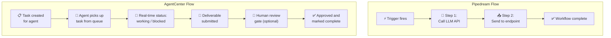

Pipedream is genuinely good at what it does. If you need to catch a webhook, run some code, and call an API — it handles that cleanly. A lot of developer teams use it to trigger their first AI agent calls: an event fires, Pipedream runs a step that calls an LLM, and the result goes somewhere useful.

That works fine at one agent. The question is what happens when you have ten.

## What Pipedream Does Well

To be fair about this comparison:

- **Fast event-driven workflows.** You connect a trigger — webhook, schedule, app event — and code runs. The setup takes minutes, not days.
- **Huge connector library.** 2,000+ built-in integrations mean you can wire almost any SaaS app without writing your own auth layer.
- **Code-first flexibility.** You can drop into Node.js or Python when the no-code steps don't cut it.
- **Reliable delivery.** Pipedream handles retries, queuing, and error notifications at the workflow level.
- **Good for prototyping.** When you want to test whether an LLM call is even worth building out, Pipedream is the fastest path to "let's see if this works."

These are real strengths. If you're stitching together API calls and occasional LLM steps, Pipedream is a solid choice.

## Where It Breaks Down for Teams Running AI Agents

The gap isn't in what Pipedream is built for — it's in what it wasn't.

AI agents aren't stateless API calls. They're persistent processes with context, tasks, deliverables, cost, and failure modes that don't fit neatly into a workflow step. When you start running them at team scale, you need visibility that event pipelines don't provide.

Specifically:

**You can't see which agents are working, stuck, or idle.** Pipedream shows you workflow run history — did the step execute? But "executed" doesn't mean "produced useful output." You have no live view of what your agents are doing right now. AgentCenter's [agent monitoring](/features/agent-monitoring) gives you real-time status per agent — working, idle, blocked, or failed.

**There's no deliverable review gate.** When an agent produces something — a report, a code change, a customer response — Pipedream has no mechanism to hold that output for a human to approve before it moves downstream. It either succeeds (and continues) or fails (and errors out).

**Cost tracking is per-workflow, not per-agent.** You can see that a workflow ran, but you can't easily break down how much an individual agent cost across 50 different workflow invocations, or spot which agent is burning 80% of your LLM budget.

**Multi-agent coordination requires custom engineering.** When Agent A finishes and hands off to Agent B, you're building that handoff logic yourself — often via Pipedream steps calling other Pipedream workflows, with no shared view of the overall pipeline state.

**No team coordination layer.** If three people need to review outputs from different agents, assign tasks, or flag an agent as blocked — that all happens outside Pipedream, in Slack or email or wherever people can see it.

## How the Two Workflows Compare

The Pipedream path is great for fast, fire-and-forget automation. The AgentCenter path is built for work that needs to be tracked, reviewed, and accounted for — over time, by a team.

## Side-by-Side Comparison

| Feature | Pipedream | AgentCenter |
|---|---|---|
| Primary model | Event-driven workflow automation | AI agent control plane |
| Live agent status | No — run history only | Yes — real-time per agent |
| Deliverable review | No | Yes — built-in approval workflow |
| Multi-agent coordination | Manual (custom steps) | Native — task dependencies, @mentions |
| Cost tracking | Per-workflow execution | Per-agent, per-task, per-project |
| Task assignment | No | Yes — Kanban board, task queues |
| Agent templates | No | 120+ pre-built agent templates |
| Escalation / blocking | Error notifications only | Explicit blocked states + @mentions |
| Pricing | Free tier; paid from ~$19/mo | Starter $14/mo (5 agents), Pro $29/mo (15 agents), Scale $79/mo (50 agents) |
| Setup requirement | None | OpenClaw agent setup required |

## Can You Use Both?

Yes — and it's a common pattern.

Teams often use Pipedream to handle the event layer: a customer submits a form, Pipedream catches the webhook and creates a task in AgentCenter. Or a scheduled Pipedream workflow fires every night and queues up a batch of agent tasks.

In that setup, Pipedream is the intake mechanism — reliable, fast, well-connected to the rest of your SaaS stack. AgentCenter is the control layer where agents actually run, produce deliverables, and get reviewed.

What breaks down is using Pipedream as a *replacement* for the control layer. Once you have more than a handful of agents producing outputs that matter, you need somewhere to see what's happening, catch errors, and keep the team aligned. A workflow run log doesn't do that job.

## The Real Difference

Pipedream treats each agent call as a step in a workflow — it runs, it either succeeds or fails, and you move on.

AgentCenter treats each agent as a persistent team member with a task queue, a deliverable history, a cost record, and a status your whole team can see. The work isn't just executed — it's managed.

If your AI usage is mostly one-off automation with LLM steps, Pipedream is probably all you need. If you're running agents that produce work your team depends on, you need a layer that makes that work visible, reviewable, and accountable.

## Bottom Line

Pipedream handles event triggers and workflow automation extremely well. AgentCenter manages what AI agents actually do — tasks, outputs, costs, and the human coordination around all of it. Most teams that grow past a few agents end up needing both: Pipedream to handle intake and integrations, AgentCenter to keep the agents themselves under control.

---

*Pipedream is a solid automation tool. AgentCenter does something different — it manages your agents, not just triggers them. [Start your 7-day free trial](/pricing) — no lock-in.*
