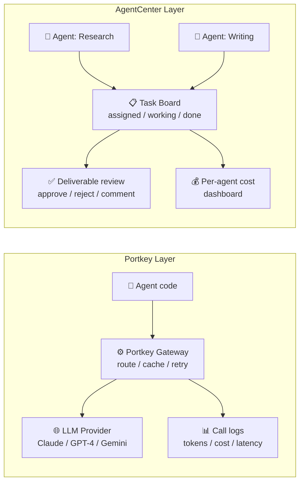

You're running five agents in production. One does research, one writes reports, one reviews them, one formats output, one handles delivery. Somewhere in your stack, Portkey is sitting as your LLM gateway.

Portkey is doing real work. It's routing calls between Claude and GPT-4, caching repeated prompts, retrying failed requests automatically. That's genuinely useful infrastructure.

But at 2am when your report agent stops producing output and your research agent has been looping for 45 minutes, Portkey shows you API call logs. It doesn't tell you which task failed, which agent owns it, what the output looks like so far, or whether anyone on your team knows there's a problem.

That's not a knock on Portkey. It's just not what it's for.

## What Portkey Does Well

Portkey is an AI gateway — a proxy layer between your code and LLM providers. It's genuinely good at:

- **LLM routing and fallbacks**: Route to Claude when GPT-4 is slow, fall back automatically when a provider is down
- **Prompt caching**: Cache repeated or near-identical prompts to cut costs and latency
- **Rate limiting**: Stay within provider rate limits across all your agents combined
- **API-level cost attribution**: See spend broken down by model, provider, or custom metadata tag
- **LLM call observability**: Full request/response logs, token counts, latency per call
- **Prompt management**: Store, version, and deploy prompts centrally
- **Multi-provider support**: Works with OpenAI, Anthropic, Google Gemini, Mistral, Cohere, and more

If your concern is "we're overspending on LLM tokens" or "we need automatic failover if Anthropic goes down," Portkey is a solid answer.

## The Core Limitation for Teams Managing AI Agents

Portkey sees calls. It doesn't see agents.

Your agent isn't a single API call. It's a task someone assigned, a workflow that runs over minutes or hours, a deliverable your team reviews, and a cost center that someone is accountable for. Portkey tells you: "Your stack made 340 API calls to Claude in the last hour, total cost $1.82."

What it doesn't tell you:

- Which agent generated which calls
- What task each agent was working on
- Whether the deliverable was ever completed or reviewed
- That the writing agent has been stuck on the same step for 40 minutes
- That three other agents are blocked waiting for the stuck one
- Who on your team should be doing something about it

When you have two or three agents, you can keep all of this in your head. When you have 10 or 15, you can't. Teams running agents in production need to know: *what is each agent doing right now, is it producing good output, and who's responsible when it's not.* An LLM gateway doesn't answer any of those questions.

## AgentCenter vs Portkey: Side-by-Side

| Feature | Portkey | AgentCenter |
|---|---|---|
| LLM routing and fallbacks | Yes | No (handled at agent layer) |
| Prompt caching | Yes | No |
| Multi-provider LLM support | Yes | Works with any OpenClaw-compatible provider |
| API call logs | Yes | No (tracks agent-level activity) |
| Agent task tracking | No | Yes (Kanban board) |
| Real-time agent status | No | Yes (online, working, idle, blocked) |
| Task assignment and @mentions | No | Yes |
| Deliverable review and approval | No | Yes |
| Per-agent cost tracking | No | Yes |
| Multi-agent coordination | No | Yes |
| Recurring task automation | No | Yes (Pro+ plan) |
| Cloud VM provisioning | No | Yes (Scale plan) |
| Pricing | Free tier; paid plans from ~$49/mo | Starter $14/mo, Pro $29/mo, Scale $79/mo |
| Best for | Managing LLM API calls across your stack | Managing the agents making those calls |

## Workflow Comparison: What Each Tool Shows You

Say you have five agents running in parallel: research, drafting, QA, summarization, and delivery.

**With Portkey only:**

1. Agents hit Portkey and calls get routed to LLM providers
2. Something breaks — you check Portkey's dashboard
3. You see: 47 failed requests in the last hour, mostly timeouts on the drafting agent
4. You now have to trace which agent owns those calls, what task it was running, what the downstream impact is on your other agents
5. No visibility into whether the QA agent is waiting on the drafting agent or already failed silently
6. No way for a non-engineer on your team to see any of this

**With AgentCenter:**

1. You open the [agent dashboard](/features/agent-dashboard) and see all five agents, their current tasks, and their status
2. The QA agent is marked "blocked" — it's waiting on the drafting agent
3. The drafting agent shows a yellow warning: stuck on the same task for 90 minutes with no output change
4. You click into the task, see the last deliverable draft, and @mention a teammate to review
5. You reassign or restart the agent — 4 minutes from noticing the problem to resolving it
6. The cost view inside [agent monitoring](/features/agent-monitoring) shows the failed run added $0.19 to your bill, and the QA agent's idle time cost another $0.11 while it waited

The difference isn't which tool you use. It's which layer of the problem you're looking at.

## Can You Use Both?

Yes, and many teams do. They're not competing for the same job.

Portkey sits at the infrastructure layer — between your agent code and the LLM APIs. AgentCenter sits above the agents — managing tasks, status, team coordination, and output review.

A common production setup: your OpenClaw agents route LLM calls through Portkey's gateway URL for caching and fallback handling, while AgentCenter tracks what those agents are doing and why.

If you're mostly worried about provider reliability and LLM spending at the API level, Portkey alone might be enough to start. If you're managing more than 5 agents and losing track of what each one is doing, what it produced, or who's responsible for it — that's where AgentCenter fills the gap.

The two tools answer different questions. Portkey: "Did this LLM call succeed?" AgentCenter: "Is this agent doing the right work and producing good output?"

## Bottom Line

Portkey handles LLM calls. AgentCenter handles agents. Most teams running agents in production eventually realize they need both layers — one for infrastructure reliability, one for operational visibility. The gap between them is exactly where agent management problems live: the work an agent is doing, the output it's producing, and the team that's responsible for reviewing it.

---

*Portkey is good at what it does. AgentCenter does something different — it manages your agents, not just the LLM calls they make. [Start your 7-day free trial](/pricing) — no lock-in.*
