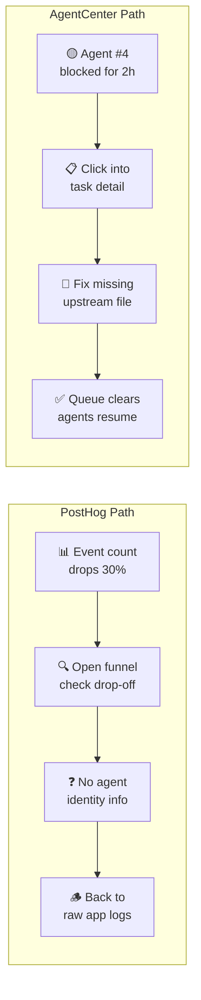

PostHog is one of the better product analytics tools out there. Open-source, self-hostable, genuinely well-built — session replays, funnels, feature flags, and raw SQL access all in one platform. If you run a SaaS product with real users, you've probably already installed it or considered it.

But here's where teams get tripped up: when they add AI agents to their stack, they try to use PostHog to track the agents too. It feels natural. You already have it running. You fire a few events — `agent_task_started`, `agent_task_completed` — and the dashboard lights up with data.

That works fine for a week. Then you have twelve agents running simultaneously, three of them producing wrong output, and PostHog is showing you event counts.

That's the gap. "How are my agents doing?" is a different question from "how are my users behaving?" PostHog answers the second. AgentCenter vs PostHog comes down to this: one is built for product analytics, the other is built to manage AI agents in production.

## What PostHog Does Well

PostHog is a solid analytics platform. For user-facing products, it covers the basics and more:

- **Event capture** — track any user action across web and mobile with a single SDK
- **Session replays** — watch recordings of what users did, including rage clicks and scroll depth
- **Funnel analysis** — see exactly where users drop off in signup, onboarding, or checkout flows
- **Feature flags** — roll changes out gradually and A/B test them with split traffic
- **Retention and cohort analysis** — understand which user segments stick around and which churn
- **SQL access** — query raw event tables directly for custom analysis beyond the built-in charts
- **Self-hosted option** — run the full stack on your own infrastructure for data residency requirements

For understanding user behavior, PostHog is a legitimate choice. The self-hosting option makes it worth evaluating for teams with compliance requirements.

## The Core Problem When Managing AI Agents

The disconnect becomes obvious the moment agents start failing silently.

An agent that ran successfully and an agent that ran successfully but produced garbage output look identical in PostHog. Both fire `agent_task_completed`. Neither event tells you what the output actually said, whether it met your acceptance criteria, or how much it cost in LLM tokens.

Here's what PostHog cannot tell you about your agent fleet:

- Which agents are currently blocked, and on what?
- Which tasks are queued and how long have they been waiting?
- What did the agent actually produce — and did it pass review?
- How much did task #7 cost versus task #12 in token spend?
- Who needs to review an output before it goes downstream?
- When did Agent #3 last send a heartbeat?

These are operational questions about a live system. PostHog handles analytical questions about historical user behavior. Those are different domains, and no amount of custom event instrumentation brings them together without rebuilding most of what AgentCenter ships out of the box.

## AgentCenter vs PostHog: Feature Comparison

| Feature | AgentCenter | PostHog |
|---|---|---|
| Real-time agent status (online / idle / working / blocked) | Yes | No |
| Per-task LLM cost tracking | Yes | No |
| Deliverable review and approval workflows | Yes | No |
| Task assignment and queue management | Yes | No |
| Kanban board for agent work | Yes | No |
| Multi-agent coordination | Yes | No |
| @Mentions and per-task comment threads | Yes | No |
| Agent heartbeat monitoring | Yes | No |
| Recurring task automation | Yes (Pro+) | No |
| User behavior analytics | No | Yes |
| Session replays | No | Yes |
| Feature flags | No | Yes |
| Funnel and retention analysis | No | Yes |
| Direct SQL access to raw events | No | Yes |
| Self-hostable | No | Yes |
| Pricing | From $14/month | Free tier + paid plans |

## Two Workflows for the Same Problem

Here's what it looks like when an agent pipeline breaks — using each tool.

**With PostHog:**

You notice `agent_task_completed` event count dropped 30% this week. You open a funnel from `task_started` to `task_completed`. The drop-off went up. You can't tell which agents caused it. You can't see any output. You start adding more events to your agent code, rebuilding queries, and eventually open raw application logs to piece together what happened. You spend two hours debugging something that probably took two minutes to create.

**With AgentCenter:**

You open the dashboard. Agent #4 has nine tasks queued and hasn't picked one up in two hours. You click in — it's flagged as blocked because an upstream file was missing. You fix the dependency. The queue clears. Meanwhile, Agent #9 submitted a deliverable overnight. You open it, review the output, approve it, and it moves downstream.

PostHog's data is accurate — it's not a data quality problem. The issue is that PostHog shows you what happened in aggregate, and AgentCenter shows you what's happening right now, per agent, with the controls to act on it immediately.

## Can You Use Both?

Yes, if you have a user-facing product and AI agents running behind the scenes.

PostHog handles the product side: did users complete onboarding? Did the new UI improve conversion? Did the feature flag rollout cause any regressions in user retention?

AgentCenter handles the agent side: what tasks are assigned, which agents are running or blocked, what did they produce, how much did each task cost?

The two tools don't overlap much. A SaaS team shipping a product that uses AI agents internally could run both — PostHog tracking the user-facing product, AgentCenter tracking the agent fleet doing backend work. See the [agent monitoring features](/features/agent-monitoring) for what that looks like in practice.

Where they genuinely don't compete: if you have no user-facing product and you're running pure agent workflows — processing pipelines, research agents, content agents — PostHog adds instrumentation overhead without giving you what you actually need. The [task orchestration](/features/task-orchestration) features in AgentCenter have no equivalent in PostHog.

And if your team needs to gate agent output through a human review step before it ships downstream, PostHog has no concept of a deliverable, a reviewer, or an approval workflow. That's not a gap you close with custom events.

## Bottom Line

PostHog is the right tool for understanding user behavior in a product. It was not built for managing AI agents. The event model works for discrete user actions; agents are long-running, stateful, and produce outputs that need human review before they're trusted. Trying to replicate agent management on top of PostHog means writing and maintaining custom infrastructure that AgentCenter ships by default. Check [pricing](/pricing) to see what that costs.

---

*PostHog is good at what it does. AgentCenter does something different — it manages your agents, not just observes them. [Start your 7-day free trial](/pricing) — no lock-in.*
