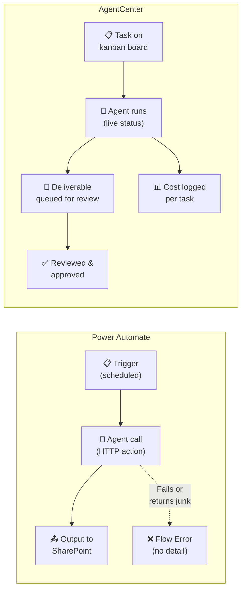

Microsoft Power Automate is genuinely good at what it does. You have a form that triggers an email. A Teams message that creates a SharePoint item. An approval that routes to a manager. For those use cases, it's hard to beat — thousands of connectors, tight Microsoft 365 integration, and a visual builder that non-engineers can actually use.

But then you add an OpenClaw AI agent to your workflow. That's where things get complicated.

## What Power Automate Does Well

- **Connector library**: 1,000+ pre-built integrations covering practically every SaaS tool in an enterprise stack
- **Microsoft ecosystem fit**: Native integration with Teams, Outlook, SharePoint, and Dataverse — if your team lives in M365, Power Automate speaks the same language
- **Visual flow builder**: Non-developers can build and maintain flows without engineering help
- **AI Builder**: Basic AI capabilities (document parsing, prediction models, sentiment analysis) baked into the platform
- **Enterprise compliance**: SOC 2, HIPAA, GDPR support — passes most enterprise security reviews without extra work
- **Approval workflows**: Built-in approval routing that integrates with Teams for simple yes/no decisions
- **Cost predictability**: Pay per flow run or per user — easy to forecast at scale

For deterministic, step-by-step business process automation, Power Automate is mature and well-supported.

## The Problem When AI Agents Enter the Picture

Here's what teams discover once they start running AI agents through Power Automate flows: it was never built for this.

A Power Automate flow expects each step to complete and return a clean result. An AI agent doesn't work that way. It might loop. It might produce a different output than last time for the same input. It might consume 40,000 tokens on one task and 4,000 on the next. It might get stuck waiting on a tool call that never resolves.

Power Automate can tell you the flow ran or failed. It cannot tell you why the agent's output quality degraded between Monday and Thursday. It doesn't show you which agent is blocked right now, or why. There's no way to @mention a team member on a specific agent task, review a deliverable before it ships downstream, or see real-time cost per agent.

One team we talked to was running 8 agents through Power Automate flows. Their feedback: "We could see when something crashed. We couldn't see anything else." They were flying blind on output quality, cost trends, and which agents were genuinely doing useful work.

That gap is what [AgentCenter](/features/agent-dashboard) is built for.

## AgentCenter vs Power Automate: Side by Side

| Feature | Power Automate | AgentCenter |
|---|---|---|
| Primary purpose | Workflow step automation | AI agent management |
| Real-time agent status | No | Online / working / idle / blocked |
| Multi-agent task orchestration | Parallel branches only (static) | Native, with task dependencies |
| Task kanban board | No | Yes — visual per-agent tracking |
| @Mentions and task threads | No | Yes — per task |
| LLM cost tracking | No | Per agent and per task |
| Output review and approval | Basic approve/reject | Full deliverable review workflow |
| Agent error breakdown | Flow failed or succeeded | Error category, context, recurrence |
| OpenClaw compatibility | No | Yes |
| Self-hosting | No | Yes |
| Pricing (team plan) | $15/user/mo (premium) | $14/mo flat (up to 5 agents) |

## How the Same Workflow Looks in Each Tool

Say your team runs a content research agent that pulls competitor data, summarizes findings, and hands off a report to a writer.

**The Power Automate path:**

1. Scheduled trigger fires the flow
2. HTTP action calls the agent
3. Output posts to SharePoint
4. If the agent times out or returns low-quality content, the flow logs a generic error or completes silently
5. No one finds out until a writer opens the SharePoint file

**The AgentCenter path:**

1. Task appears on the [kanban board](/features/task-orchestration) with the agent assigned
2. Real-time status shows the agent working, then completing
3. Deliverable queues for human review before moving downstream
4. Cost is logged against that specific task
5. If output quality drops, the reviewer catches it — not the person who needed the work done

The difference isn't the automation trigger. It's the visibility and human-in-the-loop layer around the agent itself.

## What You Lose Without a Control Plane

Teams that run AI agents purely through workflow tools tend to hit the same set of problems around month two or three.

**Cost surprises**: Token consumption varies widely per task. Without per-agent cost tracking, you find out at the end of the month that one agent consumed 80% of your LLM budget on tasks that weren't high-priority. AgentCenter's [agent monitoring](/features/agent-monitoring) shows you this as it happens.

**Output quality drift**: Agents that worked well in April start producing worse results in June because their prompt context has drifted or the underlying model updated. Without deliverable review in the workflow, that drift is invisible until someone downstream complains.

**No ownership**: When 8 agents are running through 8 different Power Automate flows, nobody knows which team member owns which agent's outputs. AgentCenter adds task ownership, @mentions, and threads so there's always a named person responsible for each piece of work.

## Can You Use Both?

Yes, and it's actually a reasonable split.

Power Automate handles the plumbing: triggering flows from M365 events, routing approved outputs to downstream systems, handling approvals with non-technical stakeholders. Keep those flows in place.

AgentCenter handles the agent layer: who's doing what, what they produced, how much it cost, and whether the output is ready to ship. That's a different problem than connecting apps.

A common integration pattern: Power Automate triggers an HTTP call that creates a task in AgentCenter. AgentCenter manages the agent's work and review cycle. Once approved, a webhook fires back to Power Automate to continue the downstream flow.

You don't need to replace your existing automation. You add a control plane on top of the agent piece — which is exactly the part Power Automate doesn't cover.

## Bottom Line

Power Automate is the right tool for automating predictable, step-by-step business processes across your Microsoft stack. It wasn't designed to manage AI agents with variable token budgets, real-time status, and outputs that need human review before they're trusted. AgentCenter fills that gap.

---

*Power Automate connects your apps well. AgentCenter manages your agents — real-time status, cost tracking, output review, and multi-agent coordination. [Start your 7-day free trial](/pricing) — no lock-in.*
