Prefect is good at what it does. If you're running Python workflows that need retries, scheduling, and reliable execution, it's one of the cleaner tools available. The Python API feels natural, the UI is solid, and it handles failures in ways that raw scripts never will.

But if you're managing a team of AI agents — delegating tasks, reviewing outputs, tracking which agent costs the most, keeping 10 or 20 agents coordinated across projects — Prefect stops being the right answer. Not because it breaks, but because it was never designed for that job.

## What Prefect Does Well

Prefect is a real workflow orchestration platform. It earns its place in production Python stacks.

- **Reliable execution:** Flows run on schedule, retry on failure, and log everything. You get actual guarantees about whether a job ran.
- **Python-first API:** You annotate functions with `@flow` and `@task`. No YAML soup. No domain-specific language to learn.
- **Workflow observability:** The Prefect UI shows run history, failure reasons, and task logs. For debugging a broken pipeline, it works well.
- **Deployment flexibility:** Self-host on your own infrastructure or use Prefect Cloud. Supports Docker, Kubernetes, and serverless workers.
- **Scheduling and triggers:** Cron schedules, event-driven triggers, and manual runs. Covers most orchestration needs out of the box.

If your team runs data pipelines, ETL jobs, or ML training scripts, Prefect is a reasonable choice.

## The Core Problem for AI Agent Teams

Workflow orchestration and agent management are different problems. That distinction matters a lot in practice.

Prefect manages Python functions. It tracks whether a flow ran, retried it if it failed, and logs what happened. That's useful when the work is deterministic — a function takes inputs, produces outputs, done.

AI agents don't work that way. An agent running a research task or drafting client deliverables might run for 20 minutes, produce a draft, and then need a human to review it before anything else happens. Another agent might be blocking on a dependency — waiting on a second agent's output before it can continue. A third might be stuck in a loop, repeating the same search query and you have no idea.

None of that shows up in a workflow dashboard. Prefect will report a task as succeeded (no Python exception raised), even if the agent produced garbage output or looped six times before timing out.

That's the gap. Prefect tells you the function ran. AgentCenter tells you whether the agent did useful work — and gives you tools to intervene if it didn't.

The distinction shows up clearly when something goes wrong at 2pm on a Tuesday. Prefect tells you which flow failed and shows you the stack trace. AgentCenter tells you which agent is blocked, why it's blocked, who needs to unblock it, and what the task context looks like.

## Prefect vs AgentCenter: Side-by-Side

| Feature | Prefect | AgentCenter |
|---|---|---|
| **Primary purpose** | Python workflow orchestration | AI agent management and control |
| **Agent task management** | No — function-level only | Yes — Kanban board, task delegation |
| **Real-time agent status** | No | Yes — online, working, idle, blocked |
| **Deliverable review and approval** | No | Yes — approval workflows per task |
| **Multi-agent coordination** | Not designed for it | Core feature |
| **Cost tracking per agent** | No | Yes — per-agent cost monitoring |
| **Task threads and @mentions** | No | Yes — per-task chat threads |
| **Works with OpenClaw agents** | No | Yes — built for OpenClaw-compatible agents |
| **Free trial** | Free tier available | 7-day free trial on paid plans |
| **Starting price** | ~$29/mo (Prefect Cloud) | $14/mo (Starter, up to 5 agents) |
| **Self-hostable** | Yes | Yes (contact for details) |
| **Best for** | Data pipelines, ETL, ML training jobs | AI agent teams managing production workloads |

## Workflow Comparison: Debugging a Slow Agent

Here's what actually happens when one of your agents starts underperforming or getting stuck.

```mermaid
graph TD
    subgraph "With Prefect"
        P1["🔴 Agent task runs<br/>but output is wrong"] --> P2["📋 Check flow run<br/>in Prefect UI"]
        P2 --> P3["✅ Task shows 'succeeded'<br/>no exception raised"]
        P3 --> P4["🔍 Manually inspect<br/>agent output"]
        P4 --> P5["🛠️ Dig into Python code<br/>to find behavioral issue"]
        P5 --> P6["❓ No coordination tools —<br/>fix and redeploy manually"]
    end
    subgraph "With AgentCenter"
        A1["🔴 Agent idle 40 min<br/>on a 10-min task"] --> A2["📊 Dashboard shows<br/>blocked status + context"]
        A2 --> A3["💬 Open task thread<br/>see dependency missing"]
        A3 --> A4["📣 @Mention upstream<br/>agent owner to resolve"]
        A4 --> A5["✅ Agent resumes,<br/>cost and progress tracked"]
    end
```

**With Prefect:**

1. You notice a workflow ran but the output looks off. No alert fired.
2. Open Prefect Cloud, find the flow run, scroll through logs.
3. The task shows "succeeded" — no Python exception was raised.
4. You realize the agent looped and produced the same paragraph three times before the timeout.
5. You dig into agent code to figure out why. Prefect gave you no signal anything was wrong.
6. You fix the code, redeploy, and re-trigger manually. No coordination layer to help.

**With AgentCenter:**

1. The [agent monitoring dashboard](/features/agent-monitoring) shows one agent idle for 40 minutes on a task that should take 10.
2. You open the task and see the thread — the agent is waiting on a file that an upstream agent hasn't delivered yet.
3. You @mention the upstream agent owner directly in the task thread. They check in, resolve the dependency.
4. The stuck agent resumes. You see cost and progress update in real time.
5. Deliverable goes into review. You approve it before it moves to the next stage.

The difference isn't just interface depth. AgentCenter tracks agent behavior and human coordination together, not just function execution state.

## Can You Use Both?

Yes, and some teams do exactly that.

Prefect (or Airflow, or Dagster) handles infrastructure-level orchestration: triggering jobs on schedule, managing retries at the system level, running ML pipelines. AgentCenter sits on top for everything that involves AI agents doing actual work — delegating tasks, reviewing deliverables, keeping track of which agent is working on what.

If you run a large pipeline that kicks off an AI agent as one of its steps, Prefect can trigger it and log the exit code. But the management of that agent — is it doing the right thing, what did it produce, who's reviewing it — that's AgentCenter's responsibility.

They don't overlap. One handles the plumbing. The other handles the people-and-agents coordination layer.

Small teams starting with three or four agents probably don't need both. As agent count grows and tasks become more interdependent, having a dedicated [task orchestration layer](/features/task-orchestration) becomes the thing that keeps coordination from turning into a mess of Slack messages and spreadsheets.

## Bottom Line

Prefect is a good workflow orchestrator. If you're running Python pipelines, it serves that job well. But it wasn't built to manage AI agents the way you'd manage a distributed team — with visibility into what each agent is doing, the ability to intervene when something goes sideways, and a review process for what they produce.

When your agent count reaches double digits and you're still debugging outputs by reading raw logs, that's the sign you've outgrown orchestration tooling and need a control plane.

---

*Prefect is good at what it does. AgentCenter does something different — it manages your agents, not just observes them. [Start your 7-day free trial](/pricing) — no lock-in.*
