Prometheus is genuinely excellent at what it does. If you want to know whether your agent process is alive, how many requests it's handling per second, or how much memory it's consuming, Prometheus gives you that data cleanly and reliably. Most infrastructure teams already have it running.

So it makes sense that when teams start deploying AI agents, they reach for Prometheus first. They know it. It's already there. And agent processes expose metrics just like any other service.

The problem isn't that Prometheus breaks. The problem is what it doesn't do.

## What Prometheus Does Well

To be fair about this:

- **Time-series metrics at scale**: Prometheus was built for this. High-cardinality metrics, efficient storage, fast queries, flexible alerting with Alertmanager.
- **Infrastructure integration**: Already part of most Kubernetes setups, works with Grafana for dashboards, integrates with most cloud platforms.
- **Open-source and widely supported**: Huge ecosystem, extensive documentation, community-contributed exporters for almost everything.
- **Pull-based scraping**: Easy to wire up to any service that exposes a `/metrics` endpoint. Your agent runtime can emit custom counters in minutes.
- **PromQL**: Once you learn it, it's a powerful query language for slicing and aggregating metrics.

Teams that already know Prometheus well can instrument an agent in a day and have a dashboard running by end of week.

## The Core Limitation for AI Agent Teams

Prometheus answers: "Is something happening?"

It can't answer: "What specifically did my agent do, did it do it correctly, what did it cost, and what should it do next?"

When you're running 3 agents, that's fine. You can mentally track the rest. But at 15 agents across 4 projects, you're flying blind on everything except uptime and throughput.

Here's what gets missed:

**Task-level visibility**: Prometheus can tell you an agent completed 47 operations. It can't tell you what those operations were, whether the outputs were correct, or which specific task is currently blocked waiting on a dependency.

**Deliverable review**: AI agents produce outputs that humans need to review before they're trusted. There's no concept in Prometheus for "this agent submitted a document, flag it for review, mark it approved or rejected." That's not a metrics problem.

**Cost per task**: You can track total LLM token usage with a counter. But attributing cost to a specific task, across multiple agents that may share a pipeline, requires task-level accounting that Prometheus isn't built to handle.

**Agent coordination**: When Agent A finishes and needs to hand off to Agent B, Prometheus records that Agent B started. It doesn't know about the handoff semantics, whether A's output was good enough to proceed, or who to notify.

**Team coordination**: Nobody on your team can comment on a specific agent's output, assign ownership of a failing task, or get a notification that an agent has been blocked for 3 hours, through Prometheus.

## AgentCenter vs Prometheus: Direct Comparison

| Capability | Prometheus | AgentCenter |
|---|---|---|
| Process-level metrics (CPU, memory) | Yes | Via agent health checks |
| Request throughput counters | Yes | Yes, per-task |
| Real-time agent status | Via custom metrics | Built-in (online, working, idle, blocked) |
| Task assignment and tracking | No | Yes, Kanban board |
| Deliverable review workflow | No | Yes, approval system |
| Cost per task | No (totals only) | Yes, per-task attribution |
| @Mentions and team chat | No | Yes, per-task threads |
| Multi-agent coordination | No | Yes, task dependencies |
| Alerting | Yes, via Alertmanager | Yes, built-in notifications |
| Dashboards | Via Grafana | Built-in dashboard |
| Open-source | Yes | SaaS |
| Starting price | Free | $14/mo (Starter) |
| Best for | Infrastructure observability | AI agent operations |

## Workflow Comparison: Handling a Blocked Agent

Here's the difference in practice. An agent processing customer support tickets has been stuck on the same task for 2 hours.

```mermaid
graph TD
    subgraph "Prometheus Workflow"
        A["📊 Alert fires:<br/>task_duration > 2h"] --> B["🔍 Engineer gets paged"]
        B --> C["📉 Pulls metrics in Grafana"]
        C --> D["🔎 Checks logs separately"]
        D --> E["📧 Manually notifies team<br/>via Slack/email"]
        E --> F["✏️ Updates status somewhere<br/>(Jira, Notion, etc.)"]
        F --> G["🔄 Agent restarted manually"]
    end
    subgraph "AgentCenter Workflow"
        H["🚨 Agent status auto-<br/>updates to Blocked"] --> I["📬 Assigned owner notified<br/>automatically"]
        I --> J["💬 Team comments<br/>in-task thread"]
        J --> K["✅ Owner unblocks<br/>or reassigns task"]
        K --> L["🔄 Agent resumes,<br/>status updates live"]
    end
```

With Prometheus, you have data that something is wrong. What you do next involves 3 or 4 other tools. With AgentCenter, the workflow for handling it is built in.

## What About Using Both?

Yes, you can. Many teams do.

Prometheus handles your infrastructure layer: agent process health, system resource usage, request rates, latency histograms. That data is still valuable.

AgentCenter handles your operations layer: what agents are doing, what they've produced, what needs human review, what's blocked, what it costs.

They don't overlap much. Prometheus doesn't try to do task management and AgentCenter doesn't try to replace your metrics stack.

The teams that run both typically set up Prometheus for infra-level alerting (is the process up, is memory spiking) and use AgentCenter for everything related to the work agents actually produce. If you already have Prometheus in your stack, you don't need to remove it.

What you do need to stop doing is treating Prometheus as your agent management layer. It wasn't built for that, and the gaps become more painful as you scale.

## Can You Track Agent Tasks in Prometheus?

Technically yes, with custom labels and counters. You can emit a metric like `agent_task_completed_total` with a `task_id` label and track completion rates per task.

But you hit limits quickly:
- High-cardinality labels (unique task IDs) are expensive in Prometheus
- The data is flat. No context, no history, no conversation thread.
- You're building task tracking on top of a metrics system. It works until it doesn't, and the workarounds compound.

At some point you've written more custom instrumentation than the agent itself. That's the wrong kind of engineering problem.

## Bottom Line

Prometheus is a good monitoring tool. AgentCenter is a management platform. If you're using Prometheus to track what your AI agents are doing operationally, you're getting metrics but missing the structure you need to actually run your [agent fleet](/features/agent-monitoring) at scale.

Use Prometheus for what it's built for. Use [AgentCenter](/features) for the rest.

---

*Prometheus tells you an agent is running. AgentCenter tells you what it's doing, whether it's doing it right, and what happens next. [Start your 7-day free trial](/pricing) — no lock-in.*
