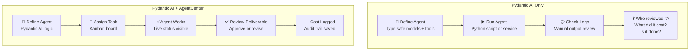

Pydantic AI is a genuinely good Python framework for building AI agents. The type safety is real, the dependency injection for tools is clean, and the team behind it has a strong track record — they built Pydantic, which is already a core part of most Python AI stacks. If you're starting a new agent in Python today, Pydantic AI is worth a serious look.

But "good for building agents" and "good for running agents in production" are two different problems. Pydantic AI solves the first one well. This post is about what happens after — when agents are live, tasks are piling up, and your team needs to know what's working.

## What Pydantic AI Does Well

Be fair here: Pydantic AI has a lot going for it.

- **Type-safe agent definitions** — Input and output types are validated at runtime. This catches a whole class of agent bugs before they reach users. If your agent is supposed to return a structured report, it either returns one or fails fast.
- **Clean tool registration** — Tools are decorated Python functions. Dependencies inject naturally. The API feels like it was designed by people who actually write production Python.
- **Multi-provider support** — Anthropic Claude, OpenAI, Gemini, Groq, and others work out of the box with a consistent interface.
- **Async-first design** — Built for async from the ground up, which matters when agents are waiting on external API calls and tool results.
- **Structured output by default** — Pydantic models define what the agent returns. No manual JSON parsing, no guessing what shape the output is.
- **Streaming support** — Real-time token streaming works cleanly for user-facing applications.
- **Lightweight** — It's a Python package. No infrastructure to spin up.

If you're writing agent logic in Python, Pydantic AI gives you structure and type safety that raw API calls don't.

## The Core Limitation for Teams Managing Agents

Pydantic AI is a build-time tool. It helps you define what an agent does. It doesn't help you see what that agent is doing once it's running — not across multiple tasks, not across a team, and not over time.

Think about what happens three months after you ship your first Pydantic AI agent. You have four agents running in parallel. One is stalled. One finished but nobody reviewed the output. One is burning through tokens at three times the expected rate. One has been erroring silently for six hours.

None of that shows up in Pydantic AI. It gives you the tools to define agent behavior. The runtime visibility, task coordination, cost tracking, and review workflows live somewhere else — usually in a spreadsheet, a Slack thread, or nowhere at all.

That's not a knock on Pydantic AI. It wasn't built to do those things. It's a framework for wiring up agent logic. The control plane is a different layer of the stack.

## Pydantic AI vs AgentCenter: Side-by-Side

| Feature | Pydantic AI | AgentCenter |
|---|---|---|
| Agent logic and type-safe definitions | Yes | No — AgentCenter manages agents, not builds them |
| Multi-provider LLM support | Yes | Yes (Anthropic, OpenAI, Gemini, others via OpenClaw) |
| Structured output enforcement | Yes (Pydantic models) | Yes (deliverable review + output schemas) |
| Real-time agent status | No | Yes — live Kanban: online, working, idle, blocked |
| Task assignment and tracking | No | Yes — Kanban board, task queues, due dates, priorities |
| Deliverable review and approval | No | Yes — submit, review, approve or request revision |
| Team collaboration | No | Yes — @mentions, threads, activity feed per task |
| Per-task cost tracking | No | Yes — token cost logged per task and per agent |
| Agent monitoring dashboard | No | Yes — work sessions, error rates, cost trends |
| Multi-agent runtime coordination | No | Yes — task dependencies, handoffs, lead orchestrator |
| Recurring task automation | No | Yes (Pro+) |
| Pricing | Free (open source) | Starter $14/mo, Pro $29/mo, Scale $79/mo |
| Setup | pip install | Hosted dashboard + OpenClaw agent connection |

## How Each Workflow Looks

The difference between the two is clearest when you look at what happens day-to-day.

**Their way (Pydantic AI alone):**

1. Define agent with Pydantic models and tool decorators
2. Deploy to your own infrastructure — a script, a container, an API endpoint
3. Send tasks by calling the agent directly from your code
4. Check logs after the fact to see what happened
5. Review outputs manually, usually by whoever notices something looks wrong
6. Track costs by parsing LLM provider billing, roughly

This works fine for one agent running once a day. It breaks down when you have multiple agents, multiple team members, and tasks arriving continuously.

**With AgentCenter added:**

1. Build agent logic in Pydantic AI (nothing changes there)
2. Connect agent to AgentCenter via the OpenClaw API
3. Create tasks on the Kanban board — assign to agent, set priority, add context
4. Watch live status: online, working, blocked
5. Agent submits a deliverable when done
6. Team member reviews and approves or sends back for revision
7. Token cost logged automatically per task

The agent code doesn't change. You're adding a management layer on top of the same Pydantic AI logic.

## Can You Use Both?

Yes, and this is actually the common pattern. Pydantic AI handles what the agent does — the tools it can call, the types it accepts, the output it returns. AgentCenter handles how that agent fits into your team's workflow — what it's working on, who can see it, whether the output passed review, and what it cost.

Think of it like a well-built API. You write the code that handles requests. You separately add a monitoring and coordination layer to track what's happening in production. Neither layer is redundant. They solve adjacent problems.

Teams using Pydantic AI to build agents and AgentCenter to run them don't have to rewrite anything. The [agent dashboard](/features/agent-dashboard) sits on top of whatever framework you built with.

The one scenario where you might truly choose one over the other: if you're still prototyping and haven't shipped anything to production, AgentCenter adds more overhead than you need. Start with Pydantic AI, get the agent logic working, then add the control plane when agents are running against real workloads and real users.

## What Teams Discover in Production

A few patterns show up consistently once agents leave staging.

Output review becomes a bottleneck. Agents produce more than your team can read. Without a review workflow and approval gate, everything either ships without human eyes or sits in someone's email until it's stale.

Cost tracking is harder than expected. Pydantic AI logs don't break down token costs per task or per agent. Provider billing gives you a monthly total. Figuring out which agent ran 40% over budget takes more work than it should.

Agent ownership gets fuzzy. The person who built the agent moves to another project. Tasks come in. Nobody is clearly responsible for reviewing outputs or responding when something looks wrong.

These aren't problems Pydantic AI is supposed to solve. They're operations problems. That's exactly what a [multi-agent workflow](/features/multi-agent-workflows) control plane handles.

## Bottom Line

Pydantic AI is a build-time framework. AgentCenter is a runtime control plane. If you're still prototyping, you probably don't need AgentCenter yet. If agents are running against real inputs, real users, or real business processes, you need somewhere to see what they're doing — and Pydantic AI alone won't give you that.

---

*Pydantic AI is good at what it does. AgentCenter does something different — it manages your agents, not just defines them. [Start your 7-day free trial](/pricing) — no lock-in.*
