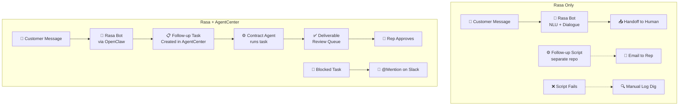

Rasa has been around long enough that most teams building conversational AI have used it at least once. Open source, Python-first, strong NLU pipeline, and now with Rasa Pro tying LLMs into their CALM framework, it holds its own for building chat and voice agents that need custom logic rather than generic LLM responses.

But there's a question that comes up around month three: what happens to those agents after they ship? Once you have four conversational agents in production, plus two data-processing agents your team wrote in a different framework, plus a scheduled agent that runs nightly reports — who tracks which one is failing, which one spent $600 last week on tool calls, and which deliverables need human review before they go to a customer?

Rasa doesn't answer that. It's not trying to.

## What Rasa Does Well

Give Rasa credit where it earns it. It's a serious framework, not a demo toy.

- **Custom NLU pipelines**: You control tokenization, entity extraction, intent classification, and can swap components without rewriting the whole stack
- **Dialogue policies**: Rule-based, memoization, and machine-learned policies for conversation flow that goes beyond one-shot LLM responses
- **CALM with LLMs**: Rasa Pro's Conversational AI with Language Models lets you use LLMs for understanding while keeping business logic deterministic
- **On-premise deployment**: Full self-hosted setup for regulated industries that can't send conversations to a hosted service
- **Voice and multi-channel**: Deploy the same agent across web, WhatsApp, Slack, phone, and custom channels through connectors
- **Tracing and analytics**: Rasa Pro includes conversation analytics, session tracking, and story-based debugging
- **Community and maturity**: Battle-tested by enterprise support teams for years, with real production case studies

If your problem is "we need a customer support agent that handles account questions, follows compliance rules, and doesn't hallucinate policies," Rasa is a defensible choice. It's especially strong for teams in banking, healthcare, and government where the LLM-only approach is a non-starter.

## Where the Gap Shows Up

Rasa builds one type of agent very well: the conversational one. But that's usually not the only agent a team has.

Here's a pattern we see: a company starts with a Rasa-built support bot. It works. Then someone writes a Python script that summarizes support conversations into weekly reports. Then a data team spins up a LangChain agent to enrich CRM records from those conversations. Then someone else adds a scheduled agent that flags high-risk cases for manual review.

Four agents. Three different frameworks. Zero shared visibility.

Rasa Pro has good analytics for what Rasa runs. It doesn't see the Python summarizer. It doesn't see the LangChain enrichment agent. It doesn't know a task is blocked waiting on human review. And when the LLM bill arrives at end of month, nobody can say which agent drove the spike.

That's the gap AgentCenter fills. It's a dashboard that sits above whatever framework your agents are written in. Kanban tasks, real-time agent status, cost tracking per agent, deliverable review workflows, and team coordination. It doesn't replace Rasa — it wraps around the fleet, including the Rasa piece.

## AgentCenter vs Rasa: Side-by-Side

| Feature | AgentCenter | Rasa |
|---|---|---|
| **Primary purpose** | Manage AI agents in production | Build conversational AI agents |
| **Agent scope** | Any OpenClaw-compatible agent, any framework | Rasa-built conversational agents |
| **Task management** | Kanban board with priorities, deadlines, assignees | No task board — conversations only |
| **Real-time agent status** | Live view: online, working, idle, blocked | Bot process status via infra tools |
| **Cost tracking per agent** | Built-in LLM and tool-call cost per task | Not tracked in Rasa itself |
| **Deliverable review** | Approval workflows for agent outputs | Human handoff in dialogue, not review queue |
| **Multi-agent coordination** | @mentions, comment threads, cross-agent handoffs | Single-agent focus per bot |
| **Recurring / scheduled tasks** | Cron-style scheduling on Pro+ | Requires external scheduler |
| **Team collaboration** | Multi-user, per-task comments, activity feed | Developer-focused, less team-friendly |
| **Deployment model** | Hosted SaaS with cloud VMs on Scale plan | Self-hosted or Rasa Pro cloud |
| **Pricing** | Starter $14/mo, Pro $29/mo, Scale $79/mo — see [pricing](/pricing) | Open source free; Rasa Pro custom enterprise pricing |

## How the Workflow Compares

Say your team runs a Rasa support bot that handles account questions. Some conversations need to trigger a follow-up: an agent that pulls the customer's contract, checks for exceptions, and writes a summary for a human rep to review.

Here's the difference when you add AgentCenter on top of Rasa.

**The Rasa-only flow:**

1. Bot handles the conversation. Hands off to a rep when it hits a limit.
2. A separate follow-up script kicks off. Nobody sees it running.
3. The script fails on an edge case. Nobody notices for two days.
4. The rep chases down what happened by reading raw logs across two systems.
5. Nobody knows which agent cost what. Monthly LLM bill is a mystery.

**The Rasa + AgentCenter flow:**

1. Bot runs through OpenClaw. Conversation triggers a follow-up task in AgentCenter via [task orchestration](/features/task-orchestration).
2. Contract agent picks up the task. Runs it. Deliverable lands in a review queue.
3. Rep approves or sends back. Every action is logged, timestamped, and attributed.
4. If the agent blocks, the on-call person gets an @mention in Slack.
5. Monthly review through [agent monitoring](/features/agent-monitoring) shows exactly what each agent spent and delivered.

The second flow costs more setup time up front. It also means the third-week failure is a notification, not a customer complaint.

## Can You Use Both?

Yes, and it's the right setup for most teams past a certain scale.

Rasa is where you build the conversational layer — NLU, dialogue policies, LLM-augmented understanding, deterministic business logic. AgentCenter is where you manage the operational layer around all your agents, Rasa and otherwise. The two don't overlap. Rasa doesn't try to be a fleet dashboard. AgentCenter doesn't try to build your NLU pipeline.

A single Rasa bot with no downstream agents doesn't need AgentCenter. You can watch Rasa's own analytics and be fine. The moment you have three or four agents running across different frameworks, or your team needs to review outputs before they reach a customer, that's when the missing layer starts to hurt.

Any Rasa-built agent can send tasks through OpenClaw and show up in AgentCenter alongside your other agents. The agent code doesn't change. The team just gets one place to see what's happening.

## Bottom Line

Rasa is one of the better ways to build a conversational AI agent, especially for teams that need on-premise deployment and deterministic logic. But building conversational agents and managing an agent fleet are different jobs. AgentCenter picks up where Rasa ends — task tracking, cost visibility, output review, and team coordination across every agent you run, not just the ones written in Rasa.

---

*Rasa builds the conversation. AgentCenter manages the operation around it. [Start your 7-day free trial](/pricing) — no lock-in.*
