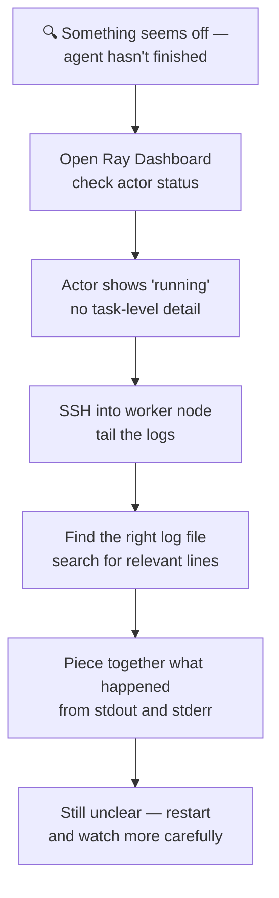
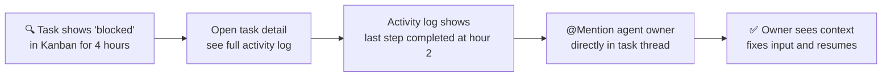

Ray is impressive infrastructure. If you need to run Python code across 50 machines simultaneously, or deploy a model that handles thousands of requests per second, Ray is one of the better tools for that job. The team at Anyscale built something genuinely useful.

The question isn't whether Ray is good. It is. The question is whether a distributed compute framework is the right tool for managing the day-to-day operations of an AI agent fleet. Those are different problems, and confusing them costs teams weeks.

## What Ray Does Well

Ray's strengths are real:

- **Distributed execution at scale.** Ray handles parallel Python workloads across clusters well. You can spin up hundreds of Ray Actors without writing much glue code — the scheduling happens automatically.
- **Ray Serve for model deployment.** Deploy LLMs as HTTP endpoints that autoscale under load. This is genuinely useful when you're running inference at volume and can't predict traffic.
- **Task parallelism with low overhead.** Remote functions in Ray add minimal latency. Fan out work across workers and collect results without managing threads manually.
- **Fault tolerance.** Ray Actors restart automatically on failure. For long-running distributed jobs, that resilience matters.
- **Ecosystem depth.** Ray integrates with PyTorch, HuggingFace, and a growing set of AI tooling. If you're already in that ecosystem, Ray fits naturally.
- **Open source.** Free to run on your own infrastructure. The Anyscale managed platform costs extra, but the core library doesn't.

If your problem is compute — scaling inference, parallelizing preprocessing, distributing training runs — Ray addresses it. That's a real problem and Ray handles it well.

## The Core Limitation for Agent Teams

Here's the gap: Ray tells you what your code is doing at the infrastructure layer. It doesn't tell you what your agents are doing at the task layer.

Say you're running 12 OpenClaw AI agents in production. Three are researching competitors, two are drafting reports, four are processing customer tickets, and three are running background data pipelines. Questions you'll ask constantly:

- Which agent produced what output this week?
- Which task has been waiting for human review for three days?
- How much did each agent cost to run yesterday — and which project is burning the most tokens?
- Who owns the agent that's been "working" for 6 hours without finishing?

Ray can tell you CPU utilization per actor and bytes transferred across nodes. It cannot answer any of those four questions. There's no task board. No deliverable tracking. No @mentions when an agent needs attention. No approval workflow before an agent's output goes downstream. No cost-per-task breakdown you can hand to a product manager.

That's not a knock on Ray — it was never designed to do those things. It's a distributed compute framework, not an agent control plane. But teams discovering that gap mid-production are the ones who end up building their own dashboards and spending weeks on glue code that should already exist.

## AgentCenter vs Ray: Feature Comparison

| Feature | Ray | AgentCenter |
|---|---|---|
| Primary purpose | Distributed compute and scaling | AI agent operations and control |
| Task tracking | No task concept — only jobs and actors | Kanban board per agent and per project |
| Agent status visibility | Worker metrics: CPU, memory, throughput | Online / working / idle / blocked per agent |
| Cost per task | No task-level cost tracking | Token cost tracked per task, per agent |
| Multi-agent coordination | Manual via Actor references | Built-in task handoffs and dependencies |
| Deliverable review | None — outputs go wherever code sends them | Review and approval workflows per deliverable |
| Team collaboration | None | @Mentions and chat threads per task |
| Non-technical visibility | Requires reading dashboards and logs | Kanban board any teammate can open |
| Pricing | Free (open source); Anyscale managed is custom | Starter $14/mo, Pro $29/mo, Scale $79/mo |
| Self-host option | Yes | Yes — see `/self-hosting` |
| Setup path | Cluster configuration, Ray workers | Account + OpenClaw agent connection |
| Built for | Engineers scaling compute workloads | Teams managing AI agents in production |

## Workflow Comparison: Debugging a Stuck Agent

Concrete example. Your research agent has been running for 4 hours and hasn't produced output. What do you do?

**With Ray only:**

You're debugging at the infrastructure layer. The actor is running. That's all Ray can confirm. What task was it working on? What has it produced so far? Has it called the right tools in the right order? You don't know without custom logging, then reading it.

**With AgentCenter:**

AgentCenter shows task state in a format any team member can read. You don't need to know how distributed scheduling works to understand that a task is blocked at step 3 of 5, or that it last called a tool successfully at 14:32.

The [agent monitoring](/features/agent-monitoring) view shows status across your entire fleet — not aggregate CPU stats, but per-task status you can act on. That's the difference between infrastructure observability and agent operations.

## Can You Use Both?

Yes — and for large-scale deployments, this is a reasonable architecture.

Ray handles the compute layer. Your OpenClaw agents run on Ray workers, getting the scaling and fault tolerance Ray provides. AgentCenter sits above that, managing the task layer — tracking what each agent is doing, surfacing outputs for review, coordinating handoffs between agents across the [task orchestration board](/features/task-orchestration).

You can also run AgentCenter without Ray entirely. Most teams with fewer than 50 agents don't need Ray's distributed compute. Standard cloud VMs handle the load fine, and AgentCenter provides the operational visibility without adding cluster configuration overhead.

Ray adds clear value when you have genuine compute scaling needs: models serving thousands of concurrent requests, parallel jobs across many workers, heavy inference workloads where you need autoscaling. If that's your situation, adding AgentCenter on top gives you both the infrastructure muscle and the operational layer your team actually looks at.

If you don't have those scale requirements yet — and most teams with under 20 agents don't — starting with AgentCenter on standard infrastructure is the faster path. You get the control plane immediately, without spending two weeks on cluster configuration first.

## Bottom Line

Ray solves distributed compute. That's a real problem, and it's solved well. But scaling your code isn't the same as managing your agents. A team running AI agents in production needs task visibility, cost tracking, and review workflows — and Ray provides none of those. AgentCenter is the layer that makes agent operations legible to the whole team, not just the engineer who wrote the workers.

---

*Ray is good at what it does. AgentCenter does something different — it manages your agents, not just the infrastructure running them. [Start your 7-day free trial](/pricing) — no lock-in.*
