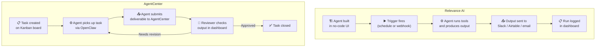

Relevance AI is one of the better no-code agent builders available right now. If you need to go from "I have an idea for an AI agent" to "this agent is running tasks" in an afternoon, it delivers. The tool-builder interface is clean, the integrations cover most common APIs, and you don't need to write a line of Python to get something working.

But here's what teams run into six weeks after launch: the agent is live, it's running every day, it's producing outputs that real humans depend on — and there's no good place to track what it did, catch when it drifted, or route a specific output to a human reviewer before it lands somewhere important.

That's not a failure of Relevance AI. That's just not what it was built for.

## What Relevance AI Does Well

To be fair: Relevance AI is excellent at building agents. Specifically:

- **No-code agent creation**: Chain tools, configure memory, set LLM behavior, and test in a single UI without touching code. The builder is one of the cleaner ones in this space.
- **Tool library**: Pre-built integrations for Google Search, Notion, Slack, Airtable, Gmail, and others. No custom connector work needed for common APIs.
- **Agent templates**: A growing library of ready-made agents for research, CRM automation, lead enrichment, and support. Clone and customize.
- **Shared workspace**: Multiple people can access, edit, and trigger agents in a shared team environment.
- **Scheduled and webhook triggers**: Agents can run on a time schedule or be triggered by an external event, which covers most automation patterns.

If you're a small team standing up your first few agents, Relevance AI meaningfully reduces setup time. The prototype-to-working-agent loop is fast. That matters when you're validating whether an agent is even worth building.

## The Gap That Shows Up in Production

Once agents are doing real work, a different set of questions appears — and these are harder to answer inside a builder tool:

- Which tasks ran today, and which are still pending?
- Did this agent's output get checked by a human before it went to the client?
- Why did that task fail at 2am — and what exactly did the agent try?
- How much did this agent cost last week across all its runs?
- Who owns this agent now that the person who built it left the team?
- If three agents are running right now, which one is blocked?

Relevance AI logs individual tool calls and shows run history. But it doesn't give you a task board with assignable human reviewers. It doesn't let you @mention a teammate on a specific output. It doesn't surface which of your 15 agents is actively working versus stuck waiting on an API response.

One team we've seen described it well: "We knew when agents ran. We didn't know what they actually produced or whether it was usable." That's the gap between a builder and a control plane.

You can explore how [agent monitoring](/features/agent-monitoring) works once agents are running production tasks.

## AgentCenter vs Relevance AI: Side by Side

For a detailed feature breakdown, see the [Relevance AI comparison page](/compare/vs-relevance-ai). Here's the quick version:

| Feature | Relevance AI | AgentCenter |
|---|---|---|
| Build AI agents (no-code) | Yes — core feature | No — connects to OpenClaw agents |
| Run agents on schedule | Yes | Yes via OpenClaw |
| Real-time agent status (working / idle / blocked) | Limited | Yes — live per-agent status |
| Kanban task board across agents | No | Yes |
| Human review and approval gate | No | Yes — deliverable review workflow |
| @Mentions and task-level threads | No | Yes |
| Per-task cost tracking | Basic run cost | Yes — task-level token breakdown |
| Multi-agent task handoffs | Basic | Yes — with dependencies |
| Named agent ownership | No | Yes |
| Error alerts and failure visibility | Run logs | Real-time alerts |
| Pricing | From ~$19/mo | From $14/mo (Starter) |
| Best for | Building and prototyping agents | Managing agents in production |

## How the Workflow Compares

Here's what a research agent workflow looks like in each tool — not at the build stage, but once the agent is running every day.

**In Relevance AI:**
1. Agent triggers at 9am on schedule
2. It runs, calls tools, and produces output
3. Output goes to wherever you pointed it — Airtable, Slack, email
4. You review run logs only if something seems wrong
5. There's no built-in step where a human reviews the output before it leaves the system

**In AgentCenter:**
1. A task appears in the agent's queue (from a recurring schedule or manual creation)
2. The agent picks it up and starts working via the OpenClaw runtime
3. When done, it submits a deliverable — the output stays inside AgentCenter first
4. A designated reviewer sees the deliverable, checks it, and either approves or sends it back with notes
5. The task closes only after a human sign-off

That review gate changes the accountability model. When agents produce outputs that go to clients, databases, or external APIs, the difference between an autonomous pipeline and a human-in-the-loop process is that one step.

## Can You Use Both?

Yes — and this is worth saying plainly.

Relevance AI builds and hosts agents. AgentCenter manages agents in production. They're not solving the same problem, so they don't really compete at the tool level.

Some teams build agents in Relevance AI and then connect them to AgentCenter via OpenClaw to get task visibility, cost tracking, and deliverable review on top. The two products complement each other if you're invested in the Relevance AI builder but need a control plane for day-to-day operations.

If you're still prototyping your first agent, AgentCenter may feel like too much overhead. Come back to it when the agent starts doing something real that other people depend on. That's when you need it.

## Bottom Line

Relevance AI helps you build agents. AgentCenter helps you run them. If your agents are handling work that humans depend on — client deliverables, database updates, outbound communications — you'll want operational visibility that a builder tool isn't designed to provide.

The two tools are most useful together, not as substitutes for each other.

---

*Relevance AI is good at what it does. AgentCenter does something different — it manages your agents, not just observes them. [Start your 7-day free trial](/pricing) — no lock-in.*
