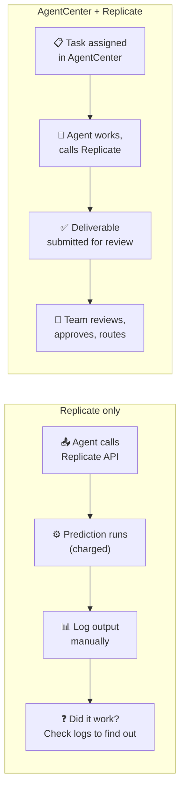

Replicate is genuinely useful. If you want to run Llama, SDXL, Whisper, or hundreds of other open-source models via a single API call, it's hard to beat. No GPU setup, no model serving infrastructure, pay per prediction.

But at some point, your team started building agents on top of those models. And then you had a different problem: not "how do I run this model?" but "what are my agents actually doing, and how do I know any of it worked?"

That's the gap Replicate doesn't fill. It was never designed to.

## What Replicate Does Well

To be fair:

- **Zero-infrastructure inference**: Call any of thousands of hosted models via a REST API with no setup
- **Pay-per-prediction pricing**: You only pay when something runs — no idle GPU costs
- **Model versioning**: Pin a model to a specific version so your results stay reproducible
- **Auto-scaling compute**: Burst to handle spikes without managing clusters
- **Wide model library**: Stable Diffusion, Llama 3, Whisper, CodeLlama, Flux — most popular open-source models are there

For prototyping agents that call ML models, Replicate removes real friction. That's why teams reach for it early.

## The Problem When You Have Agents in Production

Here's what happens around the time you go from 1 agent to 5.

Your agents call Replicate for inference. The predictions run. But then:

- You have no idea which tasks each agent completed or failed
- You can't see what any agent produced — only that predictions were made
- One agent gets blocked waiting on another, and you find out two days later in a Slack message
- A deliverable goes downstream with a quality issue and you trace it back through logs for an hour
- You want to assign a new task to a specific agent but have no interface to do that

Replicate shows you compute metrics. It doesn't show you agent operations. Those are different things, and the gap grows fast.

## AgentCenter vs Replicate: Side by Side

| Feature | Replicate | AgentCenter |
|---|---|---|
| Primary purpose | ML model inference API | AI agent operations control plane |
| Task tracking | None | Kanban with priorities, statuses, assignments |
| Agent status visibility | Compute metrics only | Online, working, idle, blocked — real-time |
| Deliverable review | None | Submission, review, and approval workflows |
| Multi-agent coordination | None | Task routing, @mentions, pipeline handoffs |
| Per-task cost tracking | Per-prediction billing | Cost attribution per agent, per task |
| Human-in-the-loop | None | @mentions, approval gates, review queues |
| Team collaboration | None | Channels, threads, shared task queues |
| Pricing model | Pay-per-prediction | $14/mo Starter, $29/mo Pro, $79/mo Scale |
| Agent health monitoring | None | Heartbeat, auto-sleep, blocked state detection |

The table makes it obvious: these tools don't compete. They operate at different levels of the stack.

## Workflow Comparison

Here's what managing agents looks like with each approach.

**With Replicate only:**

1. Your agent code calls the Replicate API
2. The model runs and returns a result
3. Your agent processes it and writes output somewhere — a file, a database, an email
4. If something went wrong, you find out when a user complains or when you dig through logs
5. No one on your team has visibility into what ran, what it produced, or whether any of it was any good

**With AgentCenter:**

1. Tasks are assigned to agents with descriptions and acceptance criteria
2. Agents pick up tasks, update status in real-time (working, blocked, completed)
3. Deliverables are submitted through review gates before moving downstream
4. The team sees every agent's status on a shared [Kanban board](/features/task-orchestration)
5. [Agent monitoring](/features/agent-monitoring) shows which agents are active, how much each task costs, and where things are stuck

The Replicate calls still happen in step 2 — AgentCenter doesn't replace that. It wraps the operational layer around it.

## Can You Use Both?

Yes, and this is actually the intended pattern.

Replicate is infrastructure. It runs the models your agents need for inference. AgentCenter is the control plane. It manages what those agents are doing with the results.

If your agents call Replicate for image generation, transcription, or code generation, those calls still work exactly the same. AgentCenter sits above that — tracking tasks, capturing deliverables, and giving your team visibility into the work.

Most teams using AgentCenter still have agents that call external APIs, including Replicate, OpenAI, Anthropic, or other providers. AgentCenter doesn't care which inference layer you use.

## Why Teams Get Stuck Using Replicate as Their "Agent Dashboard"

It's a natural mistake. You build agents. You use Replicate for the heavy lifting. Replicate's dashboard shows you predictions, costs, and compute usage. For a while, that feels like visibility.

Then you realize what you're actually missing:

- You can see that 400 predictions ran. You can't see which 40 of them failed to produce usable output.
- You can see the compute cost. You can't see which agent task drove it or whether that task was worth running.
- You can see model versions. You can't see whether the human reviewed the output or whether it went straight into production unchecked.

Replicate is excellent at showing you what the model did. It has no concept of what the agent was supposed to accomplish.

## Bottom Line

Replicate is the right tool for running ML model inference without infrastructure. If you're building agents that need access to open-source models at scale, it earns its place in your stack.

But once you have agents in production — more than two or three, with real tasks and real deliverables — you need a control plane that tracks what they're doing, not just what the models computed. That's a different problem, and it needs a different tool. Check out [AgentCenter's features](/features) to see what that looks like in practice.

---

*Replicate is good at what it does. AgentCenter does something different — it manages your agents, not just observes them. [Start your 7-day free trial](/pricing) — no lock-in.*
