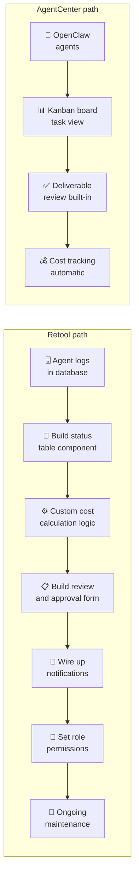

Retool is genuinely useful. If you need an internal tool fast — a form that writes to a database, a table that queries Postgres, a button that calls a webhook — it's the right pick. Flexible, well-documented, connects to almost anything. A developer can ship a working internal app in a day.

So when teams start running AI agents, the instinct makes sense: "We already have Retool. Let's just build the agent dashboard there."

That's where it gets expensive — not in Retool's pricing, but in engineering time.

## What Retool Does Well

To be fair about it:

- **Custom internal tools, fast.** If you know JavaScript and SQL, you can build most internal apps in hours.
- **Wide connector library.** Databases, REST APIs, GraphQL, Firebase, S3 — it connects to most things your stack already uses.
- **Flexible components.** Tables, charts, forms, modals, file uploads — you pick what to show and how.
- **Team access controls.** Role-based permissions, so the right people can see and edit the right things.
- **Low learning curve for junior devs.** Drag-and-drop with escape hatches for custom logic.

None of that is hype. Retool is good at what it does.

## The Problem When You Point It at AI Agents

Managing agents in production isn't just displaying data. It's a workflow problem.

You need to know which agents are running, which are blocked, which failed silently. You need to track what each one costs per task — not just total spend, but *per agent, per run, broken down by model*. You need humans to review agent output before it ships anywhere. You need task handoffs between agents when one finishes and another needs to start. You need threads, comments, @mentions so your team can coordinate around specific tasks without losing context in Slack.

Retool can display anything. But none of the agent-specific workflow logic exists by default. You build it yourself.

Here's what that usually means in practice: two to four weeks building the initial dashboard, another two weeks as the requirements shift when you realize what you actually need, then ongoing maintenance every time your agent setup changes. One team we heard from spent six weeks building a Retool agent tracker before switching to AgentCenter. The Retool version worked, technically. It was just permanent infrastructure to maintain.

## AgentCenter vs Retool: Side-by-Side

| Feature | AgentCenter | Retool |
|---|---|---|
| Primary purpose | Control plane for AI agents | Custom internal tool builder |
| Agent task queue (Kanban) | Built-in | Build from scratch |
| Real-time agent status | Online, idle, blocked, error — built-in | Wire via polling or webhooks |
| LLM cost tracking per agent | Built-in, per task | Manual — connect your own data source |
| Deliverable review and approval | Built-in approval workflow | Build the form and logic yourself |
| @Mentions and task threads | Yes | No native concept |
| Multi-agent workflow coordination | Yes | No concept of agents |
| Recurring task automation | Pro+ plan | Retool Workflows (separate product) |
| Time to get running | Under an hour | Weeks to months |
| Starting price | $14/mo (5 agents, 3 projects) | $10/user/mo (minimum 5 users = $50/mo) |
| Who it's for | Teams managing OpenClaw AI agents | Teams building general internal tools |

## How Each One Handles the Same Job

Say you have 8 agents running. You want visibility into: which ones are active, which failed, what each one cost this week, and whether a human approved the output before it went out.

**The Retool path:**

1. Store agent logs and status in a database your stack already writes to
2. Connect Retool to that database
3. Build a table component that queries agent status and refreshes on a timer
4. Write custom JavaScript to calculate per-agent costs from token logs
5. Build a separate review form where humans can mark output approved or rejected
6. Wire up notifications so reviewers know when something needs their attention
7. Add permission roles so reviewers can approve but not edit
8. Debug why the "real-time" polling is 30 seconds behind
9. Maintain all of it every time you add an agent or change what they output

**The AgentCenter path:**

1. Connect your OpenClaw agents to AgentCenter
2. Assign tasks on the Kanban board — agents pick them up automatically
3. Review deliverables directly in the task thread, approve or reject with one click
4. Cost breakdown per agent is on the [monitoring dashboard](/features/agent-monitoring) by default

The difference isn't capability. Retool can produce something that works. The difference is who's building and maintaining the infrastructure — you, or a product designed specifically for this job.

## Can You Use Both?

Yes, and they don't overlap.

Retool is a general-purpose internal tool builder. AgentCenter is specifically a control plane for AI agents. If you're already using Retool for other internal apps — admin panels, data exploration, customer support tools — keep it. There's no reason to replace it.

Where you'd use AgentCenter instead: any time you want visibility into what your agents are doing, what they're costing, and whether their output is good enough to ship. That's not Retool's job, and shoehorning it into Retool creates something you'll maintain forever.

The teams that work best use both: Retool for custom one-off internal tooling, AgentCenter for the agent control plane that handles task management, [multi-agent coordination](/features/multi-agent-workflows), review workflows, and production monitoring.

## Bottom Line

Retool builds whatever you spec. For general internal tools, that flexibility is the whole point. For managing AI agents in production, you'd spend weeks building something AgentCenter ships on day one. If your agents are running jobs that matter, the control plane shouldn't be a project — it should be infrastructure you turn on.

---

*Retool is the right tool for building internal apps from scratch. AgentCenter is already built for agents. [Start your 7-day free trial](/pricing) — no lock-in.*
