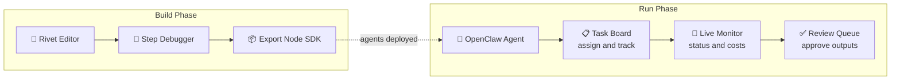

Rivet is one of the most thoughtfully built tools for working with AI agent pipelines. The visual node editor is genuinely good: you wire together LLM calls, tool invocations, conditionals, and loops, then step through execution node by node to see exactly where something went wrong. If you've spent time adding console logs, re-running, and still not understanding why your agent took a wrong turn, Rivet feels like a real upgrade.

But there's a question worth asking before you commit to it: what happens after you ship?

Rivet is a build tool. Once your pipeline is deployed and running, Rivet steps back. It doesn't tell you which of your agents is stuck, which one is burning tokens on a retry loop, or which one produced output that a human needs to check before it goes anywhere. That's not a knock on Rivet. It's just not what it was built for.

## What Rivet Does Well

- **Visual pipeline editor** — drag and drop LLM calls, tool invocations, subgraphs, and control flow into working agent pipelines without writing a full codebase first
- **Step-through debugger** — see every node's input and output during a run; find exactly where logic broke without digging through raw logs
- **Open source** — free to use, self-host, and modify; no vendor lock-in at the build layer
- **Supports major LLM providers** — OpenAI, Anthropic, and others work out of the box
- **Node.js SDK for production** — export your pipeline and embed it in a Node.js application to run anywhere
- **Good for iteration** — fast feedback loop when you're designing agent behavior and testing edge cases

For developers building their first serious agent pipeline, Rivet removes a lot of friction. The debugger alone saves hours you'd otherwise spend hunting through logs by hand.

## The Gap When Agents Go Live

Shipping an agent is step one. Managing it for the next six months is step two, three, four, and on.

Once your Rivet pipeline is running in production, you're navigating without instruments. You don't know which of your running agents has been stuck for 40 minutes, which one finished a task and handed it off to the wrong place, or which one ran up a $200 tab before anyone noticed. You find out about problems when a teammate pings you, or when a downstream system fails, or not at all.

Production agent management means knowing:

- Which tasks are in progress, blocked, or done — across every agent, right now
- What each agent has cost this week, broken down by task
- When an agent produces output that needs a human to approve before it continues
- Which agents are coordinating with each other and whether the handoffs are clean
- Who on your team is responsible for which agent's behavior

Rivet doesn't address any of that. It ends when your code leaves the editor. AgentCenter picks up from there: a dashboard where your whole team can see what's running, catch problems early, and review what agents produce before it matters that they got it wrong.

## How They Compare

| | **Rivet** | **AgentCenter** |
|---|---|---|
| Primary purpose | Build and debug agent pipelines | Manage agents in production |
| Real-time agent monitoring | No | Yes — live status, errors, cost per task |
| Task management | No | Yes — Kanban board per project |
| Multi-agent coordination | Build-time graph only | Yes — cross-agent orchestration in production |
| Deliverable review | No | Yes — approval workflow before output is used |
| Team collaboration | No | Yes — @mentions and threads per task |
| Cost tracking | No | Yes — broken down by agent and task |
| Error alerting | No | Yes — with enough context to act |
| Open source | Yes | No |
| Pricing | Free | $14/$29/$79/mo |
| Agent runtime | Rivet SDK (Node.js) | OpenClaw-compatible agents |
| Best for | Prototyping and debugging pipelines | Running and managing agents in production |

## Workflow Comparison

Here's what managing agents looks like with each approach.

**With Rivet only:**

1. Build the pipeline in the visual editor
2. Debug with the built-in step-through
3. Export and embed the pipeline in a Node.js application
4. Deploy to your server
5. Check logs when something seems off
6. Re-open Rivet to debug when it breaks

This works when you have one or two agents and can hold everything in your head. It stops working when you have eight agents, four projects, and a team of five people who all need to know what's happening.

**With AgentCenter:**

1. Connect your OpenClaw agents to AgentCenter
2. Assign tasks from the [Kanban board](/features/task-orchestration)
3. Watch real-time status, task progress, and costs in the [agent monitoring dashboard](/features/agent-monitoring)
4. Review deliverables in the approval queue before they go downstream
5. Get alerts when a task blocks or fails — with enough context to debug fast
6. See which agents are doing useful work versus sitting idle

The run phase is where most teams lose visibility. Rivet can't help there. AgentCenter is built specifically for it.

## Can You Use Both?

Yes, and that's the honest answer.

Rivet and AgentCenter solve different problems at different stages. Use Rivet to build and test your pipeline logic during development. Once your agents are deployed, use AgentCenter to manage them in production.

The integration point to understand: AgentCenter works with OpenClaw-compatible agents. If your Rivet pipeline runs through the Rivet Node.js SDK without an OpenClaw agent wrapping it, you'd need to adapt the setup. Teams already building on OpenClaw hit no friction here. The two tools complement each other without overlap.

Teams that use both generally keep Rivet open during active development and iteration. When a pipeline stabilizes and enters production rotation, AgentCenter becomes the tool they actually watch.

## Bottom Line

Rivet is a real tool that makes building agent pipelines easier, especially the visual debugger. AgentCenter handles what comes after: monitoring, coordination, cost tracking, and deliverable review once agents are running in production. One helps you build. The other helps you run. You'll likely need both.

---

*Rivet is good at what it does. AgentCenter does something different — it manages your agents in production, not just helps you build them. [Start your 7-day free trial](/pricing) — no lock-in.*
