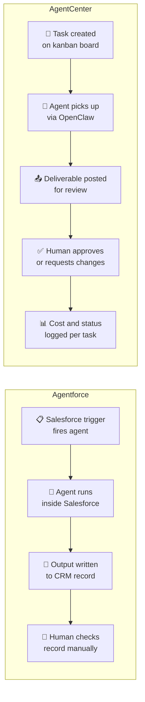

Salesforce built Agentforce for a real use case. Teams running sales, service, and marketing workflows on Salesforce needed agents that could act on CRM data without leaving the platform. Agentforce delivers that. For Salesforce-native automation, it's genuinely solid.

But if you're managing AI agents that go beyond the Salesforce ecosystem — agents built with OpenClaw, agents reading from external APIs, agents processing documents uploaded outside the CRM — Agentforce isn't the tool you're looking for. It's a product feature inside a CRM suite, not a control plane for your agent fleet.

## What Salesforce Agentforce Does Well

It helps to be specific about what Agentforce actually delivers before looking at where it falls short:

- **Native Salesforce data access**: Agents read and write CRM records directly — leads, cases, accounts, contacts — without custom API wiring
- **No-code agent configuration**: Salesforce admins set up agents using point-and-click flows in Agent Builder, no engineering involvement required
- **Einstein AI grounding**: Built-in models trained on CRM patterns handle lead scoring, case classification, and next-best-action recommendations
- **Customer service automation**: Routes tickets, responds to inquiries, and handles follow-up sequences inside Service Cloud
- **Built-in audit trail**: Every agent action ties to a Salesforce record, so compliance history and activity logs come standard
- **Salesforce ecosystem fit**: Works out of the box with Sales Cloud, Service Cloud, Marketing Cloud, and the rest of the Salesforce product stack

If your team operates entirely inside Salesforce and needs agents that act on CRM data, this list covers a lot of ground.

## The Problem for Teams Managing AI Agents

Agentforce is built inside Salesforce. That's its design, and it's also its ceiling.

Agents run against Salesforce data. Their outputs go into Salesforce fields. Monitoring and logging happen inside Salesforce. That's fine if your agents are Salesforce agents. But most engineering teams managing agents in 2026 aren't running a single-platform stack. They have a research agent pulling from external APIs. A document processing pipeline handling uploaded contracts. An internal tool that generates reports from a data warehouse. Agentforce has no visibility into any of that. It doesn't know those agents exist.

Even for agents that do run inside Salesforce, Agentforce is designed for workflow automation, not for operational management. There's no view that shows which agents are currently working, which tasks are blocked, what deliverables are waiting for human review, or what a specific run cost. When something breaks, you're digging through Salesforce Flow debug logs — not checking a board that shows you exactly where things stopped.

AgentCenter is the operational control layer. It manages OpenClaw-compatible agents across any project, shows real-time status for each agent, tracks task cost per run, and flags failures before users notice them. It doesn't care whether you use Salesforce or not. It's the layer that sits above your agents and tells you what they're doing.

## AgentCenter vs Salesforce Agentforce

| Feature | Salesforce Agentforce | AgentCenter |
|---|---|---|
| Where agents run | Salesforce ecosystem only | Any project, any stack |
| LLM support | Einstein AI, limited third-party | Claude, GPT-4, Gemini, any OpenClaw provider |
| Task tracking | Salesforce records and cases | Kanban board per agent |
| Live agent status | Not available | Online, working, idle, blocked |
| Per-task cost tracking | Not available | Built-in cost visibility per run |
| Deliverable review | Not available | Approval workflow with comment threads |
| Team coordination | Salesforce user roles | @mentions and chat threads per task |
| Multi-agent orchestration | Salesforce flows only | Cross-agent task orchestration |
| Pricing | $2/conversation (50 free/month), Salesforce subscription required | $14–$79/month flat |
| Setup requirement | Active Salesforce subscription | OpenClaw agent + AgentCenter account |

The pricing difference matters at scale. Agentforce requires an active Salesforce plan — Sales Cloud starts at $25/user/month and scales quickly into enterprise territory. Conversations beyond the 50 monthly free tier cost $2 each. A team running meaningful agent volume will hit significant costs before the agents do much useful work. AgentCenter's flat pricing runs $14/month Starter, $29 Pro, or $79 Scale — no per-conversation fees, no platform subscription required underneath. Full details at [AgentCenter pricing](/pricing).

## How a Task Moves Through Each System

The workflow difference shows up most clearly in day-to-day operations.

**With Agentforce**, an agent runs because a Salesforce automation trigger fires. The output lands in a CRM field or record. If the agent behaved unexpectedly, you investigate through Salesforce's Flow debug logs or the agent activity history inside the platform. Cost tracking is bundled into your monthly Salesforce bill — there's no task-level breakdown, no way to see what a specific run cost.

**With AgentCenter**, the task lives on a kanban board from the moment it's created. Anyone on the team can see its current status. The agent picks it up, does the work, and posts a deliverable. A team member reviews it, leaves a comment, approves or flags it. The cost of that run is logged at the task level. If the agent stalled, the board shows you exactly where. The [agent monitoring view](/features/agent-monitoring) gives you that visibility across every agent you're running.

The difference isn't about which approach is better in the abstract. It's about what problem you're solving. Agentforce automates CRM workflows for Salesforce users. AgentCenter manages agents in production for engineering teams.

## Can You Use Both?

Yes, and some teams do. The tools are not competing for the same job.

Agentforce handles Salesforce-native automation: qualifying inbound leads, routing support tickets, generating sales call summaries, and taking actions inside CRM records. If your sales or service team lives in Salesforce, Agentforce reduces the manual work they do inside that system.

AgentCenter manages your broader agent fleet — the agents that run outside Salesforce or need more operational control than Agentforce provides. Research pipelines, document workflows, content agents, internal tooling. Any agent your engineering team is responsible for keeping running reliably.

The two stacks don't integrate. Agentforce agent activity stays inside Salesforce — you can't pull Agentforce run history into AgentCenter's monitoring view, and the boards don't share data. If you run agents in both places, you'll track them separately.

One thing to consider: if you want every agent your team runs in a single dashboard — status, cost, deliverables, history — Agentforce won't cover the non-Salesforce half of that picture. AgentCenter will cover all of it. The question is whether your team is running agents outside Salesforce. Most teams managing agents seriously in 2026 are.

## Bottom Line

Agentforce is a strong automation layer for teams already invested in Salesforce who need agents that act on CRM data. AgentCenter is built for teams that need operational visibility into their AI agents, wherever those agents run. They're solving different problems. If your agents don't live in Salesforce, Agentforce can't help you. If they do, AgentCenter still gives you the task tracking, cost visibility, and deliverable review that Agentforce doesn't have.

---

*Agentforce is good at what it does. AgentCenter does something different — it manages your agents, not just the ones inside a CRM. [Start your 7-day free trial](/pricing) — no lock-in.*
