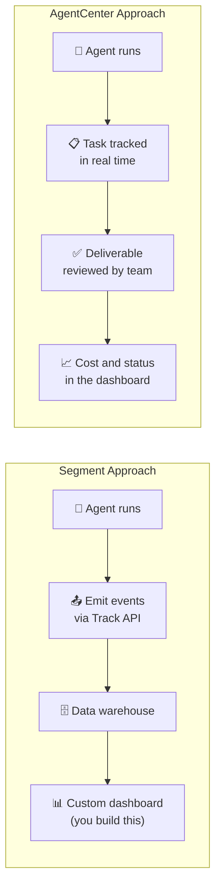

When you have a handful of AI agents running in production, the first instinct is to reach for the tool you already trust for understanding what's happening in your systems. For a lot of teams, that's Segment.

And it makes sense. Segment is excellent at capturing events, routing data, and giving you a structured picture of what happened. If you're already using it for product analytics, adding agent events feels like a natural extension.

But there's a gap between "I can see what my agent did" and "I can manage what my agents are doing." That gap gets expensive fast.

## What Segment Does Well

Segment has been solving event tracking problems for over a decade. It genuinely earns its place in most engineering stacks:

- **Event collection at scale**: Segment's Track API handles billions of events. You can instrument an agent to emit events on every action, tool call, or decision with a few lines of code.
- **Data routing**: Send agent event data to your warehouse, your BI tool, your analytics dashboards — all from one SDK call.
- **Identity resolution**: Segment connects events across sessions and surfaces clean user profiles. Useful for agents that interact with end users.
- **Pre-built integrations**: 400+ destinations. If your data needs to go somewhere, Segment probably has a connector.
- **Reliable data delivery**: Segment handles retries, batching, and delivery guarantees so you don't have to.

If you need a record of what happened across your agents, Segment gives you that record cleanly.

## The Core Limitation for Teams Managing AI Agents

Segment is a data pipeline with analytics on top. It captures events and routes them elsewhere. It does not manage work.

When you're running 8 AI agents across 3 projects, you don't just need logs of what happened. You need to know:

- Which agents are currently running, idle, or stuck?
- What task is each agent working on right now?
- Who reviews the deliverable when the agent finishes?
- Which agent cost $40 last week and produced nothing useful?
- When agent B is waiting on output from agent A, how does that dependency get tracked?

Segment can't answer any of those questions directly. You'd need to build dashboards on top of it, write your own schema for agent state, and wire up every status transition manually. By the time you're done, you've built a custom agent management layer — and it's fragile.

AgentCenter is built for exactly this. It's the control plane that sits above your OpenClaw agents: a real-time dashboard with Kanban task management, agent status monitoring, deliverable review, and cost tracking, without any custom instrumentation work.

## AgentCenter vs Segment — Side by Side

| Feature | Segment | AgentCenter |
|---|---|---|
| Real-time agent status | No — event logs, not live state | Yes — online, working, idle, blocked |
| Task and deliverable tracking | No | Yes — Kanban board per agent |
| Agent cost monitoring | No | Yes — per-task and per-agent breakdown |
| Deliverable review and approval | No | Yes — built-in review workflow |
| Multi-agent coordination | No | Yes — task dependencies and @mentions |
| @Mentions and chat threads | No | Yes — per-task comment threads |
| Recurring agent automation | No | Yes — Pro+ plan |
| Pricing | $120/mo (10k MTU) to custom | $14/mo Starter, $29 Pro, $79 Scale |
| Setup for agent management | Custom schema + custom dashboard | Ready to use with OpenClaw agents |
| Alert on stuck agents | No (you build this) | Built in |

## Workflow Comparison

### Debugging a stuck agent — Segment way

1. Agent stops producing output. No alert fires.
2. You notice the issue manually or from a customer complaint.
3. You query Segment for events from that agent over the past hour.
4. You piece together the event sequence in your BI tool or notebook.
5. You figure out where it got stuck, fix it, redeploy.

Total time: 45 minutes to 2 hours, depending on how good your dashboards are.

### Debugging a stuck agent — AgentCenter way

1. Agent status changes to "blocked" in the AgentCenter dashboard.
2. You open the task, read the activity feed, see where it stopped.
3. You leave a comment or reassign the task.
4. Agent resumes.

Total time: 5 minutes.

The difference isn't cleverness. It's that AgentCenter is built for agent operations, and Segment isn't.

## Can You Use Both?

Yes, and it's a reasonable setup.

Segment is good at capturing granular event data and sending it to your warehouse for long-term analysis. Use it if you want to run cohort analysis on agent behavior, track tool call patterns over time, or feed agent events into a BI layer your data team already uses.

AgentCenter handles the operational side: what's running, what's done, what needs review, what's costing money today. It's the daily driver for your engineering team. Segment is the historical record for your data team.

They don't compete. They answer different questions. If you're choosing one to start with and your team needs to actually manage agents in production right now, start with [AgentCenter](/features).

## Bottom Line

Segment is a data platform. It captures events from your agents and routes them to wherever you analyze data. It's not a control plane — it doesn't track task state, manage deliverables, show you which agent is stuck, or tell you where your LLM budget is going. If you want all of that without building it yourself, that's what [AgentCenter does](/features/agent-monitoring).

---

*Segment is good at what it does. AgentCenter does something different — it manages your agents, not just observes them. [Start your 7-day free trial](/pricing) — no lock-in.*
