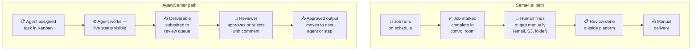

Sema4.ai is a serious enterprise automation platform. If your team is replacing legacy RPA workflows with AI-driven agents, scheduling batch jobs, or running back-office automation at scale, Sema4.ai is well-suited for it. The Python tooling is solid, the credential vault is genuinely useful, and the cloud execution model means you don't have to manage your own infrastructure.

So if you're evaluating it — it's a real tool, not vaporware.

But once you have agents running in production, a different question comes up: what are they doing *right now*, and are the outputs any good? That's where the two tools diverge.

## What Sema4.ai Does Well

Sema4.ai (formerly Robocorp) was built for enterprise automation. That heritage shows.

- **Python-first framework**: The Robocorp library ecosystem covers browser automation, file handling, API calls, and more. Developers can build agents without reinventing primitives.
- **Built-in secret management**: API keys and credentials live in Sema4.ai's vault. Your agents pull them at runtime. No ad-hoc environment variable hacks.
- **Scheduled execution**: Cron-style scheduling is native. Run an agent nightly, weekly, or on a trigger. The run history is stored.
- **Enterprise compliance**: SSO, role-based access, audit logs, and organization-level controls come with enterprise tiers. Finance and legal teams care about this.
- **Pre-built process libraries**: Common automation patterns are packaged as reusable blueprints. You build on top, not from scratch.
- **Cloud execution**: Sema4.ai hosts the execution environment. You don't provision containers or manage scaling for the agents themselves.

For teams migrating from traditional RPA tools or running scheduled data pipelines, this is a well-rounded stack.

## The Gap That Appears in Production

Sema4.ai's control room answers one question well: did the job run, and did it succeed?

It's built around the job-runner model. You see run history, pass/fail status, and logs. That's the right interface for scheduled automation jobs where the output is a file in S3 or a row written to a database.

It's not the right interface for a team managing 15 AI agents working on active tasks where:

- Humans need to review and approve deliverables before they move forward
- Multiple agents are handing work to each other
- You need to know which agent is blocked, which is idle, and which is quietly producing bad output
- Token costs are climbing and you don't know which agent is responsible
- A task started 4 hours ago and nobody knows if it's still running or silently failed

Sema4.ai's control room shows you run completions. It doesn't show you what the agent produced, whether a human approved it, or what the next step is. That's not a gap in Sema4.ai's ambition — it's just a different product category.

AgentCenter is built for that second set of questions. The [agent monitoring dashboard](/features/agent-monitoring) shows real-time status across every agent: online, working, idle, blocked. Tasks live on a Kanban board with ownership and priority. Deliverables go through a review queue before the next agent picks them up.

## AgentCenter vs Sema4.ai: Side-by-Side

| Feature | Sema4.ai | AgentCenter |
|---|---|---|
| **Primary use case** | Build and schedule enterprise automation jobs | Manage and coordinate running AI agents |
| **Agent status visibility** | Job run history (pass/fail, logs) | Real-time: online, working, idle, blocked |
| **Task management** | Scheduled triggers, no task board | Kanban board with assignments and priorities |
| **Deliverable review** | Not included | Approve or reject outputs before next step |
| **Multi-agent coordination** | Not included | @Mentions, task threads, handoff tracking |
| **Per-agent cost tracking** | Not included | Token and API cost per agent, per task |
| **Human-in-the-loop gates** | Not included | Built-in approval workflows and review queues |
| **Recurring workflows** | Cron scheduler | Recurring tasks with condition triggers (Pro+) |
| **Secret/credential management** | Built-in vault | Handled at OpenClaw/infrastructure layer |
| **Compliance and audit** | Enterprise tier (SSO, audit logs) | Team-level access, full activity feed |
| **Agent runtime** | Sema4.ai cloud (proprietary) | Any OpenClaw-compatible provider |
| **Pricing** | Free tier + custom enterprise pricing | $14/mo Starter, $29/mo Pro, $79/mo Scale |

## Workflow Comparison: Agent Delivers a Report

Here's a concrete example. An agent generates a weekly client report. A human needs to review it before it goes out.

**The Sema4.ai path**: The job runs on schedule. It finishes. The control room shows a green check. Someone on the team has to know to look for the output, find it wherever it was written, review it, and handle delivery manually. For 3 agents, this is manageable. For 15, it falls apart.

**The AgentCenter path**: The task is on the board. The agent picks it up, and the [task orchestration view](/features/task-orchestration) shows live status. When the agent marks it done, a deliverable lands in the review queue. The reviewer gets notified, approves or rejects with a comment, and the output moves to the next step — or goes back to the agent for revision.

The difference is whether the human review step is tracked in the system or happens off the side of someone's desk.

## Can You Use Both?

In practice, yes — and the combination makes sense for some teams.

Sema4.ai handles the agent execution layer: the Python code, the scheduled runs, the credential vault. If your team is invested in that stack, it stays as-is.

AgentCenter adds the coordination layer on top. Task visibility, deliverable review, multi-agent handoffs, cost tracking — none of that touches how Sema4.ai executes your agent jobs.

The catch: AgentCenter requires OpenClaw-compatible agents. If your Sema4.ai agents aren't already integrated with OpenClaw, adding AgentCenter means some plumbing work upfront. It's worth factoring into the evaluation, especially for teams with complex existing automation.

For teams starting fresh with AI agents rather than migrating existing automation, the question is simpler: AgentCenter manages the agents; OpenClaw provides the runtime. Sema4.ai is an alternative execution environment if you specifically need its enterprise compliance features or existing process libraries.

Check the [pricing page](/pricing) to see which AgentCenter plan fits the number of agents you're running.

## Bottom Line

Sema4.ai is a production-grade automation platform, well-suited for enterprise teams with scheduled AI jobs, compliance requirements, and existing Python automation workflows. It's not designed to be a task board or deliverable review system — it's a job runner.

AgentCenter is built for teams that need visibility and coordination across their agents once those agents are live. Real-time status, human review gates, multi-agent handoffs, and per-agent cost tracking are the core of what it does. The two tools aren't competing for the same thing.

---

*Sema4.ai is good at what it does. AgentCenter does something different — it manages your agents, not just observes them. [Start your 7-day free trial](/pricing) — no lock-in.*
