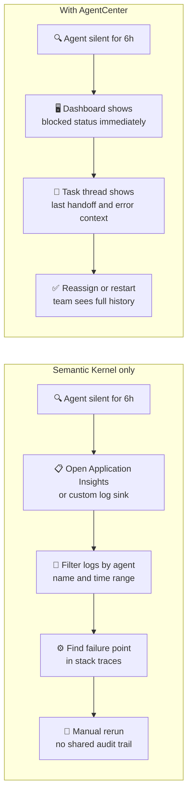

Semantic Kernel is Microsoft's open-source SDK for building AI-powered apps. If you're in a .NET shop or already running on Azure, it's one of the most natural ways to wire together agents with OpenAI, Azure OpenAI, or Hugging Face models. The abstractions are clean, the documentation is solid, and it integrates with the Azure stack you probably already own.

So the question isn't "is Semantic Kernel worth using?" It is. The question is: once those agents are live, what happens next? Semantic Kernel builds agents. AgentCenter manages them. These tools solve different problems at different stages of the agent lifecycle.

Most teams figure this out around week three, when they have five agents running and no way to tell which one produced the bad output from Tuesday night.

## What Semantic Kernel Does Well

- **Strong .NET and Azure integration.** If your team writes C# and runs on Azure, Semantic Kernel fits naturally. The SDK wraps Azure OpenAI, Azure Cognitive Search, and other Azure services in consistent abstractions.
- **Plugin architecture.** You can wrap any function as a plugin and let the agent call it. Connecting agents to internal APIs, tools, and data sources is genuinely straightforward.
- **Multi-agent support.** The Agent Framework lets you define agents with personas, tool access, and handoff rules. You can build multi-agent pipelines without bolting on a separate orchestrator.
- **Built-in memory connectors.** Vector store integrations for Qdrant, Chroma, Azure AI Search, and others. Memory isn't an afterthought.
- **Free and open source.** Active GitHub repo, a real community, and no licensing cost. That matters for teams who want to avoid vendor lock-in on the framework layer.

## The Core Limitation for Teams Running Agents in Production

Semantic Kernel solves the *build* problem well. Once agents are live, you run into a different category of problems.

Which agents are running right now? Which task did agent 3 hand off to agent 4, and did agent 4 actually receive it? What's the total spend across all agents this week? Which output from last night needs a human to review it before it goes to a client?

These are operations questions. Semantic Kernel isn't built to answer them. There's no dashboard. No task queue you can inspect from a browser. No way to leave a comment on a specific agent output, flag a stuck agent, or see cost broken down by agent and project.

You can add logging. You can push traces to Application Insights or OpenTelemetry. But as soon as you have more than three agents, you're spending meaningful time building monitoring infrastructure that has nothing to do with what the agents actually do.

That's a solvable problem, but it's not one Semantic Kernel solves for you.

## AgentCenter vs Semantic Kernel — Side by Side

| Feature | Semantic Kernel | AgentCenter |
|---|---|---|
| Primary purpose | Build AI agents and LLM-powered apps | Manage and monitor agents in production |
| Web dashboard | None | Full dashboard: tasks, status, costs |
| Real-time agent status | Requires custom instrumentation | Built-in: online, working, idle, blocked |
| Task management | No | Kanban board with task assignments |
| Cost tracking | Via Azure Monitor or custom logging | Per-agent cost tracking in the dashboard |
| Team collaboration | No | @Mentions, chat threads per task |
| Deliverable review | No | Human-in-the-loop review gates |
| Multi-agent coordination | Yes (Agent Framework) | Yes, via task orchestration |
| Recurring task automation | No | Yes (Pro+ plans) |
| Pricing | Free (open source) | Starter $14/mo, Pro $29/mo, Scale $79/mo |
| Runs without OpenClaw | Yes | No — requires OpenClaw-compatible agents |
| Best for | Building agent logic and pipelines | Operating agents across a team |

## Workflow Comparison: Debugging a Stuck Agent

A concrete example where the difference shows up immediately: one of your agents hasn't produced output in six hours. Here's what that looks like with each approach.

**With just Semantic Kernel:**

1. Pull up Application Insights (if you set it up when you built the agent)
2. Filter logs by agent name and time range
3. Read through stack traces to find where execution stopped
4. Determine whether the plugin call failed, the model timed out, or a dependency went down
5. Manually rerun once you identify the issue
6. No record for the team of what happened — just logs that will roll off eventually

**With AgentCenter:**

1. Open the dashboard and see the agent showing "blocked" status
2. Click into the task thread to see the last successful step and where it stopped
3. Check the activity feed for error context
4. Reassign the task or restart the agent manually
5. Leave a note in the task thread so the rest of the team knows what happened and why

The difference isn't just convenience. If you're running agents for clients or across a team, having a shared audit trail matters when something goes wrong.

## Can You Use Both?

Yes. This is actually the common setup once teams get past the prototype stage.

Semantic Kernel handles the agent logic: how agents reason, which plugins they call, how they hand off context to each other. AgentCenter sits on top as the operations layer: what tasks are running, who reviewed which output, what it all costs, and which agents need attention right now.

You keep your existing Semantic Kernel code. AgentCenter manages the workflow and visibility layer, not the agent internals. The two tools don't step on each other.

Teams doing serious agent work in production typically run something like this: a framework for the agent brains, a control plane for the operational view. If your agents are already built in Semantic Kernel, adding AgentCenter doesn't require rewriting anything.

For a closer look at what the [agent monitoring](/features/agent-monitoring) layer actually covers — real-time status, per-agent cost, error detection — that page has the specifics. The [task orchestration](/features/task-orchestration) page covers how task handoffs and multi-agent pipelines work inside the dashboard.

If you're evaluating plans, the [pricing page](/pricing) has the full breakdown.

## Bottom Line

Semantic Kernel is a solid choice for teams building agent applications on Azure and .NET. It handles the hard parts of agent construction well and costs nothing. What it doesn't cover is what happens to those agents after they're live: tracking tasks, reviewing outputs, coordinating a team, and keeping cost under control.

If your agents are already built or you're hitting the limits of log-based monitoring, AgentCenter adds the operations layer without requiring you to change how your agents work.

---

*Semantic Kernel is good at what it does. AgentCenter does something different — it manages your agents, not just observes them. [Start your 7-day free trial](/pricing) — no lock-in.*
